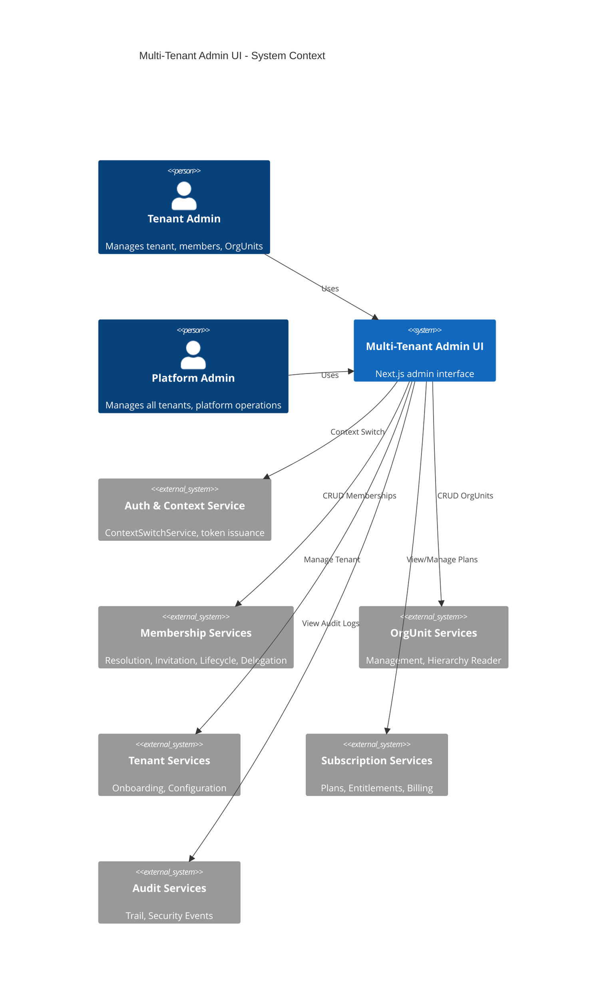
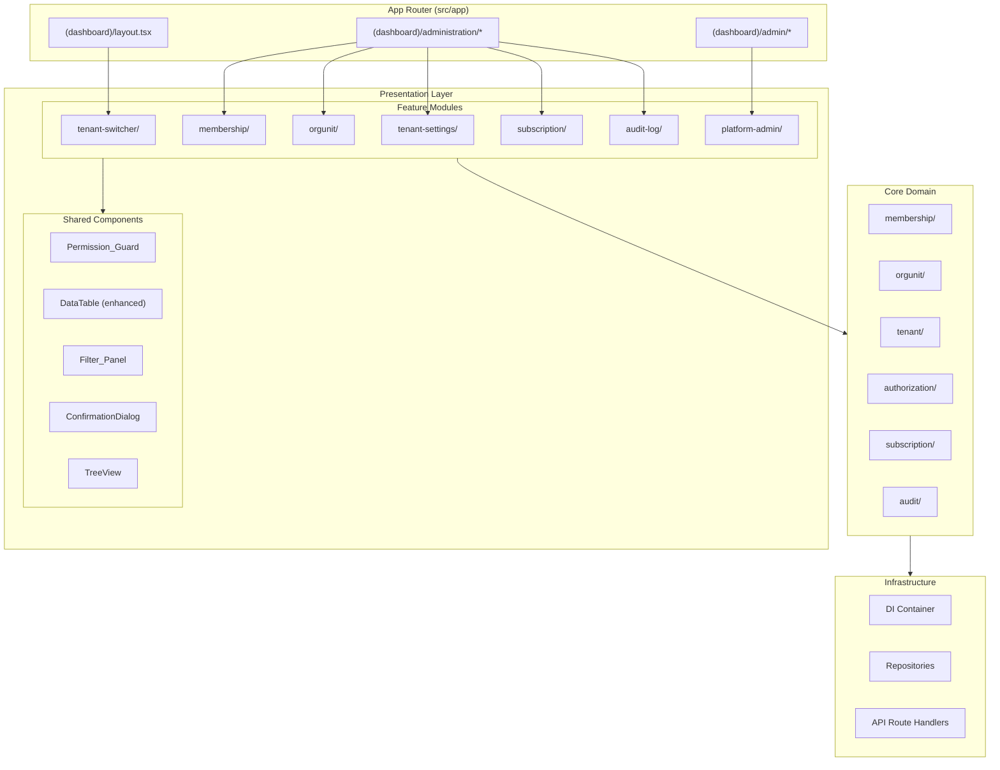
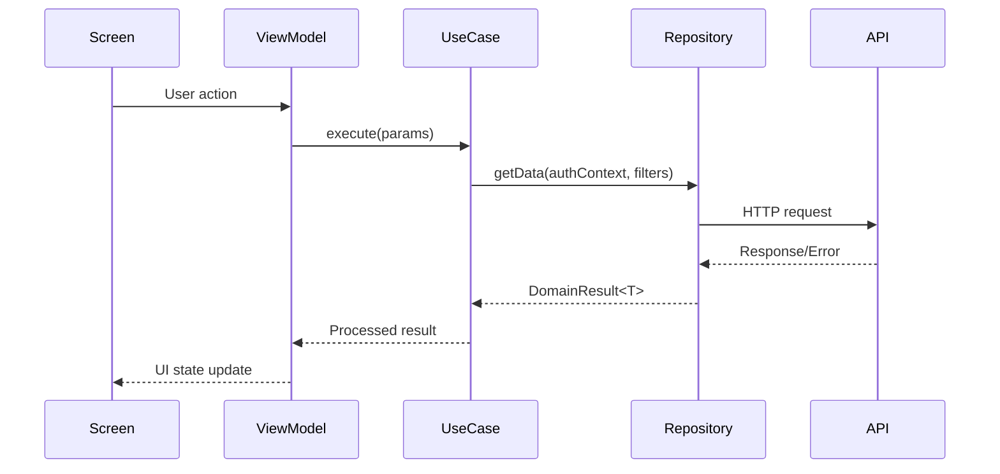
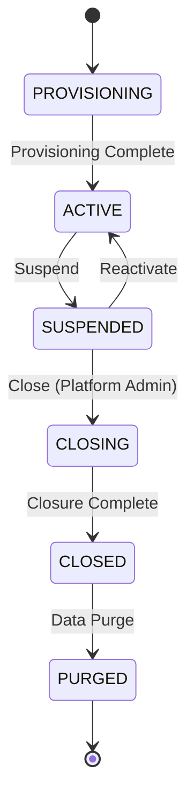

# Design Document: Multi-Tenant Admin UI

## Overview

This document specifies the comprehensive UI design for the Multi-Tenant Admin feature set, providing administrative interfaces for tenant switching, membership management, organizational unit hierarchy, tenant settings, subscription management, audit logging, and platform administration.

**Design Principles:**
- **Clean Architecture**: Screen → ViewModel → UseCase → Repository (no API calls in components)
- **Server-First Rendering**: Default to Server Components; Client Components only when necessary
- **Composition over Inheritance**: Reusable components via props and composition
- **Permission-Aware UI**: Graceful degradation for unauthorized access
- **Error Handling First**: All error paths designed upfront per `12-error-handling` steering
- **i18n by Default**: All text via translation keys, no hardcoded strings

**Technical Stack:**
- Next.js 14+ App Router
- React Query for server state
- Zustand for UI state
- Awilix for DI
- Existing DataTable, Sidebar, Header components as foundation

**Backend Dependencies:** All services from `multi-tenant-saas-architecture` spec:
- MembershipResolutionService, MembershipInvitationService, MembershipLifecycleService, DelegatedMembershipService
- OrgUnitManagementService, OrgUnitHierarchyReader
- TenantOnboardingService, ContextSwitchService
- SubscriptionPlanService, EntitlementEnforcer
- AuditTrailService, SecurityEventLogger

---

## Architecture

### System Context Diagram



### Component Architecture



### Data Flow Pattern



---

## Components and Interfaces

### 1. Tenant Switcher Component

**Location:** `src/presentation/components/organisms/TenantSwitcher.tsx`

The Tenant Switcher is integrated into the Header component and allows users with multiple memberships to switch between tenants and OrgUnits.

#### Component Structure

```typescript
// Component Props
interface TenantSwitcherProps {
  currentTenantId: string;
  currentTenantName: string;
  currentOrgUnitId: string | null;
  currentOrgUnitName: string | null;
  currentRole: MembershipRole;
  memberships: MembershipSummary[];
  onContextSwitch: (tenantId: string, orgUnitId: string | null) => Promise<void>;
  isLoading?: boolean;
  className?: string;
}

interface MembershipSummary {
  tenantId: string;
  tenantName: string;
  tenantLogoUrl: string | null;
  orgUnitId: string | null;
  orgUnitName: string | null;
  role: MembershipRole;
  status: MembershipStatus;
}
```

#### ViewModel Interface

```typescript
// src/presentation/features/tenant-switcher/viewModel/useTenantSwitcherViewModel.ts
interface TenantSwitcherViewModel {
  // State
  memberships: MembershipSummary[];
  currentContext: {
    tenantId: string;
    tenantName: string;
    orgUnitId: string | null;
    orgUnitName: string | null;
    role: MembershipRole;
  };
  isDropdownOpen: boolean;
  isSwitching: boolean;
  error: string | null;
  
  // Actions
  openDropdown: () => void;
  closeDropdown: () => void;
  switchContext: (tenantId: string, orgUnitId: string | null) => Promise<void>;
}
```

#### Integration with Header

```typescript
// Modified Header component structure
export function Header({
  // ... existing props
  tenantSwitcherProps?: TenantSwitcherProps;
}) {
  return (
    <header className="...">
      {/* Mobile menu button */}
      
      {/* Impersonation banner */}
      
      {/* NEW: Tenant Switcher - positioned after menu, before flex spacer */}
      {tenantSwitcherProps && (
        <TenantSwitcher {...tenantSwitcherProps} />
      )}
      
      <div className="flex-1" />
      
      {/* Notification bell, Avatar, Logout */}
    </header>
  );
}
```

#### Keyboard Navigation

- `Tab` / `Shift+Tab`: Navigate to/from switcher button
- `Enter` / `Space`: Open/close dropdown
- `ArrowDown` / `ArrowUp`: Navigate dropdown items
- `Enter`: Select highlighted item
- `Escape`: Close dropdown

**Validates:** Requirements 1.1-1.10

---

### 2. Membership Management

#### 2.1 Member List Screen

**Location:** `src/presentation/features/membership/screens/MemberListScreen.tsx`

```typescript
// Screen component - thin wrapper
export function MemberListScreen() {
  const vm = useMemberListViewModel();
  
  return (
    <PermissionGuard permissions={['membership:read']}>
      <MemberListContent viewModel={vm} />
    </PermissionGuard>
  );
}
```

#### 2.2 ViewModel Structure

```typescript
// src/presentation/features/membership/viewModel/useMemberListViewModel.ts
interface MemberListViewModel {
  // Query state (React Query)
  members: Member[];
  isLoading: boolean;
  isError: boolean;
  error: AppError | null;
  
  // Pagination
  page: number;
  pageSize: number;
  totalPages: number;
  totalCount: number;
  
  // Sorting
  sortColumn: string;
  sortDirection: 'asc' | 'desc';
  
  // Filtering
  filters: MemberFilters;
  
  // Selection (for bulk ops)
  selectedIds: Set<string>;
  selectionMode: boolean;
  
  // Permissions
  canWrite: boolean;
  canDelegate: boolean;
  canBulkOperate: boolean;
  
  // Actions
  setPage: (page: number) => void;
  setPageSize: (size: number) => void;
  setSort: (column: string, direction: 'asc' | 'desc') => void;
  setFilters: (filters: MemberFilters) => void;
  toggleSelection: (id: string) => void;
  selectAll: () => void;
  clearSelection: () => void;
  refetch: () => void;
}

interface MemberFilters {
  search?: string;
  role?: MembershipRole | null;
  status?: MembershipStatus | null;
  orgUnitId?: string | null;
}
```

#### 2.3 DataTable Enhancement for Selection

The existing DataTable component will be enhanced to support row selection:

```typescript
// Enhanced DataTable props
interface DataTableProps<T> {
  // ... existing props
  
  // NEW: Selection support
  selectable?: boolean;
  selectedIds?: Set<string>;
  onSelectionChange?: (selectedIds: Set<string>) => void;
  disableSelection?: (row: T) => boolean;
  
  // NEW: Sorting support
  sortable?: boolean;
  sortColumn?: string;
  sortDirection?: 'asc' | 'desc';
  onSortChange?: (column: string, direction: 'asc' | 'desc') => void;
}
```

#### 2.4 Member Actions Component

```typescript
// src/presentation/features/membership/components/MemberActions.tsx
interface MemberActionsProps {
  member: Member;
  onSuspend: () => void;
  onActivate: () => void;
  onRevoke: () => void;
  onResendInvitation: () => void;
  onCancelInvitation: () => void;
  onEdit: () => void;
  canWrite: boolean;
  canDelegate: boolean;
}

// Action visibility matrix
const ACTION_VISIBILITY = {
  ACTIVE: ['suspend', 'edit'],
  SUSPENDED: ['activate', 'revoke', 'edit'],
  INVITED: ['resendInvitation', 'cancelInvitation'],
  REVOKED: [], // No actions for revoked members
};
```

**Validates:** Requirements 2.1-2.12, 4.1-4.11

---

### 3. Member Invitation Flow

#### 3.1 Invitation Form Component

```typescript
// src/presentation/features/membership/components/InvitationForm.tsx
interface InvitationFormProps {
  onSubmit: (data: InvitationFormData) => Promise<void>;
  onClose: () => void;
  isOpen: boolean;
  availableRoles: MembershipRole[];
  availableOrgUnits: OrgUnit[];
  defaultOrgUnitId?: string;
  isSubmitting: boolean;
}

interface InvitationFormData {
  emails: string[]; // Supports bulk
  role: MembershipRole;
  orgUnitId: string | null;
}
```

#### 3.2 Delegation Matrix UI Logic

```typescript
// Delegation matrix (mirrors backend DelegatedMembershipService)
const DELEGATION_MATRIX: Record<MembershipRole, MembershipRole[]> = {
  PLATFORM_ADMIN: ['TENANT_OWNER', 'ORG_ADMIN', 'RT_ADMIN', 'SECURITY', 'RESIDENT'],
  TENANT_OWNER: ['ORG_ADMIN', 'RT_ADMIN', 'SECURITY', 'RESIDENT'],
  ORG_ADMIN: ['RT_ADMIN', 'SECURITY', 'RESIDENT'],
  RT_ADMIN: ['SECURITY', 'RESIDENT'],
  SECURITY: [],
  RESIDENT: [],
};

function getDelegableRoles(currentRole: MembershipRole): MembershipRole[] {
  return DELEGATION_MATRIX[currentRole] ?? [];
}
```

#### 3.3 Bulk Email Parsing

```typescript
// Email parsing with validation
function parseBulkEmails(input: string): { valid: string[]; invalid: string[] } {
  const lines = input.split(/[\n,;]/).map(s => s.trim()).filter(Boolean);
  const valid: string[] = [];
  const invalid: string[] = [];
  
  const emailRegex = /^[^\s@]+@[^\s@]+\.[^\s@]+$/;
  
  for (const line of lines) {
    if (emailRegex.test(line)) {
      valid.push(line.toLowerCase());
    } else {
      invalid.push(line);
    }
  }
  
  return { valid: [...new Set(valid)], invalid }; // Dedupe valid emails
}

const BULK_LIMIT = 50;
```

**Validates:** Requirements 3.1-3.12

---

### 4. Member Role Change

#### 4.1 Member Card Modal

```typescript
// src/presentation/features/membership/components/MemberCard.tsx
interface MemberCardProps {
  member: Member;
  isOpen: boolean;
  onClose: () => void;
  onRoleChange: (newRole: MembershipRole, newOrgUnitId: string | null) => Promise<void>;
  availableRoles: MembershipRole[];
  availableOrgUnits: OrgUnit[];
  changeHistory: RoleChangeHistory[];
  canEdit: boolean;
}

interface RoleChangeHistory {
  id: string;
  previousRole: MembershipRole;
  newRole: MembershipRole;
  changedAt: Date;
  changedBy: {
    name: string;
    email: string;
  };
}
```

**Validates:** Requirements 5.1-5.11

---

### 5. Bulk Operations

#### 5.1 Bulk Actions Toolbar

```typescript
// src/presentation/features/membership/components/BulkActionsToolbar.tsx
interface BulkActionsToolbarProps {
  selectedCount: number;
  selectedMembers: Member[];
  onBulkSuspend: () => void;
  onBulkActivate: () => void;
  onBulkChangeRole: () => void;
  onExport: () => void;
  onClearSelection: () => void;
}

// Determine available actions based on selected member statuses
function getAvailableBulkActions(members: Member[]): string[] {
  const statuses = new Set(members.map(m => m.status));
  const actions: string[] = ['export']; // Always available
  
  if (statuses.size === 1) {
    if (statuses.has('ACTIVE')) actions.push('suspend', 'changeRole');
    if (statuses.has('SUSPENDED')) actions.push('activate');
  }
  
  return actions;
}
```

#### 5.2 Bulk Operation Progress

```typescript
interface BulkOperationProgress {
  total: number;
  completed: number;
  successes: string[];
  failures: { id: string; error: string }[];
  status: 'pending' | 'running' | 'completed';
}
```

**Validates:** Requirements 6.1-6.9

---

### 6. OrgUnit Hierarchy Tree

#### 6.1 Tree View Component

**Location:** `src/presentation/components/organisms/TreeView.tsx`

```typescript
// Generic tree component
interface TreeViewProps<T> {
  data: TreeNode<T>[];
  renderNode: (node: TreeNode<T>, depth: number, isExpanded: boolean) => React.ReactNode;
  expandedIds: Set<string>;
  onToggleExpand: (id: string) => void;
  selectedId?: string;
  onSelect?: (id: string) => void;
  
  // Drag and drop
  draggable?: boolean;
  onDrop?: (sourceId: string, targetId: string) => void;
  isValidDropTarget?: (sourceId: string, targetId: string) => boolean;
  
  // Keyboard navigation
  onKeyboardNavigate?: (direction: 'up' | 'down' | 'left' | 'right') => void;
}

interface TreeNode<T> {
  id: string;
  data: T;
  children: TreeNode<T>[];
}
```

#### 6.2 OrgUnit Tree Screen

```typescript
// src/presentation/features/orgunit/screens/OrgUnitTreeScreen.tsx
interface OrgUnitTreeViewModel {
  // Data
  hierarchy: OrgUnitNode[];
  selectedOrgUnit: OrgUnit | null;
  
  // UI State
  expandedIds: Set<string>;
  searchQuery: string;
  highlightedIds: Set<string>; // For search highlighting
  
  // Loading/Error
  isLoading: boolean;
  error: AppError | null;
  
  // Permissions
  canWrite: boolean;
  
  // Actions
  toggleExpand: (id: string) => void;
  expandAll: () => void;
  collapseAll: () => void;
  selectOrgUnit: (id: string) => void;
  setSearchQuery: (query: string) => void;
  
  // CRUD
  createOrgUnit: (parentId: string, data: CreateOrgUnitData) => Promise<void>;
  updateOrgUnit: (id: string, data: UpdateOrgUnitData) => Promise<void>;
  deleteOrgUnit: (id: string) => Promise<void>;
  moveOrgUnit: (id: string, newParentId: string) => Promise<void>;
}

interface OrgUnitNode {
  id: string;
  name: string;
  type: OrgUnitType;
  memberCount: number;
  childCount: number;
  path: string[];
  children: OrgUnitNode[];
}
```

#### 6.3 OrgUnit Type Hierarchy Rules

```typescript
// Valid child types for each parent type
const ORGUNIT_TYPE_HIERARCHY: Record<OrgUnitType, OrgUnitType[]> = {
  ORGANIZATION: ['CLUSTER'],
  CLUSTER: ['RW'],
  RW: ['RT'],
  RT: [], // Leaf node - no children
};

function getValidChildTypes(parentType: OrgUnitType): OrgUnitType[] {
  return ORGUNIT_TYPE_HIERARCHY[parentType] ?? [];
}

function canMoveToParent(sourceType: OrgUnitType, targetType: OrgUnitType): boolean {
  return ORGUNIT_TYPE_HIERARCHY[targetType]?.includes(sourceType) ?? false;
}
```

#### 6.4 OrgUnit Details Panel

```typescript
// src/presentation/features/orgunit/components/OrgUnitDetailsPanel.tsx
interface OrgUnitDetailsPanelProps {
  orgUnit: OrgUnit | null;
  memberCount: number;
  childCount: number;
  onEdit: () => void;
  onDelete: () => void;
  onAddChild: () => void;
  canWrite: boolean;
}

// Tabs: Details, Members
type OrgUnitDetailTab = 'details' | 'members';
```

#### 6.5 Drag and Drop Validation

```typescript
// Move validation (cycle detection, type check, cross-tenant check)
function validateMove(
  source: OrgUnit,
  target: OrgUnit,
  hierarchy: Map<string, OrgUnit>
): { valid: boolean; errorKey?: string } {
  // Check 1: Cross-tenant
  if (source.tenantId !== target.tenantId) {
    return { valid: false, errorKey: 'orgunit.move_cross_tenant_error' };
  }
  
  // Check 2: Root OrgUnit
  if (source.parentId === null) {
    return { valid: false, errorKey: 'orgunit.move_root_error' };
  }
  
  // Check 3: Type compatibility
  if (!canMoveToParent(source.type, target.type)) {
    return { valid: false, errorKey: 'orgunit.move_type_error' };
  }
  
  // Check 4: Cycle detection (target is descendant of source)
  if (isDescendantOf(target.id, source.id, hierarchy)) {
    return { valid: false, errorKey: 'orgunit.move_cycle_error' };
  }
  
  return { valid: true };
}
```

**Validates:** Requirements 7.1-7.12, 8.1-8.11, 10.1-10.11

---

### 7. OrgUnit Member Assignment

```typescript
// src/presentation/features/orgunit/components/OrgUnitMembersTab.tsx
interface OrgUnitMembersTabProps {
  orgUnitId: string;
  members: MemberSummary[];
  onAssignMembers: (memberIds: string[]) => Promise<void>;
  onRemoveMember: (memberId: string) => Promise<void>;
  canWrite: boolean;
  isRootOrgUnit: boolean;
}

// Member search dialog
interface MemberSearchDialogProps {
  isOpen: boolean;
  onClose: () => void;
  onConfirm: (memberIds: string[]) => void;
  excludeIds: string[]; // Already assigned members
  scopeOrgUnitId: string | null; // User's auth scope
}
```

**Validates:** Requirements 9.1-9.10

---

### 8. Tenant Settings

#### 8.1 Settings Screen Structure

```typescript
// src/presentation/features/tenant-settings/screens/TenantSettingsScreen.tsx
type TenantSettingsTab = 'profile' | 'configuration' | 'lifecycle';

interface TenantSettingsViewModel {
  // Active tab
  activeTab: TenantSettingsTab;
  
  // Profile
  profile: TenantProfile;
  isProfileDirty: boolean;
  profileErrors: Record<string, string>;
  
  // Configuration
  configuration: TenantConfiguration;
  isConfigDirty: boolean;
  
  // Lifecycle
  lifecycleStatus: TenantLifecycleStatus;
  lifecycleHistory: LifecycleEvent[];
  
  // Loading
  isSaving: boolean;
  
  // Actions
  setTab: (tab: TenantSettingsTab) => void;
  updateProfile: (data: Partial<TenantProfile>) => void;
  saveProfile: () => Promise<void>;
  updateConfiguration: (data: Partial<TenantConfiguration>) => void;
  saveConfiguration: () => Promise<void>;
  suspendTenant: (reason: string) => Promise<void>;
  reactivateTenant: () => Promise<void>;
  closeTenant: () => Promise<void>;
}
```

#### 8.2 Profile Form

```typescript
interface TenantProfile {
  name: string;
  rtRwNumber: string;
  region: string;
  address: string;
  contactPerson: string;
  logoUrl: string | null;
  primaryColor: string | null;
  secondaryColor: string | null;
}

// Validation rules
const PROFILE_VALIDATION = {
  name: { required: true, maxLength: 100 },
  rtRwNumber: { required: true, pattern: /^RT\d{3}\/RW\d{3}$/ },
  region: { required: true },
  address: { required: true, maxLength: 500 },
  contactPerson: { required: true, maxLength: 100 },
  logo: { maxSize: 2 * 1024 * 1024, allowedTypes: ['image/jpeg', 'image/png'] },
};
```

#### 8.3 Configuration Form

```typescript
interface TenantConfiguration {
  sirenDeviceId: string | null;
  sirenConnectionStatus: 'connected' | 'disconnected' | 'unknown';
  notificationChannels: {
    telegram: boolean;
    whatsapp: boolean;
    email: boolean;
  };
  timezone: string;
  language: string;
  emergencyEscalationTimeout: number; // 1-10 minutes
}
```

#### 8.4 Lifecycle State Machine



**Validates:** Requirements 11.1-11.10, 12.1-12.10, 13.1-13.11

---

### 9. Subscription Management

#### 9.1 Subscription Overview

```typescript
// src/presentation/features/subscription/viewModel/useSubscriptionViewModel.ts
interface SubscriptionViewModel {
  // Current plan
  currentPlan: SubscriptionPlan;
  subscriptionStatus: SubscriptionStatus;
  billingPeriod: { start: Date; end: Date };
  trialDaysRemaining: number | null;
  
  // Usage
  usage: {
    members: { current: number; max: number };
    orgUnits: { current: number; max: number };
    storage: { current: number; max: number }; // bytes
  };
  usageWarnings: string[]; // Metrics at >80%
  
  // All plans
  availablePlans: SubscriptionPlan[];
  
  // Billing history
  billingHistory: BillingEntry[];
  billingPage: number;
  billingTotalPages: number;
  
  // Actions
  upgradePlan: (planId: string) => Promise<void>;
  downgradePlan: (planId: string) => Promise<void>;
  downloadInvoice: (billingId: string) => Promise<void>;
  retryPayment: (billingId: string) => Promise<void>;
}

type SubscriptionStatus = 'TRIAL' | 'ACTIVE' | 'PAST_DUE' | 'SUSPENDED' | 'CLOSED';
```

#### 9.2 Plan Comparison Card

```typescript
// src/presentation/features/subscription/components/PlanComparisonCard.tsx
interface PlanComparisonCardProps {
  plan: SubscriptionPlan;
  isCurrentPlan: boolean;
  currentUsage: UsageMetrics;
  onUpgrade: () => void;
  onDowngrade: () => void;
  isTrialMode: boolean;
}

interface SubscriptionPlan {
  id: string;
  name: string;
  tier: 'Basic' | 'Standard' | 'Pro';
  price: number;
  currency: string;
  billingCycle: 'monthly' | 'yearly';
  features: PlanFeature[];
  limits: {
    maxMembers: number;
    maxOrgUnits: number;
    maxStorage: number;
  };
}

interface PlanFeature {
  key: string;
  name: string;
  included: boolean;
}
```

**Validates:** Requirements 14.1-14.9, 15.1-15.10, 16.1-16.11

---

### 10. Audit Log

#### 10.1 Audit Log Table

```typescript
// src/presentation/features/audit-log/viewModel/useAuditLogViewModel.ts
interface AuditLogViewModel {
  // Data
  entries: AuditLogEntry[];
  totalCount: number;
  
  // Pagination
  page: number;
  pageSize: number;
  
  // Filters
  filters: AuditFilters;
  
  // Expanded row
  expandedEntryId: string | null;
  
  // Export
  isExporting: boolean;
  
  // Actions
  setPage: (page: number) => void;
  setPageSize: (size: number) => void;
  setFilters: (filters: AuditFilters) => void;
  toggleExpand: (id: string) => void;
  exportLogs: (format: 'csv' | 'json') => Promise<void>;
}

interface AuditFilters {
  dateFrom: Date | null;
  dateTo: Date | null;
  eventTypes: AuditEventType[];
  actorSearch: string;
  resourceType: string | null;
  resourceId: string | null;
}

interface AuditLogEntry {
  id: string;
  timestamp: Date;
  eventType: AuditEventType;
  actor: {
    id: string;
    name: string;
    email: string;
  };
  resource: {
    type: string;
    id: string;
    name: string;
  };
  details: Record<string, unknown>;
  ipAddress: string;
  tenantId?: string; // For platform admins
}
```

#### 10.2 Filter Panel Component

```typescript
// src/presentation/components/molecules/FilterPanel.tsx
interface FilterPanelProps {
  filters: FilterDefinition[];
  values: Record<string, unknown>;
  onChange: (key: string, value: unknown) => void;
  onClear: () => void;
  onApply: () => void;
}

interface FilterDefinition {
  key: string;
  label: string;
  type: 'text' | 'select' | 'multiselect' | 'daterange';
  options?: { value: string; label: string }[];
}
```

**Validates:** Requirements 17.1-17.13, 18.1-18.10

---

### 11. Platform Admin Dashboard

#### 11.1 Dashboard Screen

```typescript
// src/presentation/features/platform-admin/screens/PlatformDashboardScreen.tsx
interface PlatformDashboardViewModel {
  // Metrics
  metrics: PlatformMetrics;
  metricsLastUpdated: Date;
  
  // Tenant overview
  tenants: TenantOverview[];
  tenantPage: number;
  tenantFilters: TenantFilters;
  
  // Alerts
  alerts: SystemAlert[];
  
  // Security events
  securityEvents: SecurityEvent[];
  
  // Actions
  refreshMetrics: () => void;
  navigateToTenant: (tenantId: string) => void;
  provisionNewTenant: () => void;
  acknowledgeAlert: (alertId: string) => void;
}

interface PlatformMetrics {
  tenantsByStatus: Record<TenantLifecycleStatus, number>;
  totalMembers: number;
  activeSessions: number;
  systemHealth: {
    apiResponseTime: number; // ms
    databaseLatency: number; // ms
    errorRate: number; // percentage
  };
}
```

#### 11.2 Tenant Operations

```typescript
// src/presentation/features/platform-admin/components/TenantOperations.tsx
interface TenantOperationsProps {
  tenant: TenantDetail;
  onImpersonate: () => void;
  onForceSuspend: (reason: string) => void;
  onForceClose: () => void;
  onResetTokenVersion: () => void;
  onViewAuditTrail: () => void;
}

// Impersonation state (stored in Zustand)
interface ImpersonationState {
  isImpersonating: boolean;
  originalContext: AuthContext | null;
  impersonatedTenantId: string | null;
  impersonatedTenantName: string | null;
  impersonationStartedAt: Date | null;
}
```

#### 11.3 Security Events Section

```typescript
interface SecurityEvent {
  id: string;
  timestamp: Date;
  type: SecurityEventType;
  severity: 'critical' | 'high' | 'medium' | 'low';
  tenantId: string | null;
  userId: string | null;
  details: string;
  ipAddress: string;
  acknowledged: boolean;
  acknowledgedBy: string | null;
  acknowledgedAt: Date | null;
}

type SecurityEventType =
  | 'failed_login_attempt'
  | 'token_reuse_detected'
  | 'unauthorized_access'
  | 'rate_limit_violation'
  | 'cross_tenant_access_blocked'
  | 'token_version_reset';
```

**Validates:** Requirements 19.1-19.11, 20.1-20.9, 21.1-21.10

---

### 12. Shared Components

#### 12.1 Permission Guard

```typescript
// src/presentation/components/atoms/PermissionGuard.tsx
interface PermissionGuardProps {
  permissions: string[];
  all?: boolean; // Default true - require all permissions
  fallback?: React.ReactNode;
  children: React.ReactNode;
}

export function PermissionGuard({
  permissions,
  all = true,
  fallback = null,
  children,
}: PermissionGuardProps) {
  const { hasAllPermissions, hasAnyPermission, isLoading } = usePermissions();
  
  if (isLoading) {
    return null; // Or loading skeleton
  }
  
  const hasAccess = all
    ? hasAllPermissions(permissions)
    : hasAnyPermission(permissions);
  
  return hasAccess ? <>{children}</> : <>{fallback}</>;
}

// Hook
function usePermissions() {
  const authContext = useAuthContext();
  
  return {
    hasPermission: (permission: string) => 
      authContext?.permissions.has(permission) ?? false,
    hasAllPermissions: (permissions: string[]) =>
      permissions.every(p => authContext?.permissions.has(p) ?? false),
    hasAnyPermission: (permissions: string[]) =>
      permissions.some(p => authContext?.permissions.has(p) ?? false),
    isLoading: authContext === null,
  };
}
```

**Validates:** Requirements 22.1-22.10

#### 12.2 Confirmation Dialog

```typescript
// src/presentation/components/molecules/ConfirmationDialog.tsx
interface ConfirmationDialogProps {
  isOpen: boolean;
  title: string;
  message: string;
  confirmLabel?: string;
  cancelLabel?: string;
  variant?: 'default' | 'destructive';
  onConfirm: () => void;
  onCancel: () => void;
  isLoading?: boolean;
}

// Destructive confirmation with typing
interface DestructiveConfirmationDialogProps extends ConfirmationDialogProps {
  confirmationText: string; // Text user must type
  variant: 'destructive';
}

export function DestructiveConfirmationDialog({
  confirmationText,
  ...props
}: DestructiveConfirmationDialogProps) {
  const [input, setInput] = useState('');
  const canConfirm = input === confirmationText;
  
  return (
    <ConfirmationDialog
      {...props}
      confirmLabel={props.confirmLabel}
      onConfirm={canConfirm ? props.onConfirm : undefined}
    >
      <div className="mt-4">
        <label className="text-sm font-medium">
          Type "{confirmationText}" to confirm:
        </label>
        <input
          value={input}
          onChange={e => setInput(e.target.value)}
          className="mt-1 w-full rounded border px-3 py-2"
        />
      </div>
    </ConfirmationDialog>
  );
}
```

#### 12.3 Toast Notifications

```typescript
// Toast types and configuration
interface ToastConfig {
  type: 'success' | 'error' | 'warning' | 'info';
  message: string; // i18n key
  duration?: number; // ms, default 3000 for success, 5000 for error
  action?: {
    label: string;
    onClick: () => void;
  };
}

// Zustand store for toasts
interface ToastStore {
  toasts: Toast[];
  addToast: (config: ToastConfig) => void;
  removeToast: (id: string) => void;
}
```

---

## Data Models

### UI State Models (Zustand)

```typescript
// src/infrastructure/stateManagement/stores/adminUiStore.ts
interface AdminUiState {
  // Sidebar
  sidebarCollapsed: boolean;
  toggleSidebar: () => void;
  
  // OrgUnit tree expansion state (persisted)
  orgUnitExpandedIds: Set<string>;
  toggleOrgUnitExpand: (id: string) => void;
  setOrgUnitExpanded: (ids: Set<string>) => void;
  
  // Member list selection
  memberSelection: Set<string>;
  toggleMemberSelection: (id: string) => void;
  clearMemberSelection: () => void;
  
  // Impersonation
  impersonation: ImpersonationState;
  startImpersonation: (tenantId: string, tenantName: string) => void;
  endImpersonation: () => void;
  
  // Active filters (for URL persistence)
  activeFilters: Record<string, unknown>;
  setActiveFilters: (filters: Record<string, unknown>) => void;
}
```

### Server State (React Query)

```typescript
// Query key factory
const adminQueryKeys = {
  all: ['admin'] as const,
  memberships: () => [...adminQueryKeys.all, 'memberships'] as const,
  membershipList: (filters: MemberFilters) => 
    [...adminQueryKeys.memberships(), 'list', filters] as const,
  membershipDetail: (id: string) => 
    [...adminQueryKeys.memberships(), 'detail', id] as const,
  orgUnits: () => [...adminQueryKeys.all, 'orgUnits'] as const,
  orgUnitTree: (scope: string | null) => 
    [...adminQueryKeys.orgUnits(), 'tree', scope] as const,
  tenantSettings: () => [...adminQueryKeys.all, 'tenantSettings'] as const,
  subscription: () => [...adminQueryKeys.all, 'subscription'] as const,
  auditLogs: (filters: AuditFilters) => 
    [...adminQueryKeys.all, 'audit', filters] as const,
  platformMetrics: () => [...adminQueryKeys.all, 'platformMetrics'] as const,
};

// React Query configuration
const queryConfig = {
  staleTime: 5 * 60 * 1000, // 5 minutes
  cacheTime: 30 * 60 * 1000, // 30 minutes
  retry: 2,
  refetchOnWindowFocus: false,
};
```

---

## Correctness Properties

*A property is a characteristic or behavior that should hold true across all valid executions of a system — essentially, a formal statement about what the system should do. Properties serve as the bridge between human-readable specifications and machine-verifiable correctness guarantees.*

### Property 1: Tenant Switcher displays all membership fields

*For any* list of memberships provided to the Tenant Switcher dropdown, each rendered dropdown item SHALL contain the tenant name, user's role, and tenant logo (when present).

**Validates: Requirements 1.3**

### Property 2: Member list scope filtering (tenant admin)

*For any* user with tenant-level admin role (PLATFORM_ADMIN, TENANT_OWNER), the Member List SHALL return members from all OrgUnits within the tenant.

**Validates: Requirements 2.4**

### Property 3: Member list scope filtering (org admin)

*For any* user with org-scoped admin role (ORG_ADMIN, RT_ADMIN) and *for any* OrgUnit scope, the Member List SHALL return only members where the member's OrgUnit is a descendant of or equal to the admin's scope OrgUnit.

**Validates: Requirements 2.5**

### Property 4: Pagination correctness

*For any* member list of size N and page size P, the total pages SHALL equal ceil(N/P), and page K SHALL contain members at indices [(K-1)*P, min(K*P, N)).

**Validates: Requirements 2.6**

### Property 5: Sorting correctness

*For any* member list and sort column/direction, the resulting list SHALL be ordered such that for all consecutive pairs (a, b), a[column] ≤ b[column] (ascending) or a[column] ≥ b[column] (descending).

**Validates: Requirements 2.7**

### Property 6: Filter correctness

*For any* filter combination (role, status, search), the resulting member list SHALL contain only members where all specified filter conditions are met.

**Validates: Requirements 2.8**

### Property 7: Permission-based action visibility

*For any* auth context with `membership:write` permission, action buttons SHALL be displayed for each member row; *for any* auth context without `membership:write` permission, action buttons SHALL NOT be displayed.

**Validates: Requirements 2.9**

### Property 8: Invitation role delegation matrix

*For any* user role R, the Invitation Form role dropdown SHALL display exactly the roles defined in DELEGATION_MATRIX[R].

**Validates: Requirements 3.4**

### Property 9: Invitation OrgUnit scope constraint

*For any* org-scoped admin with OrgUnit O, the Invitation Form OrgUnit dropdown SHALL display only OrgUnits where the OrgUnit is a descendant of or equal to O.

**Validates: Requirements 3.5, 3.6**

### Property 10: Email validation

*For any* string input S, the email validation function SHALL return true if and only if S matches the pattern `^[^\s@]+@[^\s@]+\.[^\s@]+$`.

**Validates: Requirements 3.7**

### Property 11: Bulk email limit enforcement

*For any* bulk email input resulting in more than 50 valid emails, the system SHALL reject the submission and display an error.

**Validates: Requirements 3.12**

### Property 12: Member action button visibility matrix

*For any* member with status S, the displayed action buttons SHALL match exactly the actions defined in ACTION_VISIBILITY[S].

**Validates: Requirements 4.1**

### Property 13: OrgUnit tree hierarchy rendering

*For any* valid OrgUnit hierarchy H, the rendered tree structure SHALL preserve the parent-child relationships such that for each node N with children C, all nodes in C are rendered as immediate children of N.

**Validates: Requirements 7.2**

### Property 14: OrgUnit tree scope filtering

*For any* user with authorization scope S, the displayed OrgUnit tree SHALL contain only OrgUnits where the OrgUnit is a descendant of or equal to S.

**Validates: Requirements 7.4, 7.5, 7.6**

### Property 15: OrgUnit type hierarchy enforcement

*For any* parent OrgUnit with type T, the Create OrgUnit form type dropdown SHALL display only types defined in ORGUNIT_TYPE_HIERARCHY[T].

**Validates: Requirements 8.3**

### Property 16: OrgUnit delete prevention

*For any* OrgUnit O where O has children OR O has members, the delete operation SHALL be blocked and an error message SHALL be displayed.

**Validates: Requirements 8.9**

### Property 17: OrgUnit move validation - cycle prevention

*For any* OrgUnit S being moved to target T, if T is a descendant of S, the move SHALL be rejected with error key `orgunit.move_cycle_error`.

**Validates: Requirements 10.4**

### Property 18: OrgUnit move validation - type compatibility

*For any* OrgUnit S with type TS being moved to target T with type TT, if TS is not in ORGUNIT_TYPE_HIERARCHY[TT], the move SHALL be rejected with error key `orgunit.move_type_error`.

**Validates: Requirements 10.4**

### Property 19: Usage warning threshold

*For any* usage metric U with limit L, if U/L > 0.8, the metric SHALL be displayed with warning styling.

**Validates: Requirements 14.8**

### Property 20: Permission Guard - all mode

*For any* permission requirement with `all=true` and required permissions P, the guard SHALL render children if and only if the user has all permissions in P.

**Validates: Requirements 22.3**

### Property 21: Permission Guard - any mode

*For any* permission requirement with `all=false` and required permissions P, the guard SHALL render children if and only if the user has at least one permission in P.

**Validates: Requirements 22.4**

### Property 22: Navigation link visibility

*For any* user permission set P, the navigation sidebar SHALL display a link L if and only if the required permissions for L are satisfied by P.

**Validates: Requirements 25.3**

---

## Routing & Navigation

### Route Structure

```
/                                    - Dashboard home
/admin/                              - Platform admin section
  tenants/                           - Tenant list (PLATFORM_ADMIN only)
  tenants/[id]/                      - Tenant detail
  platform/                          - Platform dashboard
  security/                          - Security events
/administration/                     - Tenant admin section
  members/                           - Member list
  members/invite/                    - Invite flow (optional dedicated page)
  orgunit/                           - OrgUnit tree
  settings/                          - Tenant settings (tabbed)
    profile/                         - Profile tab
    config/                          - Configuration tab
    lifecycle/                       - Lifecycle tab
  subscription/                      - Subscription management
  audit/                             - Audit log
```

### Navigation Item Configuration

```typescript
// Extension to navItems.ts
const ADMIN_NAV_ITEMS: NavItem[] = [
  // Membership Management
  {
    label: 'Members',
    href: '/administration/members',
    icon: '👥',
    permissions: ['membership:read'],
  },
  // OrgUnit Management
  {
    label: 'Organization',
    href: '/administration/orgunit',
    icon: '🏛️',
    permissions: ['orgunit:read'],
  },
  // Tenant Settings
  {
    label: 'Tenant Settings',
    href: '/administration/settings',
    icon: '⚙️',
    permissions: ['tenant:manage'],
  },
  // Subscription
  {
    label: 'Subscription',
    href: '/administration/subscription',
    icon: '💳',
    permissions: ['tenant:manage'],
  },
  // Audit Log
  {
    label: 'Audit Log',
    href: '/administration/audit',
    icon: '📜',
    permissions: ['audit:read', 'tenant:manage'], // OR logic
    permissionMode: 'any',
  },
  // Platform Admin
  {
    label: 'Platform Dashboard',
    href: '/admin/platform',
    icon: '🌐',
    roles: ['PLATFORM_ADMIN'],
  },
  {
    label: 'All Tenants',
    href: '/admin/tenants',
    icon: '🏢',
    roles: ['PLATFORM_ADMIN'],
  },
  {
    label: 'Security Events',
    href: '/admin/security',
    icon: '🔒',
    roles: ['PLATFORM_ADMIN'],
  },
];
```

### Route Protection Middleware

```typescript
// src/middleware.ts (enhanced)
const ROUTE_PERMISSIONS: Record<string, string[]> = {
  '/administration/members': ['membership:read'],
  '/administration/orgunit': ['orgunit:read'],
  '/administration/settings': ['tenant:manage'],
  '/administration/subscription': ['tenant:manage'],
  '/administration/audit': ['audit:read'], // or tenant:manage
  '/admin/tenants': [], // Role check instead
  '/admin/platform': [],
  '/admin/security': [],
};

const ROUTE_ROLES: Record<string, MembershipRole[]> = {
  '/admin/tenants': ['PLATFORM_ADMIN'],
  '/admin/platform': ['PLATFORM_ADMIN'],
  '/admin/security': ['PLATFORM_ADMIN'],
};
```

**Validates:** Requirements 25.1-25.11

---

## Error Handling Design

### Error Categories

Following `12-error-handling` steering:

```typescript
interface AdminUIError {
  type: 'validation' | 'business' | 'authentication' | 'authorization' | 
        'not_found' | 'technical' | 'unexpected';
  code: string;
  message: string; // Internal
  userMessage?: string; // i18n key
  retryable?: boolean;
  cause?: unknown;
}
```

### Error Code Registry

```typescript
const ADMIN_UI_ERROR_CODES = {
  // Membership errors
  MEMBERSHIP_NOT_FOUND: 'membership.not_found',
  MEMBERSHIP_DELEGATION_DENIED: 'membership.delegation_denied',
  MEMBERSHIP_SELF_MODIFY_DENIED: 'membership.self_modify_denied',
  INVITATION_DUPLICATE_EMAIL: 'invitation.duplicate_email',
  INVITATION_LIMIT_EXCEEDED: 'invitation.limit_exceeded',
  
  // OrgUnit errors
  ORGUNIT_NOT_FOUND: 'orgunit.not_found',
  ORGUNIT_DELETE_HAS_CHILDREN: 'orgunit.delete_has_children',
  ORGUNIT_MOVE_CYCLE: 'orgunit.move_cycle',
  ORGUNIT_MOVE_TYPE_INVALID: 'orgunit.move_type_invalid',
  ORGUNIT_MOVE_CROSS_TENANT: 'orgunit.move_cross_tenant',
  
  // Tenant errors
  TENANT_SETTINGS_VALIDATION: 'tenant.settings_validation',
  TENANT_LIFECYCLE_INVALID: 'tenant.lifecycle_invalid',
  
  // Subscription errors
  SUBSCRIPTION_DOWNGRADE_BLOCKED: 'subscription.downgrade_blocked',
  BILLING_PAYMENT_FAILED: 'billing.payment_failed',
  
  // Platform errors
  PLATFORM_IMPERSONATION_FAILED: 'platform.impersonation_failed',
  
  // Generic
  COMMON_VALIDATION_FAILED: 'common.validation_failed',
  COMMON_UNAUTHORIZED: 'common.unauthorized',
  COMMON_FETCH_ERROR: 'common.fetch_error',
};
```

### Error Boundary Placement

```
AppRouter
└── ErrorBoundary (root - catches unhandled)
    └── DashboardLayout
        └── Feature ErrorBoundary
            └── Screen
                └── Component-level try/catch in ViewModels
```

---

## Security Design

### UI-Level Permission Checks

All permission checks at UI level are **defense in depth** - authorization is enforced server-side.

```typescript
// Pattern for protected actions
async function performProtectedAction(action: () => Promise<void>) {
  try {
    await action();
  } catch (error) {
    if (isAuthorizationError(error)) {
      // Server rejected - show error, don't retry
      showToast({ type: 'error', message: 'common.unauthorized' });
    } else {
      // Re-throw for error boundary
      throw error;
    }
  }
}
```

### Permission Requirements Matrix

| Feature | Required Permissions | Notes |
|---------|---------------------|-------|
| View Members | `membership:read` | Scope-filtered |
| Edit Members | `membership:write` | Within delegation scope |
| Invite Members | `membership:delegate` | Per delegation matrix |
| View OrgUnits | `orgunit:read` | Scope-filtered |
| Edit OrgUnits | `orgunit:write` | Within scope |
| Tenant Settings | `tenant:manage` | Tenant owner+ |
| View Audit | `audit:read` OR `tenant:manage` | Scope-filtered |
| Export Audit | `audit:read` | Within scope |
| Platform Admin | Role: PLATFORM_ADMIN | All platform ops |

### Impersonation Security

- Prominent visual banner during impersonation
- All actions logged with `impersonation: true` flag
- Auto-expire after 30 minutes
- Cannot impersonate PLATFORM_ADMIN tenants

**Validates:** Requirements 22.1-22.10 (Permission Guard), Security sections in all requirements

---

## Accessibility Design

### Keyboard Navigation Patterns

| Component | Key | Action |
|-----------|-----|--------|
| Tenant Switcher | `Enter`/`Space` | Open/close dropdown |
| | `ArrowDown`/`ArrowUp` | Navigate items |
| | `Enter` | Select item |
| | `Escape` | Close dropdown |
| DataTable | `Tab` | Navigate to row |
| | `Space` | Toggle selection |
| | `Enter` | Open row details |
| TreeView | `ArrowRight` | Expand node |
| | `ArrowLeft` | Collapse node |
| | `ArrowDown`/`ArrowUp` | Navigate nodes |
| | `Enter` | Select node |
| Modal | `Tab` | Cycle through focusable elements |
| | `Escape` | Close modal |

### Focus Management

```typescript
// Modal focus trap hook
function useFocusTrap(isOpen: boolean, returnFocusRef: RefObject<HTMLElement>) {
  const containerRef = useRef<HTMLDivElement>(null);
  
  useEffect(() => {
    if (!isOpen) return;
    
    const container = containerRef.current;
    if (!container) return;
    
    // Store active element
    const previouslyFocused = document.activeElement as HTMLElement;
    
    // Focus first focusable
    const focusables = container.querySelectorAll<HTMLElement>(
      'button, [href], input, select, textarea, [tabindex]:not([tabindex="-1"])'
    );
    focusables[0]?.focus();
    
    return () => {
      // Return focus
      (returnFocusRef.current ?? previouslyFocused)?.focus();
    };
  }, [isOpen, returnFocusRef]);
  
  return containerRef;
}
```

### ARIA Attributes Strategy

- All interactive elements have `role` and `aria-label`
- Status badges have `aria-describedby` for context
- Loading states use `aria-busy` and `aria-live="polite"`
- Error messages use `aria-live="assertive"`
- Tree uses `role="tree"`, `role="treeitem"`, `aria-expanded`
- Tables use `role="grid"` with proper cell semantics

**Validates:** Requirements 23.1-23.12

---

## Testing Strategy

### ViewModel Unit Tests

```typescript
// Example: MemberListViewModel test
describe('MemberListViewModel', () => {
  describe('filtering', () => {
    it('should apply role filter correctly', async () => {
      const mockUseCase = createMockMembershipUseCase();
      const vm = createMemberListViewModel({ membershipUseCase: mockUseCase });
      
      await vm.setFilters({ role: 'RT_ADMIN' });
      
      expect(mockUseCase.listMembers).toHaveBeenCalledWith(
        expect.objectContaining({ role: 'RT_ADMIN' })
      );
    });
  });
  
  describe('pagination', () => {
    it.each([
      { totalItems: 0, pageSize: 10, expectedPages: 0 },
      { totalItems: 10, pageSize: 10, expectedPages: 1 },
      { totalItems: 11, pageSize: 10, expectedPages: 2 },
      { totalItems: 100, pageSize: 25, expectedPages: 4 },
    ])('should calculate $expectedPages pages for $totalItems items with page size $pageSize',
      ({ totalItems, pageSize, expectedPages }) => {
        const vm = createMemberListViewModelWithData(totalItems, pageSize);
        expect(vm.totalPages).toBe(expectedPages);
      }
    );
  });
});
```

### Screen Integration Tests

```typescript
// Example: MemberListScreen integration test
describe('MemberListScreen', () => {
  it('should display loading skeleton while fetching', async () => {
    renderWithProviders(<MemberListScreen />);
    
    expect(screen.getByTestId('loading-skeleton')).toBeInTheDocument();
    
    await waitForElementToBeRemoved(() => screen.queryByTestId('loading-skeleton'));
  });
  
  it('should display error state with retry button on fetch failure', async () => {
    server.use(
      rest.get('/api/memberships', (req, res, ctx) => {
        return res(ctx.status(500));
      })
    );
    
    renderWithProviders(<MemberListScreen />);
    
    await waitFor(() => {
      expect(screen.getByText(/fetch_error/i)).toBeInTheDocument();
      expect(screen.getByRole('button', { name: /retry/i })).toBeInTheDocument();
    });
  });
});
```

### Property-Based Tests

Using `fast-check` for property-based testing:

```typescript
// Example: Permission Guard property test
describe('PermissionGuard properties', () => {
  // Feature: multi-tenant-admin-ui, Property 20: Permission Guard - all mode
  it('should render children iff user has ALL permissions when all=true', () => {
    fc.assert(
      fc.property(
        fc.array(fc.string(), { minLength: 1, maxLength: 5 }), // required permissions
        fc.array(fc.string(), { minLength: 0, maxLength: 10 }), // user permissions
        (requiredPermissions, userPermissions) => {
          const userPermissionSet = new Set(userPermissions);
          const hasAll = requiredPermissions.every(p => userPermissionSet.has(p));
          
          const { queryByTestId } = renderWithAuth(
            <PermissionGuard permissions={requiredPermissions} all={true}>
              <div data-testid="protected-content" />
            </PermissionGuard>,
            { permissions: userPermissionSet }
          );
          
          if (hasAll) {
            expect(queryByTestId('protected-content')).toBeInTheDocument();
          } else {
            expect(queryByTestId('protected-content')).not.toBeInTheDocument();
          }
        }
      ),
      { numRuns: 100 }
    );
  });
  
  // Feature: multi-tenant-admin-ui, Property 21: Permission Guard - any mode
  it('should render children iff user has ANY permission when all=false', () => {
    fc.assert(
      fc.property(
        fc.array(fc.string(), { minLength: 1, maxLength: 5 }),
        fc.array(fc.string(), { minLength: 0, maxLength: 10 }),
        (requiredPermissions, userPermissions) => {
          const userPermissionSet = new Set(userPermissions);
          const hasAny = requiredPermissions.some(p => userPermissionSet.has(p));
          
          const { queryByTestId } = renderWithAuth(
            <PermissionGuard permissions={requiredPermissions} all={false}>
              <div data-testid="protected-content" />
            </PermissionGuard>,
            { permissions: userPermissionSet }
          );
          
          if (hasAny) {
            expect(queryByTestId('protected-content')).toBeInTheDocument();
          } else {
            expect(queryByTestId('protected-content')).not.toBeInTheDocument();
          }
        }
      ),
      { numRuns: 100 }
    );
  });
});
```

### Accessibility Tests

```typescript
// Automated axe-core checks
describe('Accessibility', () => {
  it('MemberListScreen should have no accessibility violations', async () => {
    const { container } = renderWithProviders(<MemberListScreen />);
    await waitForLoadingToComplete();
    
    const results = await axe(container);
    expect(results).toHaveNoViolations();
  });
  
  it('OrgUnitTreeScreen should have no accessibility violations', async () => {
    const { container } = renderWithProviders(<OrgUnitTreeScreen />);
    await waitForLoadingToComplete();
    
    const results = await axe(container);
    expect(results).toHaveNoViolations();
  });
});
```

---

## API Integration

### Service-to-UI Action Mapping

| UI Action | Service | Method | Notes |
|-----------|---------|--------|-------|
| Switch tenant | ContextSwitchService | `switchContext(tenantId, orgUnitId)` | Issues new token |
| List memberships | MembershipResolutionService | `findByScope(authContext, filters)` | Scope-filtered |
| Invite member | MembershipInvitationService | `invite(email, role, orgUnitId)` | Per delegation matrix |
| Suspend member | MembershipLifecycleService | `suspend(membershipId, reason)` | |
| Activate member | MembershipLifecycleService | `activate(membershipId)` | |
| Revoke member | MembershipLifecycleService | `revoke(membershipId)` | Irreversible |
| Change role | DelegatedMembershipService | `changeRole(membershipId, newRole, orgUnitId)` | Per delegation matrix |
| List OrgUnits | OrgUnitHierarchyReader | `getHierarchy(authContext)` | Scope-filtered |
| Create OrgUnit | OrgUnitManagementService | `create(parentId, name, type)` | |
| Update OrgUnit | OrgUnitManagementService | `update(id, name)` | Type immutable |
| Delete OrgUnit | OrgUnitManagementService | `delete(id)` | Must be empty |
| Move OrgUnit | OrgUnitManagementService | `reparent(id, newParentId)` | Atomic path update |
| Update tenant profile | TenantOnboardingService | `updateProfile(data)` | |
| Update tenant config | TenantOnboardingService | `updateConfiguration(data)` | |
| Suspend tenant | TenantOnboardingService | `suspend(reason)` | |
| Reactivate tenant | TenantOnboardingService | `reactivate()` | |
| Get subscription | SubscriptionPlanService | `getCurrentPlan()` | |
| Upgrade plan | SubscriptionPlanService | `upgrade(planId)` | |
| Downgrade plan | SubscriptionPlanService | `downgrade(planId)` | Usage check |
| Get billing history | SubscriptionPlanService | `getBillingHistory(page)` | |
| List audit logs | AuditTrailService | `query(filters, pagination)` | Scope-filtered |
| Export audit logs | AuditTrailService | `export(filters, format)` | Max 10k rows |
| Impersonate tenant | ContextSwitchService | `impersonate(tenantId)` | Platform admin |

---

## DI Registration

### Use Case Registration

```typescript
// src/infrastructure/di/registry/useCasesContainer.ts (additions)
function registerAdminUseCases(container: AwilixContainer): void {
  // Context switching
  container.register({
    switchContextUseCase: asFunction(SwitchContextUseCaseImpl).singleton(),
  });
  
  // Membership
  container.register({
    listMembersUseCase: asFunction(ListMembersUseCaseImpl).singleton(),
    inviteMemberUseCase: asFunction(InviteMemberUseCaseImpl).singleton(),
    changeMemberStatusUseCase: asFunction(ChangeMemberStatusUseCaseImpl).singleton(),
    changeMemberRoleUseCase: asFunction(ChangeMemberRoleUseCaseImpl).singleton(),
    bulkMemberOperationUseCase: asFunction(BulkMemberOperationUseCaseImpl).singleton(),
  });
  
  // OrgUnit
  container.register({
    getOrgUnitTreeUseCase: asFunction(GetOrgUnitTreeUseCaseImpl).singleton(),
    createOrgUnitUseCase: asFunction(CreateOrgUnitUseCaseImpl).singleton(),
    updateOrgUnitUseCase: asFunction(UpdateOrgUnitUseCaseImpl).singleton(),
    deleteOrgUnitUseCase: asFunction(DeleteOrgUnitUseCaseImpl).singleton(),
    moveOrgUnitUseCase: asFunction(MoveOrgUnitUseCaseImpl).singleton(),
  });
  
  // Tenant settings
  container.register({
    getTenantSettingsUseCase: asFunction(GetTenantSettingsUseCaseImpl).singleton(),
    updateTenantProfileUseCase: asFunction(UpdateTenantProfileUseCaseImpl).singleton(),
    updateTenantConfigUseCase: asFunction(UpdateTenantConfigUseCaseImpl).singleton(),
    manageTenantLifecycleUseCase: asFunction(ManageTenantLifecycleUseCaseImpl).singleton(),
  });
  
  // Subscription
  container.register({
    getSubscriptionUseCase: asFunction(GetSubscriptionUseCaseImpl).singleton(),
    changePlanUseCase: asFunction(ChangePlanUseCaseImpl).singleton(),
    getBillingHistoryUseCase: asFunction(GetBillingHistoryUseCaseImpl).singleton(),
  });
  
  // Audit
  container.register({
    queryAuditLogsUseCase: asFunction(QueryAuditLogsUseCaseImpl).singleton(),
    exportAuditLogsUseCase: asFunction(ExportAuditLogsUseCaseImpl).singleton(),
  });
  
  // Platform admin
  container.register({
    getPlatformMetricsUseCase: asFunction(GetPlatformMetricsUseCaseImpl).singleton(),
    impersonateTenantUseCase: asFunction(ImpersonateTenantUseCaseImpl).singleton(),
    platformTenantOperationsUseCase: asFunction(PlatformTenantOperationsUseCaseImpl).singleton(),
  });
}
```

### ViewModel Registration

```typescript
// src/infrastructure/di/registry/viewModelContainer.ts (additions)
function registerAdminViewModels(container: AwilixContainer): void {
  container.register({
    useTenantSwitcherViewModel: asFunction(TenantSwitcherViewModel),
    useMemberListViewModel: asFunction(MemberListViewModel),
    useInvitationFormViewModel: asFunction(InvitationFormViewModel),
    useMemberCardViewModel: asFunction(MemberCardViewModel),
    useOrgUnitTreeViewModel: asFunction(OrgUnitTreeViewModel),
    useTenantSettingsViewModel: asFunction(TenantSettingsViewModel),
    useSubscriptionViewModel: asFunction(SubscriptionViewModel),
    useAuditLogViewModel: asFunction(AuditLogViewModel),
    usePlatformDashboardViewModel: asFunction(PlatformDashboardViewModel),
  });
}
```

---

## File Structure

```
src/
├── app/(dashboard)/
│   ├── admin/
│   │   ├── platform/
│   │   │   └── page.tsx
│   │   ├── security/
│   │   │   └── page.tsx
│   │   └── tenants/
│   │       ├── page.tsx
│   │       └── [id]/
│   │           └── page.tsx
│   └── administration/
│       ├── members/
│       │   ├── page.tsx
│       │   └── invite/
│       │       └── page.tsx
│       ├── orgunit/
│       │   └── page.tsx
│       ├── settings/
│       │   ├── page.tsx
│       │   ├── profile/
│       │   │   └── page.tsx
│       │   ├── config/
│       │   │   └── page.tsx
│       │   └── lifecycle/
│       │       └── page.tsx
│       ├── subscription/
│       │   └── page.tsx
│       └── audit/
│           └── page.tsx
├── presentation/
│   ├── features/
│   │   ├── tenant-switcher/
│   │   │   ├── components/
│   │   │   │   └── TenantSwitcher.tsx
│   │   │   └── viewModel/
│   │   │       └── useTenantSwitcherViewModel.ts
│   │   ├── membership/
│   │   │   ├── screens/
│   │   │   │   └── MemberListScreen.tsx
│   │   │   ├── components/
│   │   │   │   ├── MemberActions.tsx
│   │   │   │   ├── InvitationForm.tsx
│   │   │   │   ├── MemberCard.tsx
│   │   │   │   └── BulkActionsToolbar.tsx
│   │   │   └── viewModel/
│   │   │       ├── useMemberListViewModel.ts
│   │   │       ├── useInvitationFormViewModel.ts
│   │   │       └── useMemberCardViewModel.ts
│   │   ├── orgunit/
│   │   │   ├── screens/
│   │   │   │   └── OrgUnitTreeScreen.tsx
│   │   │   ├── components/
│   │   │   │   ├── OrgUnitNode.tsx
│   │   │   │   ├── OrgUnitDetailsPanel.tsx
│   │   │   │   ├── OrgUnitMembersTab.tsx
│   │   │   │   └── OrgUnitForm.tsx
│   │   │   └── viewModel/
│   │   │       └── useOrgUnitTreeViewModel.ts
│   │   ├── tenant-settings/
│   │   │   ├── screens/
│   │   │   │   └── TenantSettingsScreen.tsx
│   │   │   ├── components/
│   │   │   │   ├── ProfileForm.tsx
│   │   │   │   ├── ConfigurationForm.tsx
│   │   │   │   └── LifecyclePanel.tsx
│   │   │   └── viewModel/
│   │   │       └── useTenantSettingsViewModel.ts
│   │   ├── subscription/
│   │   │   ├── screens/
│   │   │   │   └── SubscriptionScreen.tsx
│   │   │   ├── components/
│   │   │   │   ├── PlanComparisonCard.tsx
│   │   │   │   └── BillingHistoryTable.tsx
│   │   │   └── viewModel/
│   │   │       └── useSubscriptionViewModel.ts
│   │   ├── audit-log/
│   │   │   ├── screens/
│   │   │   │   └── AuditLogScreen.tsx
│   │   │   ├── components/
│   │   │   │   ├── AuditLogTable.tsx
│   │   │   │   └── AuditExportDialog.tsx
│   │   │   └── viewModel/
│   │   │       └── useAuditLogViewModel.ts
│   │   └── platform-admin/
│   │       ├── screens/
│   │       │   ├── PlatformDashboardScreen.tsx
│   │       │   ├── TenantListScreen.tsx
│   │       │   ├── TenantDetailScreen.tsx
│   │       │   └── SecurityEventsScreen.tsx
│   │       ├── components/
│   │       │   ├── PlatformMetricsCards.tsx
│   │       │   ├── TenantOperations.tsx
│   │       │   ├── ImpersonationBanner.tsx
│   │       │   └── SecurityEventsList.tsx
│   │       └── viewModel/
│   │           └── usePlatformDashboardViewModel.ts
│   ├── components/
│   │   ├── atoms/
│   │   │   └── PermissionGuard.tsx
│   │   ├── molecules/
│   │   │   ├── FilterPanel.tsx
│   │   │   ├── ConfirmationDialog.tsx
│   │   │   └── DestructiveConfirmationDialog.tsx
│   │   └── organisms/
│   │       ├── TenantSwitcher.tsx
│   │       ├── TreeView.tsx
│   │       └── DataTable.tsx (enhanced)
│   └── locales/
│       ├── en/
│       │   └── admin.json
│       └── id/
│           └── admin.json
├── core/domains/
│   ├── membership/
│   ├── orgunit/
│   ├── tenant/
│   ├── subscription/
│   └── audit/
└── infrastructure/
    ├── di/registry/
    │   ├── useCasesContainer.ts (extended)
    │   └── viewModelContainer.ts (extended)
    ├── stateManagement/stores/
    │   └── adminUiStore.ts
    └── repositories/
        ├── membership/
        ├── orgunit/
        ├── tenant/
        ├── subscription/
        └── audit/
```

---

## Implementation Notes

### Performance Considerations

1. **Virtualization for large lists**: Use `react-window` for Member List and Audit Log with >1000 items
2. **Debounced search**: 300ms debounce on text search filters
3. **Optimistic updates**: For status changes and acknowledgments
4. **Lazy loading**: Tree nodes load children on expand for deep hierarchies
5. **Query invalidation**: Strategic invalidation to avoid stale data

### i18n Key Structure

```
admin.{feature}.{screen}.{element}

Examples:
- admin.membership.list.title
- admin.membership.list.empty
- admin.membership.invite.submit
- admin.orgunit.tree.add_child
- admin.settings.profile.save_success
- admin.audit.export.limit_warning
```

### Browser Support

- Chrome/Edge: Latest 2 versions
- Firefox: Latest 2 versions
- Safari: Latest 2 versions
- Mobile: iOS Safari 14+, Chrome Android 90+

---

## Dependencies

### New NPM Packages (if needed)

| Package | Purpose | Version |
|---------|---------|---------|
| `@dnd-kit/core` | Drag-and-drop for tree | ^6.x |
| `react-window` | Virtualization | ^1.8.x |
| `fast-check` | Property-based testing | ^3.x |
| `date-fns` | Date formatting | ^2.x (if not present) |

### Existing Packages to Use

- `@tanstack/react-query` - Server state
- `zustand` - UI state
- `awilix` - DI
- `react-hook-form` - Forms
- `zod` - Validation

---

## References

- Requirements: `requirements.md` (25 requirements)
- Backend Design: `multi-tenant-saas-architecture/design.md`
- Error Handling: `12-error-handling` steering
- Testing: `04-testing-pattern` steering
- DI: `06-di-pattern` steering
- Security: `05-security-guideline` steering
