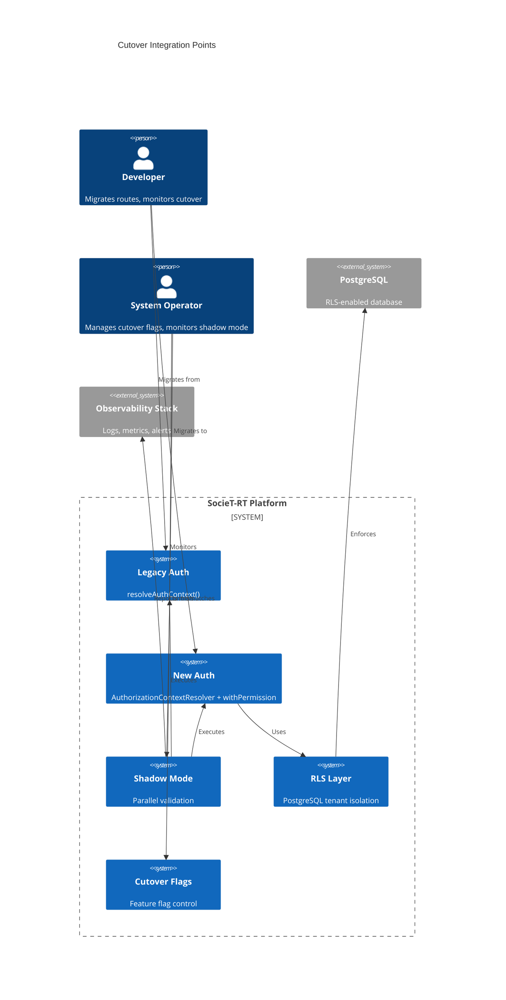
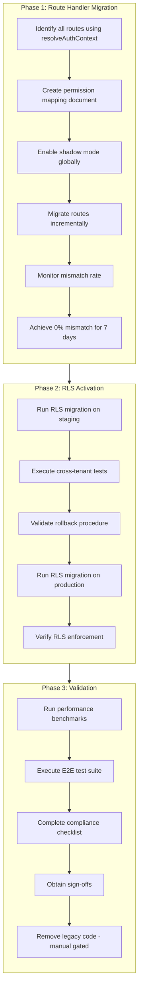
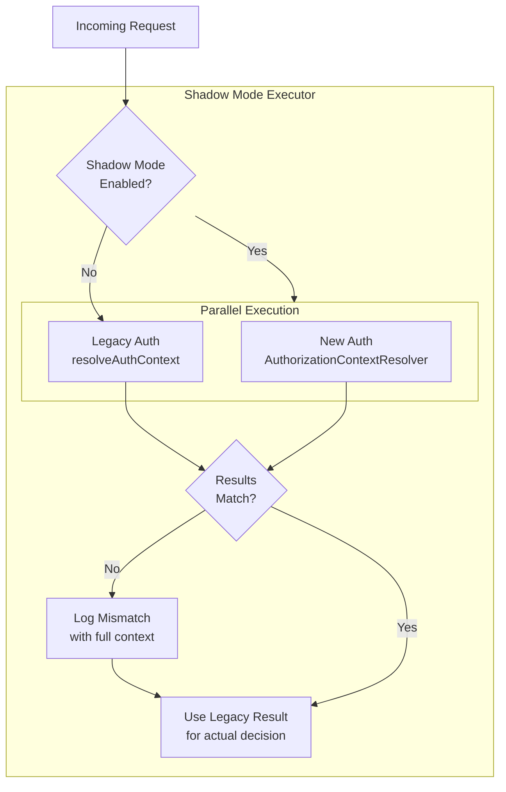

# Design Document: Multi-Tenant Integration Cutover

## Overview

This document specifies the technical design for cutting over the SocieT-RT application from its legacy authorization model to the fully implemented Multi-Tenant SaaS Architecture. The cutover involves three major phases:

1. **Phase 1: Route Handler Integration** — Migrating 28+ API route directories from legacy `resolveAuthContext()` to `withPermission()` wrapper
2. **Phase 2: RLS Activation** — Enabling PostgreSQL Row-Level Security policies on all tenant-scoped tables
3. **Phase 3: Validation & Performance** — Shadow mode validation, performance benchmarks, and E2E testing

**Design Principles:**
- **Zero Regression** — Shadow mode validates new authorization before full cutover
- **Incremental Migration** — Per-route cutover flags enable gradual rollout
- **Fail Closed** — Authorization failures deny access (INV-AUTH-002)
- **Observable** — All authorization decisions logged with correlationId
- **Reversible** — Instant rollback capability for flags and RLS

**Key Clarifications Incorporated:**
- Shadow mode: per-route defaults to active when global enabled (unless explicitly excluded)
- Migration criteria: handler ONLY migrated when `resolveAuthContext` fully removed
- Cutover prerequisites: rate < 0.1% AND 7 days AND 10,000 samples (ALL required)
- RLS rollback failure: halt deployment, alert admins, manual intervention required
- Deprecated code removal: manual-gated, not automatic

**References:**
- Multi-Tenant SaaS Architecture: `.kiro/specs/multi-tenant-saas-architecture/`
- Requirements: `.kiro/specs/multi-tenant-integration-cutover/requirements.md`

---

## Architecture

### System Context — Cutover Components



### High-Level Cutover Flow



---

## Components and Interfaces

### 1. Middleware AuthorizationContext Resolution

The middleware intercepts all requests and resolves the full `AuthorizationContext` for protected routes.

**Interface Definition:**

```typescript
// src/infrastructure/middleware/authorization/authorizationMiddleware.ts

interface AuthorizationMiddlewareConfig {
  /** Routes that bypass authorization (auth routes) */
  bypassRoutes: RegExp[];
  /** Whether to log successful resolutions */
  logSuccess: boolean;
  /** Header prefix for context serialization */
  headerPrefix: string;
}

interface AuthorizationMiddleware {
  /**
   * Process request through authorization pipeline.
   * 
   * 1. Check if route is bypassed (auth routes)
   * 2. Extract JWT from Authorization header or cookie
   * 3. Validate JWT structure and signature
   * 4. Invoke AuthorizationContextResolver.resolve()
   * 5. Serialize context to request headers
   * 6. Log resolution attempt with correlationId
   */
  handle(request: NextRequest): Promise<NextResponse>;
}
```

**Header Serialization:**

| Header | Value | Description |
|--------|-------|-------------|
| `x-authorization-context` | JSON | Full serialized context (excluding permissions set) |
| `x-user-id` | string | userId from context |
| `x-tenant-id` | string | tenantId from context |
| `x-membership-id` | string | membershipId (server-resolved) |
| `x-org-unit-id` | string \| null | orgUnitId from context |
| `x-user-role` | MembershipRole | role from context |
| `x-token-version` | number | tokenVersion from context |

**Security Constraint:** Full permission set is NOT serialized to headers. Permissions are derived from role at route level via `PermissionRegistry.getPermissionsForRole()`.

**Error Response Mapping:**

| Error Code | HTTP Status | Condition |
|------------|-------------|-----------|
| `AUTH_TOKEN_INVALID` | 401 | Missing/malformed JWT |
| `AUTH_TOKEN_EXPIRED` | 401 | JWT expired |
| `AUTH_TOKEN_VERSION_MISMATCH` | 401 | tokenVersion mismatch → force re-login |
| `AUTH_NO_MEMBERSHIP` | 403 | No active membership in tenant |
| `AUTH_MEMBERSHIP_INACTIVE` | 403 | Membership REVOKED or INVITED |
| `AUTH_USER_QUARANTINED` | 403 | User in quarantine manifest |

**Reference:** Requirements 1.1–1.7

---

### 2. Route Handler Migration Pattern

The migration replaces legacy `resolveAuthContext()` calls with `withPermission()` wrapper.

**Before (Legacy Pattern):**

```typescript
// src/app/api/residents/route.ts (LEGACY)

import { resolveAuthContext } from '@infrastructure/utils/resolveAuthContext';

export async function GET(request: NextRequest) {
  const correlationId = request.headers.get('x-correlation-id') ?? generateCorrelationId();
  
  // Legacy pattern - REMOVE after migration
  const authContext = resolveAuthContext(request);
  if (!authContext) {
    return NextResponse.json({ code: 'AUTH_UNAUTHORIZED', message: 'Unauthorized' }, { status: 401 });
  }
  
  // Business logic
  const residents = await getResidentsUseCase.execute({ tenantId: authContext.tenantId });
  return NextResponse.json({ data: residents });
}
```

**After (Migrated Pattern):**

```typescript
// src/app/api/residents/route.ts (MIGRATED)

import { withPermission, type AuthorizedRouteHandler } from '@infrastructure/middleware/authorization';
import type { AuthorizationContext } from '@core/domains/authorization/types';

const handleGetResidents: AuthorizedRouteHandler<ResidentsResponse> = async (
  request,
  authContext,
) => {
  // AuthorizationContext is guaranteed to be valid and have required permissions
  const residents = await getResidentsUseCase.execute({ 
    authContext,  // Pass full AuthorizationContext to use case
  });
  return NextResponse.json({ data: residents });
};

// Export wrapped handler with required permissions
export const GET = withPermission(
  { permissions: ['resident:read'] },
  handleGetResidents,
);
```

**Migration Criteria (CRITICAL):**
A handler is ONLY considered migrated when:
1. `resolveAuthContext(request)` is completely removed from the handler
2. Handler uses `withPermission` wrapper exclusively for authorization
3. Handler signature uses `AuthorizedRouteHandler<T>` type

⚠️ Handlers that BOTH call `resolveAuthContext(request)` AND are wrapped with `withPermission` are NOT considered migrated.

**Route Directories to Migrate (28 total):**

| Domain | Directory | Priority | Notes |
|--------|-----------|----------|-------|
| admin | `/api/admin` | High | Platform operations |
| administration | `/api/administration` | High | Tenant management |
| announcements | `/api/announcements` | Medium | Community comms |
| audit | `/api/audit` | High | Security logs |
| auth | `/api/auth` | N/A | EXCLUDED - special handling |
| automation | `/api/automation` | Low | IoT automation |
| billing | `/api/billing` | High | Financial |
| dashboard | `/api/dashboard` | Medium | Aggregation |
| door-monitoring | `/api/door-monitoring` | Medium | Security |
| door-sensors | `/api/door-sensors` | Medium | IoT |
| emergency | `/api/emergency` | Critical | Safety-critical |
| emergency-contacts | `/api/emergency-contacts` | Critical | Safety-critical |
| events | `/api/events` | Low | Community |
| feature-flags | `/api/feature-flags` | Low | Config |
| files | `/api/files` | Medium | Documents |
| finance | `/api/finance` | High | Financial |
| health | `/api/health` | N/A | EXCLUDED - public |
| home | `/api/home` | Low | Dashboard |
| iot | `/api/iot` | Medium | Devices |
| map | `/api/map` | Low | Visualization |
| notifications | `/api/notifications` | Medium | Alerts |
| packages | `/api/packages` | Low | Delivery |
| privacy | `/api/privacy` | High | GDPR compliance |
| residents | `/api/residents` | High | Core data |
| security | `/api/security` | High | Guard operations |
| tenants | `/api/tenants` | High | Multi-tenant |
| visitors | `/api/visitors` | Low | Access control |
| voting | `/api/voting` | Medium | Governance |

**Reference:** Requirements 2.1–2.8

---

### 3. Permission Mapping Reference

A central document maps each API route to its required permissions.

**Location:** `.kiro/specs/multi-tenant-integration-cutover/permission-mapping.md`

**Format:**

```markdown
# Permission Mapping Reference

## Residents Domain

| Method | Route | Permissions | Classification | Rationale |
|--------|-------|-------------|----------------|-----------|
| GET | /api/residents | `resident:read` | protected | Read resident list |
| POST | /api/residents | `resident:write` | protected | Create resident |
| GET | /api/residents/[id] | `resident:read` | protected | Read single resident |
| PUT | /api/residents/[id] | `resident:write` | protected | Update resident |
| DELETE | /api/residents/[id] | `resident:write` | protected | Delete resident |
| POST | /api/residents/import | `resident:write` | protected | Bulk import |
| GET | /api/residents/export | `resident:read` | protected | Export data |

## Emergency Domain (Safety-Critical)

| Method | Route | Permissions | Classification | Rationale |
|--------|-------|-------------|----------------|-----------|
| POST | /api/emergency | `emergency:create` | protected+allowSuspended | Create emergency - SAFETY |
| POST | /api/emergency/panic | `emergency:create` | protected+allowSuspended | Panic button - SAFETY |
| GET | /api/emergency/status | `emergency:create` | protected+allowSuspended | Check status - SAFETY |
| POST | /api/emergency/[id]/acknowledge | `emergency:manage` | protected | Acknowledge alert |

## Auth Domain (Excluded from withPermission)

| Method | Route | Permissions | Classification | Rationale |
|--------|-------|-------------|----------------|-----------|
| POST | /api/auth/login | N/A | public | User authentication |
| POST | /api/auth/logout | N/A | auth-only | Requires valid JWT only |
| POST | /api/auth/register | N/A | public | User registration |
| POST | /api/auth/refresh | N/A | auth-only | Token refresh |
```

**Validation Rule:** All permissions in mapping MUST exist in `PermissionRegistry`.

**Reference:** Requirements 3.1–3.7

---

### 4. Shadow Mode Authorization

Shadow mode runs both legacy and new authorization in parallel for validation.

**Architecture:**



**Interface Definition:**

```typescript
// src/infrastructure/shadow/ShadowAuthExecutor.ts

interface ShadowAuthConfig {
  /** Global shadow mode enabled */
  enabled: boolean;
  /** Routes excluded from shadow mode (auth routes) */
  excludedRoutes: RegExp[];
  /** Per-route overrides */
  routeOverrides: Map<string, boolean>;
  /** Mismatch threshold for alerting (default 0.01 = 1%) */
  mismatchAlertThreshold: number;
  /** Latency threshold for warning (default 100ms) */
  latencyWarningThresholdMs: number;
}

interface ShadowAuthResult {
  legacyResult: LegacyAuthResult;
  newResult: NewAuthResult;
  match: boolean;
  mismatchType?: 'false_positive' | 'false_negative' | 'data_mismatch';
  executionTimeMs: number;
}

interface ShadowMetrics {
  totalRequests: number;
  mismatchCount: number;
  mismatchRate: number;
  falsePositives: number;  // new allows, legacy denies
  falseNegatives: number;  // new denies, legacy allows
  avgLatencyMs: number;
  p95LatencyMs: number;
}
```

**Per-Route Shadow Mode Behavior:**
- When global shadow mode is ENABLED, per-route shadow mode defaults to ACTIVE
- Routes can be explicitly EXCLUDED via feature flag
- Auth routes (login, logout, register, refresh) are ALWAYS excluded

**Mismatch Logging Schema:**

```typescript
interface MismatchLogEntry {
  correlationId: string;
  timestamp: Date;
  userId: string;
  tenantId: string;
  endpoint: string;
  method: string;
  legacyResult: {
    allowed: boolean;
    userId?: string;
    tenantId?: string;
    role?: string;
  };
  newResult: {
    allowed: boolean;
    userId?: string;
    tenantId?: string;
    membershipId?: string;
    role?: string;
    permissions?: string[];
  };
  mismatchType: 'false_positive' | 'false_negative' | 'data_mismatch';
  mismatchDetails: string;
}
```

**Reference:** Requirements 4.1–4.8

---

### 5. Cutover Feature Flags

Granular feature flags control the cutover from legacy to new authorization.

**Flag Hierarchy:**

```
auth.cutover.enabled (global)
├── auth.cutover.domain.residents
│   ├── auth.cutover.route.residents.list
│   ├── auth.cutover.route.residents.create
│   └── auth.cutover.route.residents.import
├── auth.cutover.domain.finance
│   ├── auth.cutover.route.finance.transactions
│   └── auth.cutover.route.finance.balance
└── ...
```

**Precedence Rule:** `route-specific > domain-specific > global`

```typescript
// src/infrastructure/cutover/CutoverFlagResolver.ts

interface CutoverFlagResolver {
  /**
   * Determine if a route should use new authorization.
   * 
   * Precedence: route > domain > global
   * 
   * @param routeId - Full route identifier (e.g., "residents.list")
   * @param domain - Domain name (e.g., "residents")
   * @returns true if new auth should be used, false for legacy
   */
  shouldUseNewAuth(routeId: string, domain: string): boolean;
  
  /**
   * Check if cutover is allowed based on prerequisites.
   * 
   * ALL THREE conditions must be met:
   * 1. Mismatch rate < threshold (default 0.1%)
   * 2. Observation window >= 7 days
   * 3. Sample size >= 10,000 requests
   * 
   * @returns { allowed: boolean, reason?: string }
   */
  canEnableCutover(): { allowed: boolean; reason?: string };
  
  /**
   * Update a cutover flag.
   * Logs the change with full audit context.
   */
  updateFlag(
    flagName: string,
    newValue: boolean,
    operatorId: string,
    reason: string,
  ): Promise<void>;
}
```

**Cutover Prerequisites (ALL REQUIRED):**

| Condition | Threshold | Description |
|-----------|-----------|-------------|
| Mismatch Rate | < 0.1% | Shadow mode mismatch rate below threshold |
| Observation Window | ≥ 7 days | Sustained low mismatch rate duration |
| Sample Size | ≥ 10,000 | Minimum requests processed in shadow mode |

⚠️ Rate below threshold is NECESSARY but NOT SUFFICIENT. All three conditions must be met.

**Cutover Flag Audit Log:**

```typescript
interface CutoverFlagAuditEntry {
  timestamp: Date;
  operator: string;
  flagName: string;
  oldValue: boolean;
  newValue: boolean;
  reason: string;
  shadowMetricsSnapshot: ShadowMetrics;
}
```

**Reference:** Requirements 5.1–5.8

---

### 6. Safety-Critical Route Handling

Emergency and panic button routes must work even for suspended memberships.

**Safety Routes:**
- `POST /api/emergency` — Create emergency alert
- `POST /api/emergency/panic` — Panic button activation
- `GET /api/emergency/status` — Check emergency status
- `POST /api/emergency/[id]/acknowledge` — Acknowledge alert (requires `emergency:manage`)

**WithPermission Extension:**

```typescript
interface RequirePermissionOptions {
  /** Required permissions */
  permissions: string[];
  /** Allow SUSPENDED membership status (for safety routes) */
  allowSuspended?: boolean;
  /** Log successful authorizations */
  logSuccess?: boolean;
}

// Usage for safety-critical route
export const POST = withPermission(
  { 
    permissions: ['emergency:create'], 
    allowSuspended: true  // Allow suspended users for safety
  },
  handleCreateEmergency,
);
```

**Authorization Rules for Safety Routes:**

| Membership Status | Normal Routes | Safety Routes |
|-------------------|---------------|---------------|
| ACTIVE | ✅ Allowed | ✅ Allowed |
| SUSPENDED | ❌ Denied | ✅ Allowed |
| REVOKED | ❌ Denied | ❌ Denied |
| INVITED | ❌ Denied | ❌ Denied |

**Audit Logging for Suspended Access:**

When a suspended user accesses safety routes, the audit log MUST include:
```typescript
{
  // ... standard fields
  membershipStatus: 'SUSPENDED',
  membershipSuspended: true,
  safetyRouteAccess: true,
}
```

**Reference:** Requirements 7.1–7.7

---

### 7. RLS Database Migration

PostgreSQL Row-Level Security policies are enabled via Prisma migration.

**Migration Strategy:**
1. Single atomic migration applies all RLS policies
2. Rollback script prepared and tested
3. Staging validation mandatory before production
4. Automatic rollback on partial failure + halt + alert

**Tables Receiving RLS (TENANT_OWNED):**

| Table | RLS Policy |
|-------|------------|
| `tenants` | `tenant_id = app.current_tenant_id` |
| `org_units` | `tenant_id = app.current_tenant_id` |
| `memberships` | `tenant_id = app.current_tenant_id` |
| `households` | `tenant_id = app.current_tenant_id` |
| `residents` | `tenant_id = app.current_tenant_id` |
| `financial_transactions` | `tenant_id = app.current_tenant_id` |
| `announcements` | `tenant_id = app.current_tenant_id` |
| `votes` | `tenant_id = app.current_tenant_id` |
| `emergency_alerts` | `tenant_id = app.current_tenant_id` |
| `iot_devices` | `tenant_id = app.current_tenant_id` |

**Tables NOT Receiving RLS:**

| Table | Classification | Reason |
|-------|----------------|--------|
| `users` | GLOBAL_IDENTITY | User exists across tenants |
| `subscription_plans` | PLATFORM_SHARED | Read-all lookup |
| `feature_flags` | PLATFORM_SHARED | Read-all lookup |

**RLS Policy Template:**

```sql
-- Enable RLS on table
ALTER TABLE "tablename" ENABLE ROW LEVEL SECURITY;
ALTER TABLE "tablename" FORCE ROW LEVEL SECURITY;

-- SELECT policy
CREATE POLICY "tablename_tenant_select" ON "tablename"
  FOR SELECT
  USING (tenant_id = current_setting('app.current_tenant_id')::uuid);

-- INSERT policy
CREATE POLICY "tablename_tenant_insert" ON "tablename"
  FOR INSERT
  WITH CHECK (tenant_id = current_setting('app.current_tenant_id')::uuid);

-- UPDATE policy
CREATE POLICY "tablename_tenant_update" ON "tablename"
  FOR UPDATE
  USING (tenant_id = current_setting('app.current_tenant_id')::uuid)
  WITH CHECK (tenant_id = current_setting('app.current_tenant_id')::uuid);

-- DELETE policy
CREATE POLICY "tablename_tenant_delete" ON "tablename"
  FOR DELETE
  USING (tenant_id = current_setting('app.current_tenant_id')::uuid);
```

**Rollback Failure Handling:**

If automatic rollback fails:
1. **HALT** deployment immediately
2. **ALERT** administrators with critical severity
3. **FLAG** database as in inconsistent state
4. **REQUIRE** manual intervention by DBA

This is NOT an automatic retry — human intervention is mandatory.

**Reference:** Requirements 8.1–8.8

---

### 8. RLS Prisma Middleware

Prisma middleware ensures RLS context is set for every tenant-scoped operation.

**Interface Definition:**

```typescript
// src/infrastructure/rls/RlsPrismaMiddleware.ts

interface RlsPrismaMiddlewareConfig {
  /** Operations that require RLS context */
  tenantScopedOperations: Set<string>;
  /** Tables exempt from RLS (GLOBAL_IDENTITY, PLATFORM_SHARED) */
  exemptTables: Set<string>;
}

interface RlsExecutionContext {
  /** Tenant ID from AuthorizationContext */
  tenantId: string;
  /** Correlation ID for tracing */
  correlationId: string;
  /** Whether this is a privileged execution (bypasses RLS) */
  privileged?: boolean;
  /** Justification required for privileged execution */
  justification?: string;
}
```

**Execution Pattern:**

```typescript
async function executeWithRlsContext<T>(
  context: RlsExecutionContext,
  operation: (tx: Prisma.TransactionClient) => Promise<T>,
): Promise<T> {
  // Validate tenantId is present
  if (!context.tenantId && !context.privileged) {
    throw new RlsError('RLS_NO_TENANT_CONTEXT', 'Tenant ID required for RLS operation');
  }
  
  return prisma.$transaction(async (tx) => {
    // Set tenant context (transaction-scoped via SET LOCAL)
    await tx.$executeRawUnsafe(
      `SET LOCAL "app.current_tenant_id" = '${context.tenantId}';`
    );
    
    // Execute operation - RLS policies will filter by tenant
    const result = await operation(tx);
    
    // Context automatically cleared when transaction ends (SET LOCAL)
    // Defense-in-depth: explicitly reset before returning
    await tx.$executeRawUnsafe(`RESET "app.current_tenant_id";`);
    
    return result;
  });
}
```

**Privileged Execution Path:**

For cross-tenant operations (e.g., platform admin viewing all tenants):

```typescript
async function executePrivileged<T>(
  justification: string,
  operation: () => Promise<T>,
): Promise<T> {
  // Log privileged execution with justification
  await auditLogger.log({
    type: 'PRIVILEGED_EXECUTION',
    justification,
    timestamp: new Date(),
  });
  
  // Execute without RLS context (superuser connection)
  return operation();
}
```

**Reference:** Requirements 9.1–9.8

---

### 9. RLS Coverage CI Validation

CI pipeline validates RLS coverage before deployment.

**Coverage Enforcer Interface:**

```typescript
// src/infrastructure/rls/RlsCoverageEnforcer.ts

interface RlsCoverageReport {
  coveredTables: TableCoverage[];
  uncoveredTables: string[];
  exemptedTables: ExemptedTable[];
  staleExemptions: ExemptedTable[];  // > 90 days old
}

interface TableCoverage {
  tableName: string;
  classification: 'TENANT_OWNED' | 'ORG_SCOPED';
  policies: PolicyInfo[];
}

interface ExemptedTable {
  tableName: string;
  reason: string;
  approvedBy: string;
  approvedAt: Date;
}

interface RlsCoverageEnforcer {
  /**
   * Validate RLS coverage for all tenant-scoped tables.
   * 
   * @returns Coverage report with validation status
   * @throws RlsCoverageError if uncovered tables found without exemption
   */
  validateCoverage(): Promise<RlsCoverageReport>;
}
```

**Exemption File Format:**

```json
// .kiro/rls-exemptions.json
{
  "exemptions": [
    {
      "tableName": "audit_logs",
      "reason": "Append-only table with no tenant filtering required",
      "approvedBy": "security-lead@societ-rt.com",
      "approvedAt": "2024-01-15T10:00:00Z"
    }
  ]
}
```

**CI Validation Rules:**
1. **FAIL** build if TENANT_OWNED/ORG_SCOPED table missing RLS without exemption
2. **FAIL** build if exemption missing `approvedBy` field
3. **WARN** if exemption older than 90 days (stale review)
4. **PASS** if all tables covered or properly exempted

**Reference:** Requirements 10.1–10.7

---

## Data Models

### 1. Authorization Context (Target State)

```typescript
// src/core/domains/authorization/types.ts

interface AuthorizationContext {
  userId: string;
  tenantId: string;
  membershipId: string;           // Server-resolved, NEVER from JWT
  orgUnitId: string | null;       // null for tenant-level admins
  role: MembershipRole;
  permissions: ReadonlySet<string>;  // Derived from role via PermissionRegistry
  tokenVersion: number;
  isAuthoritative: boolean;       // ACTIVE membership
  isTenantLevel: boolean;         // orgUnitId === null
  membership: Membership;         // Full membership entity
}
```

### 2. Legacy Auth Context (Deprecated)

```typescript
// src/core/protocols/index.ts

/**
 * @deprecated Use AuthorizationContext from @core/domains/authorization/types
 * Will be removed 30 days after cutover completion validation
 * Migration guide: See permission-mapping.md
 */
interface AuthContext {
  userId: string;
  tenantId: string;
  role: UserRole;  // Legacy enum
}
```

### 3. Shadow Mode Metrics

```typescript
interface ShadowModeMetrics {
  // Counters
  totalRequests: number;
  mismatchCount: number;
  falsePositiveCount: number;   // new allows, legacy denies
  falseNegativeCount: number;   // new denies, legacy allows
  
  // Derived metrics
  mismatchRate: number;         // mismatchCount / totalRequests
  
  // Timing
  avgLatencyMs: number;
  p50LatencyMs: number;
  p95LatencyMs: number;
  p99LatencyMs: number;
  
  // Time window
  windowStartTime: Date;
  windowEndTime: Date;
  windowDays: number;
}
```

### 4. Cutover Flag State

```typescript
interface CutoverFlagState {
  // Global flag
  globalEnabled: boolean;
  
  // Domain flags
  domainFlags: Map<string, boolean>;
  
  // Route-specific flags
  routeFlags: Map<string, boolean>;
  
  // Metadata
  lastUpdated: Date;
  updatedBy: string;
  
  // Prerequisites status
  prerequisites: {
    mismatchRateMet: boolean;
    observationWindowMet: boolean;
    sampleSizeMet: boolean;
    allMet: boolean;
  };
}
```

---

## Correctness Properties

*A property is a characteristic or behavior that should hold true across all valid executions of a system — essentially, a formal statement about what the system should do. Properties serve as the bridge between human-readable specifications and machine-verifiable correctness guarantees.*

### Property 1: Middleware Authorization Context Resolution

*For any* valid JWT with active membership, the middleware SHALL resolve a complete AuthorizationContext and serialize it to request headers with all required fields (userId, tenantId, membershipId, orgUnitId, role, tokenVersion).

**Validates: Requirements 1.1, 1.2, 1.5**

### Property 2: Authorization Context Header Security

*For any* AuthorizationContext serialized to headers, the serialized JSON SHALL NOT contain the full permissions set (permissions are derived from role at route level).

**Validates: Requirements 1.6**

### Property 3: Authorization Resolution Audit Logging

*For any* authorization resolution attempt (success or failure), the system SHALL produce an audit log entry containing correlationId, userId, tenantId, and resolution result.

**Validates: Requirements 1.4, 15.1**

### Property 4: Permission Mapping Validity

*For any* permission referenced in the permission mapping document, that permission SHALL exist in the PermissionRegistry.

**Validates: Requirements 2.3, 3.7**

### Property 5: Multi-Permission Check

*For any* route requiring multiple permissions, the withPermission wrapper SHALL verify ALL required permissions are present before granting access (not just one).

**Validates: Requirements 2.5**

### Property 6: Route Classification Completeness

*For any* route in the permission mapping, the route SHALL have a valid classification (public, auth-only, or array of permissions) — no route shall be unclassified.

**Validates: Requirements 3.3**

### Property 7: Shadow Mode Dual Execution

*For any* request when global shadow mode is enabled (and route is not excluded), the system SHALL execute BOTH legacy resolveAuthContext AND new AuthorizationContextResolver.

**Validates: Requirements 4.1**

### Property 8: Shadow Mode Mismatch Logging

*For any* request where legacy and new authorization results differ, the system SHALL log a mismatch entry containing correlationId, userId, tenantId, endpoint, legacyResult, and newResult.

**Validates: Requirements 4.2**

### Property 9: Shadow Mode Legacy Decision Authority

*For any* request in shadow mode, the LEGACY authorization result SHALL be used for the actual access decision (allow/deny), regardless of the new authorization result.

**Validates: Requirements 4.3**

### Property 10: Shadow Mode Metrics Accuracy

*For any* sequence of N requests in shadow mode with M mismatches, the reported mismatchRate SHALL equal M/N (within floating-point tolerance).

**Validates: Requirements 4.4**

### Property 11: Shadow Mode Route Exclusion

*For any* auth route (login, logout, register, refresh, forgot-password, reset-password), the system SHALL NOT execute shadow mode comparison, regardless of global shadow mode setting.

**Validates: Requirements 4.8**

### Property 12: Cutover Flag Precedence

*For any* route with multiple applicable cutover flags, the system SHALL apply precedence: route-specific flag > domain flag > global flag.

**Validates: Requirements 5.1, 5.2, 5.3, 5.4**

### Property 13: Cutover Prerequisites Enforcement

*For any* attempt to enable cutover, the system SHALL block cutover UNLESS ALL THREE conditions are met: mismatch rate < 0.1% AND observation window ≥ 7 days AND sample size ≥ 10,000. Any single unmet condition blocks cutover.

**Validates: Requirements 5.6**

### Property 14: Cutover Audit Logging

*For any* cutover flag change, the system SHALL log an audit entry containing timestamp, operator, flagName, oldValue, newValue, and reason.

**Validates: Requirements 5.7**

### Property 15: OrgUnit Scope Check Correctness

*For any* ORG_SCOPED resource access, the authorization check SHALL verify the resource's orgUnitId is within (or equal to) the user's membership orgUnitId scope.

**Validates: Requirements 6.3**

### Property 16: Suspended Membership Safety Access

*For any* user with SUSPENDED membership status attempting to access a safety-critical route (emergency, panic), the system SHALL grant access if they have the required permission (emergency:create).

**Validates: Requirements 7.2, 7.3**

### Property 17: Safety Route Auth Requirements

*For any* safety-critical route access, the system SHALL still require a valid JWT and a valid (non-REVOKED, non-INVITED) membership — only SUSPENDED status is allowed through.

**Validates: Requirements 7.4**

### Property 18: Safety Route Audit Logging

*For any* suspended user accessing safety routes, the audit log SHALL include `membershipSuspended: true` flag.

**Validates: Requirements 7.5, 7.7**

### Property 19: RLS Session Variable Correctness

*For any* RLS policy applied to a tenant-scoped table, the policy SHALL reference `app.current_tenant_id` as the session variable for tenant filtering.

**Validates: Requirements 8.3**

### Property 20: RLS Operation Coverage

*For any* tenant-scoped table with RLS enabled, there SHALL exist policies for all four operations: SELECT, INSERT, UPDATE, and DELETE.

**Validates: Requirements 8.4**

### Property 21: RLS Table Classification

*For any* table classified as GLOBAL_IDENTITY (users) or PLATFORM_SHARED (subscription_plans, feature_flags), the table SHALL NOT have RLS policies applied.

**Validates: Requirements 8.5**

### Property 22: RLS Middleware Interception

*For any* Prisma operation on a tenant-scoped table, the RLS middleware SHALL intercept the operation and execute `SET LOCAL "app.current_tenant_id"` BEFORE the operation executes.

**Validates: Requirements 9.1, 9.2**

### Property 23: RLS Transaction Scoping

*For any* RLS-protected operation, the system SHALL use BOTH `$transaction` wrapper AND `SET LOCAL` (transaction-scoped) — both must be used together.

**Validates: Requirements 9.3**

### Property 24: RLS Fail-Closed Behavior

*For any* operation where tenantId is not available in AuthorizationContext, the RLS middleware SHALL deny the operation (fail-closed).

**Validates: Requirements 9.6**

### Property 25: RLS Privileged Execution Audit

*For any* privileged execution (RLS bypass), the system SHALL require and log an explicit justification in the audit log.

**Validates: Requirements 9.5**

### Property 26: RLS Coverage Enforcement

*For any* new TENANT_OWNED or ORG_SCOPED table added without RLS policy or explicit exemption, the CI build SHALL fail.

**Validates: Requirements 10.2, 10.5**

### Property 27: RLS Exemption Validation

*For any* table exemption in rls-exemptions.json, the exemption SHALL have a valid `approvedBy` field, or CI SHALL warn/fail.

**Validates: Requirements 10.4, 10.6**

### Property 28: Cross-Tenant Read Isolation

*For any* tenant A's data and any tenant B user (where A ≠ B), a SELECT query with tenant B's context SHALL return zero rows of tenant A's data.

**Validates: Requirements 11.1, 11.5**

### Property 29: Cross-Tenant Write Isolation

*For any* attempt by tenant B user to INSERT/UPDATE data with tenant A's tenant_id, the operation SHALL fail (constraint violation or RLS denial).

**Validates: Requirements 11.2**

### Property 30: Cross-Tenant Delete Isolation

*For any* attempt by tenant B user to DELETE tenant A's data, the DELETE SHALL affect zero rows.

**Validates: Requirements 11.3**

### Property 31: Cross-Tenant Query Pattern Coverage

*For any* query pattern (direct query, JOIN, subquery, aggregation) involving cross-tenant data access, the RLS isolation SHALL still prevent data leakage.

**Validates: Requirements 11.7**

### Property 32: Audit Log Completeness

*For any* authorization decision, the audit log SHALL contain: correlationId, timestamp, userId, tenantId, membershipId, endpoint, method, requiredPermissions, decision, and reason.

**Validates: Requirements 15.1, 15.2, 15.3, 15.4**

### Property 33: Audit Log Security

*For any* audit log entry, the entry SHALL NOT contain sensitive data (passwords, tokens, OTP, CVV, unmasked PII).

**Validates: Requirements 15.5**

### Property 34: Auth Route Exclusion

*For any* auth route (login, logout, register, refresh, forgot-password, reset-password), the route SHALL NOT use withPermission wrapper and SHALL NOT require AuthorizationContext resolution.

**Validates: Requirements 17.1, 17.2, 17.3**

---

## Error Handling

Following the project's error handling steering (12-error-handling.md):

### Authorization Error Classification

| Error Type | Code | HTTP Status | Retryable | User Message |
|------------|------|-------------|-----------|--------------|
| Authentication | `AUTH_TOKEN_INVALID` | 401 | No | Sesi tidak valid. Silakan login kembali. |
| Authentication | `AUTH_TOKEN_EXPIRED` | 401 | No | Sesi telah berakhir. Silakan login kembali. |
| Authentication | `AUTH_TOKEN_VERSION_MISMATCH` | 401 | No | Sesi tidak valid. Silakan login kembali. |
| Authorization | `AUTH_NO_MEMBERSHIP` | 403 | No | Anda tidak memiliki akses ke tenant ini. |
| Authorization | `AUTH_MEMBERSHIP_INACTIVE` | 403 | No | Keanggotaan Anda tidak aktif. |
| Authorization | `AUTH_INSUFFICIENT_PERMISSION` | 403 | No | Anda tidak memiliki izin untuk aksi ini. |
| Authorization | `AUTH_OUT_OF_SCOPE` | 403 | No | Anda tidak memiliki akses ke resource ini. |
| Authorization | `AUTH_USER_QUARANTINED` | 403 | No | Akun Anda sedang ditinjau. Hubungi administrator. |
| Technical | `AUTH_CONTEXT_RESOLUTION_FAILED` | 500 | Yes | Terjadi kesalahan autentikasi. Coba lagi. |
| Technical | `RLS_CONTEXT_FAILED` | 500 | Yes | Terjadi kesalahan akses data. Coba lagi. |

### Error Response Format

```typescript
interface AuthErrorResponse {
  code: string;           // Stable error code
  message: string;        // Safe user message
  correlationId: string;  // For support/debugging
}

// Example response
{
  "code": "AUTH_INSUFFICIENT_PERMISSION",
  "message": "Anda tidak memiliki izin untuk aksi ini.",
  "correlationId": "abc123-def456"
}
```

### Error Logging Context

```typescript
// Internal log (NOT sent to client)
{
  correlationId: "abc123-def456",
  type: "authorization",
  code: "AUTH_INSUFFICIENT_PERMISSION",
  userId: "user-uuid",
  tenantId: "tenant-uuid",
  route: "/api/residents",
  method: "POST",
  requiredPermissions: ["resident:write"],
  presentPermissions: ["resident:read"],
  missingPermissions: ["resident:write"],
  decision: "DENY",
  reason: "Missing required permissions",
  timestamp: "2024-01-15T10:30:00Z"
}
```

---

## Testing Strategy

### Unit Tests

**Scope:** Individual components in isolation

| Component | Test Focus |
|-----------|------------|
| `AuthorizationContextResolver` | Claim validation, token version check, membership resolution |
| `PermissionRegistry` | Role-permission mapping, getMissingPermissions |
| `withPermission` | Permission check, handler invocation, error responses |
| `ShadowAuthExecutor` | Dual execution, mismatch detection, metrics |
| `CutoverFlagResolver` | Flag precedence, prerequisites validation |
| `RlsSessionContext` | SQL generation, tenant ID validation |
| `RlsCoverageEnforcer` | Coverage detection, exemption validation |

### Property-Based Tests

**Library:** fast-check (for TypeScript)

**Configuration:**
- Minimum 100 iterations per property
- Tag format: `Feature: multi-tenant-integration-cutover, Property N: {title}`

| Property | Generator | Assertion |
|----------|-----------|-----------|
| Property 1 | Valid JWTs with varying claims | Headers contain all required fields |
| Property 5 | Permission arrays of varying length | All permissions checked |
| Property 12 | Random flag combinations | Precedence correctly applied |
| Property 13 | Random metrics scenarios | Cutover blocked unless ALL conditions met |
| Property 28-31 | Random tenant pairs | Zero cross-tenant data access |

### Integration Tests

**Scope:** Component interactions and end-to-end flows

| Test Suite | Coverage |
|------------|----------|
| Middleware Integration | JWT → AuthorizationContext → Headers |
| Route Migration | withPermission wrapper with real route handlers |
| Shadow Mode | Parallel execution and mismatch logging |
| RLS Integration | Prisma queries with tenant context |
| Cross-Tenant Security | RLS prevents all cross-tenant access patterns |

### E2E Tests

**Scope:** Complete user flows in production-like environment

| Flow | Validation |
|------|------------|
| Login → Protected Route | Full auth pipeline works end-to-end |
| Suspended User → Emergency | Safety routes work for suspended users |
| Context Switch | Multi-tenant user switches contexts correctly |
| Token Revocation | Force logout invalidates all sessions |
| Rollback | Feature flag rollback restores legacy behavior |

### Performance Tests

**Targets:**

| Metric | Target | Critical |
|--------|--------|----------|
| AuthorizationContextResolver.resolve() p99 | < 100ms | Yes |
| getMissingPermissions p99 | < 10ms | No |
| RLS query overhead | < 20% | Yes |
| Shadow mode latency impact | < 100ms p95 | Yes |

**Load Conditions:**
- 100 concurrent requests
- Production-like data: 10,000 users, 100 tenants, 1,000 memberships/tenant

### Security Tests

| Test | Validation |
|------|------------|
| Cross-Tenant READ | Tenant B user cannot read Tenant A data |
| Cross-Tenant WRITE | Tenant B user cannot write Tenant A data |
| Cross-Tenant DELETE | Tenant B user cannot delete Tenant A data |
| Complex Queries | JOINs, subqueries, aggregations still isolated |
| Privilege Escalation | Cannot gain permissions beyond role |
| Token Tampering | Modified JWT rejected |

---

## Rollback Procedure

See separate document: `.kiro/specs/multi-tenant-integration-cutover/rollback-procedure.md`

**Summary:**

| Rollback Type | Target Time | Steps |
|---------------|-------------|-------|
| Cutover Flag Rollback | < 5 minutes | Set `auth.cutover.enabled = false` |
| Domain Rollback | < 5 minutes | Set `auth.cutover.domain.{domain} = false` |
| Route Rollback | < 5 minutes | Set `auth.cutover.route.{route} = false` |
| RLS Rollback | < 15 minutes | Run rollback migration script |

**Production Cutover Gate:** Staging rollback test MUST pass before production cutover is allowed.

---

## Migration Completion Criteria

All criteria MUST be met before cutover is declared complete:

| Criterion | Validation Method |
|-----------|-------------------|
| All 28+ directories migrated | Static analysis: no `resolveAuthContext()` calls |
| Permission mapping complete | All routes documented in permission-mapping.md |
| Shadow mode 0% mismatch for 7 days | Metrics dashboard |
| Sample size ≥ 10,000 | Metrics dashboard |
| RLS enabled on all tenant tables | RLS coverage CI passing |
| Cross-tenant tests passing | Security test suite |
| Performance benchmarks met | Performance test suite |
| Integration tests passing | CI pipeline |
| Rollback procedure tested | Staging test log |
| Sign-offs obtained | Engineering Lead, Security Lead, QA Lead |

**Post-Completion:**
- Legacy `resolveAuthContext()` removal is MANUAL-GATED (not automatic)
- Requires explicit approval after 30-day deprecation period
- Cutover flags remain available for emergency rollback
