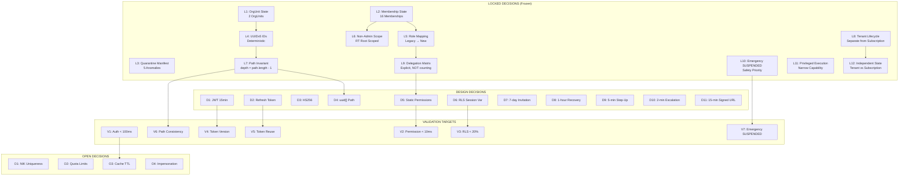

# Architecture Decision Records (ADRs)

## Multi-Tenant SaaS Architecture Transformation

> **Document Status:** DOCUMENTATION ONLY
> **Spec ID:** 9106ad34-d0b8-4360-9ad5-da31c6e948bc
> **Created:** 2024-01-15
> **Last Updated:** 2024-01-15

This document contains comprehensive Architecture Decision Records (ADRs) for the SocieT-RT multi-tenant SaaS transformation. Each decision is classified, justified, and traced to requirements and invariants.

---

## Table of Contents

1. [Summary Table](#summary-table)
2. [Decision Dependency Graph](#decision-dependency-graph)
3. [Locked Decisions (L1-L12)](#locked-decisions-l1-l12)
4. [Design Decisions (D1-D11)](#design-decisions-d1-d11)
5. [Validation Targets (V1-V7)](#validation-targets-v1-v7)
6. [Open Decisions (O1-O4)](#open-decisions-o1-o4)
7. [Invariant Registry Reference](#invariant-registry-reference)
8. [Requirement Traceability Matrix](#requirement-traceability-matrix)

---

## Summary Table

### Locked Decisions (CANNOT Change)

| ID | Title | Brief Description | Evidence |
|----|-------|-------------------|----------|
| L1 | M1/M2 OrgUnit State | 2 OrgUnits created: rt01 root, rt02 root | M2_CLONE_VALIDATION_REPORT |
| L2 | M1/M2 Membership State | 16 Memberships: 3 platform + 13 RT-scoped | M2_CLONE_VALIDATION_REPORT |
| L3 | Quarantine Manifest | 5 platform anomalies (PNA-01 through PNA-05) | PHASE_1_2A_ANOMALY_AUDIT |
| L4 | UUIDv5 OrgUnit IDs | Deterministic IDs with namespace `f0e1d2c3-...` | M2_BACKFILL_DESIGN |
| L5 | Role Mapping | Super_Admin→PLATFORM_ADMIN, Ketua_RT→RT_ADMIN, etc. | M2 migration artifact |
| L6 | Non-Admin Scope | RT users org-scoped to RT root, NOT tenant-wide null | M2_CLONE_VALIDATION_REPORT |
| L7 | Path Invariant | depth = path.length - 1; root: depth=0, path=[id] | ARCHITECTURE_TARGET_DESIGN §1.2 |
| L8 | Tenant Lifecycle Separation | Tenant.lifecycleStatus separate from Subscription.status | Requirements 23/49 |
| L9 | Explicit Delegation Matrix | Role delegation via matrix, NOT permission counting | Requirements 25 |
| L10 | Emergency Access SUSPENDED | Emergency allowed for SUSPENDED membership | Requirements 20 |
| L11 | Narrow Privileged Execution | Not superuser switch, narrow capability only | Requirements 43 |
| L12 | Independent State Machines | Tenant lifecycle and Subscription are independent | Requirements 23/49 |

### Design Decisions (Implementation Choices)

| ID | Title | Value | Rationale |
|----|-------|-------|-----------|
| D1 | JWT Access Token Expiry | 15 minutes | Security vs UX balance |
| D2 | Refresh Token Design | Opaque 256-bit, SHA-256 hashed, 30-day | Industry standard, reuse detection |
| D3 | JWT Algorithm | HS256 | Single-issuer symmetric key simplicity |
| D4 | OrgUnit Path Storage | uuid[] (not ltree) | Prisma native support, shallow hierarchy |
| D5 | Permission Registry | Config-based static mapping | MVP simplicity, UI deferred |
| D6 | RLS Session Variable | `app.current_tenant_id` | PostgreSQL standard pattern |
| D7 | Invitation Expiry | 7 days | Convenience vs security balance |
| D8 | Recovery Token Expiry | 1 hour | Short window reduces compromise risk |
| D9 | Step-Up Validity | 5 minutes | Operation-scoped, minimize replay |
| D10 | Escalation Timeout | 2 minutes | Urgency vs false alarm handling |
| D11 | Signed URL TTL | 15 minutes | Short-lived file access |

### Validation Targets (MUST Be Tested)

| ID | Property | Test Type | Target |
|----|----------|-----------|--------|
| V1 | Authorization Context Resolution | Performance | < 100ms p99 |
| V2 | Permission Lookup | Performance | < 10ms p99 |
| V3 | RLS Overhead | Performance | < 20% query latency |
| V4 | Token Version Mismatch | Unit | Immediate rejection |
| V5 | Refresh Token Reuse | Integration | Family-wide revocation |
| V6 | OrgUnit Path Consistency | Property | parentId chain match |
| V7 | Emergency During SUSPENDED | Integration | Operations succeed |

### Open Decisions (Deferred)

| ID | Decision | Blocker | Impact |
|----|----------|---------|--------|
| O1 | NIK Uniqueness Constraint | Resident/residency model not final | Data integrity |
| O2 | TRIAL/PAST_DUE Quota Limits | Business rules not finalized | Entitlement |
| O3 | Authorization Cache TTL | Redis infrastructure pending | Performance |
| O4 | User Impersonation | High-risk, optional feature | Security |

---

## Decision Dependency Graph



---

## Locked Decisions (L1-L12)

### ADR-L01: M1/M2 OrgUnit State

**Status:** LOCKED
**Date:** 2024-01-10
**Decision ID:** L1

#### Context

During M1/M2 migration phases, OrgUnit records were created to establish the organizational hierarchy foundation for multi-tenancy. The exact state achieved must be preserved as the baseline for all subsequent migrations.

#### Decision

**Two OrgUnits have been created and are frozen:**

| OrgUnit | UUID | Type | Tenant |
|---------|------|------|--------|
| rt01 root | `2459b0bb-115e-52ce-88cd-c176a9aa1e39` | RT | rt01 |
| rt02 root | `50197f3e-5ebc-5547-91ba-e54b604e0edb` | RT | rt02 |

Both are root-level OrgUnits with:
- `depth = 0`
- `path = [id]` (array containing only their own UUID)
- `parentId = NULL`

#### Consequences

**Positive:**
- Deterministic, reproducible state for testing and validation
- Clear baseline for FASE 1.6+ migrations
- UUIDv5 ensures consistent ID generation across environments

**Negative:**
- Cannot retroactively change IDs without cascade effects
- Limits flexibility in organizational restructuring

#### Alternatives Considered

1. **Auto-generated UUIDs (v4):** Rejected — would create different IDs per environment
2. **Integer IDs:** Rejected — not compatible with distributed systems
3. **Composite keys:** Rejected — adds complexity without benefit

#### Security Implications

- OrgUnit IDs are non-sensitive but must be consistent for RLS policies
- tenant_id association is the security boundary, not the OrgUnit ID itself

#### Migration Implications

- All future OrgUnits must use UUIDv5 with the same namespace (L4)
- rt01/rt02 roots serve as anchors for descendant OrgUnits
- Path arrays must be recalculated for any structural changes

#### Related Requirements

- Requirement 21: OrgUnit Hierarchy Management
- Requirement 46: OrgUnit Path Integrity Maintenance

#### Related Invariants

- INV-ORG-004: Root OrgUnit has parentId=NULL, depth=0, path=[id]

---

### ADR-L02: M1/M2 Membership State

**Status:** LOCKED
**Date:** 2024-01-10
**Decision ID:** L2

#### Context

During M1/M2 migration, Membership records were created to link users to tenants with appropriate roles, replacing the legacy `User.tenantId` 1:1 relationship.

#### Decision

**16 Memberships have been created and are frozen:**

| Category | Count | Scope | Roles |
|----------|-------|-------|-------|
| Platform PLATFORM_ADMIN | 3 | tenant-level (orgUnitId = NULL) | PLATFORM_ADMIN |
| RT org-scoped | 13 | org-scoped to RT root OrgUnit | RT_ADMIN, ORG_ADMIN, SECURITY, RESIDENT |

**Distribution:**
- 3 users with PLATFORM_ADMIN role at tenant level (no OrgUnit scope)
- 13 users with RT-specific roles scoped to their respective RT root OrgUnits

#### Consequences

**Positive:**
- Clear separation between platform-level and org-scoped access
- Membership model supports future multi-tenant scenarios
- Audit trail established from migration

**Negative:**
- Legacy User.tenantId still exists (dual-write period)
- Some users may need membership adjustments post-migration

#### Alternatives Considered

1. **Migrate all as tenant-wide:** Rejected — violates principle of least privilege
2. **Wait for full hierarchy:** Rejected — blocks other migration phases
3. **Auto-create all role types:** Rejected — creates unnecessary memberships

#### Security Implications

- PLATFORM_ADMIN with null orgUnitId grants tenant-wide access
- Org-scoped memberships restrict access to OrgUnit subtree
- Membership status (ACTIVE/SUSPENDED/REVOKED) controls access immediately

#### Migration Implications

- All 16 memberships must pass validation checks
- Future membership creation follows same patterns
- Quarantined anomalies (L3) excluded from this count

#### Related Requirements

- Requirement 1: Membership Read Model
- Requirement 22: Membership Lifecycle Management
- Requirement 9: Write-Path Migration for Membership

#### Related Invariants

- INV-MEM-001: Membership OrgUnit belongs to Membership tenant
- INV-MEM-002: Tenant-level membership has orgUnitId=NULL
- INV-MEM-003: Org-scoped roles require valid orgUnitId

---

### ADR-L03: Quarantine Manifest

**Status:** LOCKED
**Date:** 2024-01-10
**Decision ID:** L3

#### Context

During anomaly audit (PHASE_1_2A), five platform-level users were identified with data inconsistencies that make automated migration unsafe. These users have RT-specific roles but are associated with the platform tenant.

#### Decision

**5 platform anomalies are explicitly quarantined:**

| Alias | User ID | Tenant | Legacy Role | Category |
|-------|---------|--------|-------------|----------|
| PNA-01 | `00000000-0000-0000-0000-000000000021` | platform | Ketua_RT | mis-tenanted-rt-role:has-activity |
| PNA-02 | `00000000-0000-0000-0000-000000000022` | platform | Pengurus | mis-tenanted-rt-role:inactive |
| PNA-03 | `00000000-0000-0000-0000-000000000023` | platform | Warga | mis-tenanted-rt-role:has-activity |
| PNA-04 | `00000000-0000-0000-0000-000000000024` | platform | Security_Guard | mis-tenanted-rt-role:inactive |
| PNA-05 | `42cc1bea-9a68-44b1-aadf-1bb0bb609028` | platform | Warga | app-registration-style-id:inactive |

**Quarantine rules:**
- These users are EXCLUDED from automatic membership creation
- They are EXCLUDED from mismatch calculations in shadow authorization
- They are BLOCKED from authorization resolution with code `AUTH_USER_QUARANTINED`
- They require EXPLICIT manual remediation before normal operation

#### Consequences

**Positive:**
- Prevents data corruption from migrating inconsistent records
- Clear audit trail of known issues
- Explicit handling prevents silent failures

**Negative:**
- Affected users cannot access system until remediation
- Manual intervention required for resolution
- Adds complexity to authorization checks

#### Alternatives Considered

1. **Auto-remediate based on activity:** Rejected — could destroy audit trail
2. **Delete anomalous records:** Rejected — may have legitimate data associations
3. **Ignore and migrate anyway:** Rejected — violates data integrity principles

#### Security Implications

- Quarantined users cannot authenticate to protected resources
- Explicit error code prevents confusion with other auth failures
- Manifest verification ensures exactly 5 users remain quarantined

#### Migration Implications

- Legacy data remediation (Req 11) MUST skip these users
- Verification step confirms manifest has exactly 5 entries
- Any resolution requires documented manual process

#### Related Requirements

- Requirement 1.7: Quarantined anomalies excluded from authorization
- Requirement 3.7: Reject quarantined users with AUTH_USER_QUARANTINED
- Requirement 7.8: Exclude from shadow mismatch calculations
- Requirement 9.7: Not automatically creating memberships for anomalies
- Requirement 11.8/11.9: Never auto-remediate, verify manifest

#### Related Invariants

- INV-QUARANTINE-001: Quarantined users cannot receive Membership until explicit remediation

---

### ADR-L04: UUIDv5 Deterministic OrgUnit IDs

**Status:** LOCKED
**Date:** 2024-01-10
**Decision ID:** L4

#### Context

OrgUnit IDs must be deterministic across environments (dev, staging, prod) to ensure consistent validation, testing, and migration scripts.

#### Decision

**UUIDv5 with fixed namespace for all OrgUnit ID generation:**

- **Namespace UUID:** `f0e1d2c3-b4a5-5968-8776-655443322110`
- **Name Format:** `societ-rt:orgunit:legacy-tenant-root:<tenant_id>`

**Generation algorithm:**
```javascript
const namespace = 'f0e1d2c3-b4a5-5968-8776-655443322110';
const name = `societ-rt:orgunit:legacy-tenant-root:${tenantId}`;
const orgUnitId = uuidv5(name, namespace);
```

**Example outputs:**
- rt01 tenant → `2459b0bb-115e-52ce-88cd-c176a9aa1e39`
- rt02 tenant → `50197f3e-5ebc-5547-91ba-e54b604e0edb`

#### Consequences

**Positive:**
- Same input always produces same UUID
- Reproducible across all environments
- Easy to verify/validate expected IDs
- No collision risk with proper namespace

**Negative:**
- Namespace must be kept consistent forever
- Name format changes would break ID compatibility
- Requires UUIDv5 library support

#### Alternatives Considered

1. **UUIDv4 (random):** Rejected — different per environment
2. **Sequential integers:** Rejected — collision across environments
3. **Hash-based custom IDs:** Rejected — reinventing UUIDv5

#### Security Implications

- UUIDs are not cryptographic secrets
- Predictability is acceptable for organizational IDs
- tenant_id derivation means IDs leak tenant existence (acceptable)

#### Migration Implications

- All migration scripts must use this namespace
- Validation scripts can regenerate expected IDs
- Future OrgUnits (children) will use extended name format

#### Related Requirements

- Requirement 21: OrgUnit Hierarchy Management

#### Related Invariants

- INV-ORG-004: Root OrgUnit structure

---

### ADR-L05: Legacy to New Role Mapping

**Status:** LOCKED
**Date:** 2024-01-10
**Decision ID:** L5

#### Context

The legacy system used `UserRole` enum values that must be mapped to the new `MembershipRole` enum for multi-tenant authorization.

#### Decision

**Fixed role mapping (one-to-one, no interpretation):**

| Legacy UserRole | Target MembershipRole | Notes |
|-----------------|----------------------|-------|
| Super_Admin | PLATFORM_ADMIN | Platform-level operations only |
| Ketua_RT | RT_ADMIN | RT-level administration |
| Pengurus | ORG_ADMIN | Organization-level administration |
| Warga | RESIDENT | Basic resident access |
| Security_Guard | SECURITY | Security personnel access |

**Key clarifications:**
- Ketua_RT who are "primary contacts" do NOT automatically become TENANT_OWNER
- Contact-person status is metadata, not a role determinant
- Role mapping is deterministic, not context-dependent

#### Consequences

**Positive:**
- Predictable, auditable migration
- No subjective interpretation required
- Clear documentation of transformation

**Negative:**
- Some edge cases may need manual review
- TENANT_OWNER role requires explicit assignment post-migration
- Cannot retroactively change mapping logic

#### Alternatives Considered

1. **Map Ketua_RT to TENANT_OWNER for primary contacts:** Rejected — contact status ≠ ownership
2. **Merge SECURITY and RESIDENT:** Rejected — distinct capability sets (L9)
3. **Create new intermediate roles:** Rejected — adds complexity without benefit

#### Security Implications

- Role determines permission set (via Permission Registry)
- Over-permissioning risk if mapping is incorrect
- Under-permissioning blocks legitimate access

#### Migration Implications

- All 13 RT-scoped memberships follow this mapping
- TENANT_OWNER must be explicitly assigned after migration
- Dual-write period maintains legacy role for rollback

#### Related Requirements

- Requirement 11.3: Map legacy UserRole to MembershipRole
- Requirement 2: Permission Registry role definitions

#### Related Invariants

- None directly; mapping is a migration artifact

---

### ADR-L06: Non-Admin Org-Scoped to RT Root

**Status:** LOCKED
**Date:** 2024-01-10
**Decision ID:** L6

#### Context

During migration, non-admin users (RESIDENT, SECURITY) need an orgUnitId assignment. The question was whether to assign them tenant-wide scope (null) or scope them to the RT root OrgUnit.

#### Decision

**Non-admin RT users are org-scoped to RT root OrgUnit, NOT tenant-wide null.**

| Role | orgUnitId Assignment |
|------|---------------------|
| PLATFORM_ADMIN | NULL (tenant-wide) |
| TENANT_OWNER | NULL (tenant-wide) |
| ORG_ADMIN | RT root OrgUnit |
| RT_ADMIN | RT root OrgUnit |
| SECURITY | RT root OrgUnit |
| RESIDENT | RT root OrgUnit |

**Rationale:**
- Only tenant-level admin roles (PLATFORM_ADMIN, TENANT_OWNER) should have null orgUnitId
- Org-scoped roles must have explicit OrgUnit binding
- RT root is the appropriate scope for current single-RT tenants

#### Consequences

**Positive:**
- Enforces principle of least privilege
- Prepares for multi-OrgUnit tenants
- Clear authorization boundary per user

**Negative:**
- Requires OrgUnit existence before membership creation
- Slightly more complex queries for org-scoped access

#### Alternatives Considered

1. **Null orgUnitId for all migrated users:** Rejected — over-permissioning
2. **Defer orgUnitId assignment:** Rejected — leaves authorization ambiguous
3. **Create virtual "default" OrgUnit:** Rejected — adds unnecessary abstraction

#### Security Implications

- Users cannot access resources outside their OrgUnit subtree
- Tenant isolation remains via tenant_id check
- OrgUnit scope is additional restriction, not replacement for tenant check

#### Migration Implications

- OrgUnits must be created before memberships (L1 → L2 ordering)
- Migration validates orgUnitId belongs to same tenant
- Future OrgUnit restructuring requires membership scope review

#### Related Requirements

- Requirement 4.8: activeOrgUnitId null only for tenant-level admins
- Requirement 6.3: Tenant-wide scope only for PLATFORM_ADMIN, TENANT_OWNER

#### Related Invariants

- INV-MEM-002: Tenant-level membership has orgUnitId=NULL
- INV-MEM-003: Org-scoped roles require valid orgUnitId

---

### ADR-L07: OrgUnit Path Depth Invariant

**Status:** LOCKED
**Date:** 2024-01-10
**Decision ID:** L7

#### Context

OrgUnit path and depth fields are derived from the parent chain. The invariant relationship must be defined to ensure data consistency.

#### Decision

**Path invariant: `depth = path.length - 1`**

**Root OrgUnit:**
- `depth = 0`
- `path = [id]` (single-element array with own UUID)
- `parentId = NULL`

**Non-root OrgUnit:**
- `depth = parent.depth + 1`
- `path = [...parent.path, id]`
- `parentId = parent.id`

**Example:**
```
Root:     depth=0, path=[A]
Child:    depth=1, path=[A, B]
Grandchild: depth=2, path=[A, B, C]
```

#### Consequences

**Positive:**
- Efficient descendant queries via path array
- O(1) depth lookup without traversal
- Consistent with materialized path pattern

**Negative:**
- path/depth must be updated on subtree moves
- Inconsistency possible if update fails mid-transaction

#### Alternatives Considered

1. **depth = path.length:** Rejected — root would have depth=1, less intuitive
2. **No depth column, compute from path:** Rejected — adds query overhead
3. **ltree instead of uuid[]:** Rejected — Prisma compatibility issues (D4)

#### Security Implications

- Path is optimization, not security boundary
- tenant_id remains the security check
- Corrupted path degrades performance, not security

#### Migration Implications

- All path updates must be transactional
- Repair utility available for inconsistencies
- Validation checks enforce invariant post-migration

#### Related Requirements

- Requirement 6.5: Use path array for efficient descendant checking
- Requirement 21.4: Compute path and depth from parentId
- Requirement 46: Path Integrity Maintenance

#### Related Invariants

- INV-ORG-003: depth = path.length - 1
- INV-ORG-004: Root OrgUnit has parentId=NULL, depth=0, path=[id]

---

### ADR-L08: Tenant Lifecycle Separate from Subscription Status

**Status:** LOCKED
**Date:** 2024-01-12
**Decision ID:** L8

#### Context

Early design conflated tenant provisioning state with billing subscription status. This created semantic confusion and incorrect state transitions.

#### Decision

**Tenant.lifecycleStatus is SEPARATE from Subscription.status**

**Tenant Lifecycle States:**
```
PROVISIONING → ACTIVE → SUSPENDED → CLOSING → CLOSED → PURGED
```

**Subscription Status States:**
```
TRIAL → ACTIVE → PAST_DUE → SUSPENDED → CLOSED
```

**Key distinctions:**
- Tenant PROVISIONING = incomplete setup (billing pending)
- Subscription TRIAL = full features, time-limited
- Tenant SUSPENDED = administrative suspension (e.g., terms violation)
- Subscription SUSPENDED = billing failure suspension
- Both can be ACTIVE simultaneously and independently

#### Consequences

**Positive:**
- Clear semantic separation
- Independent state machines reduce coupling
- Different business logic per state type
- Admin vs. billing actions clearly distinguished

**Negative:**
- Two status fields to manage
- Need to consider both for some operations
- More complex status display logic

#### Alternatives Considered

1. **Single combined status:** Rejected — conflates different concerns
2. **Subscription status only:** Rejected — no provisioning/closing states
3. **Nested state machine:** Rejected — overly complex

#### Security Implications

- Tenant CLOSED blocks all operations except export
- Subscription SUSPENDED allows safety-critical operations
- Both must be checked for full access control

#### Migration Implications

- Existing tenants default to lifecycleStatus = ACTIVE
- New tenants start with lifecycleStatus = PROVISIONING
- Subscription status remains unchanged by this decision

#### Related Requirements

- Requirement 23: Tenant Onboarding Flow
- Requirement 49: Tenant Provisioning & Lifecycle State Machine
- Requirement 18: Subscription Status Management

#### Related Invariants

- None directly; this is state machine design

---

### ADR-L09: Explicit Delegation Matrix

**Status:** LOCKED
**Date:** 2024-01-12
**Decision ID:** L9

#### Context

Role delegation (granting roles to other users) must be controlled to prevent privilege escalation. The question was how to define which roles can grant which other roles.

#### Decision

**Role delegation via EXPLICIT matrix, NOT permission counting.**

**Delegation Matrix:**

| Delegator Role | Can Delegate |
|----------------|--------------|
| PLATFORM_ADMIN | [] (platform operations only, not delegation) |
| TENANT_OWNER | [ORG_ADMIN, RT_ADMIN, SECURITY, RESIDENT] |
| ORG_ADMIN | [RT_ADMIN, SECURITY, RESIDENT] |
| RT_ADMIN | [SECURITY, RESIDENT] |
| SECURITY | [] |
| RESIDENT | [] |

**Prohibited delegations:**
- No role can grant PLATFORM_ADMIN (platform-level operation only)
- No role can grant TENANT_OWNER (requires explicit ownership transfer flow)
- SECURITY and RESIDENT have distinct capability sets (NOT hierarchy levels)

#### Consequences

**Positive:**
- Explicit, auditable delegation rules
- No implicit privilege escalation paths
- Clear documentation of authority boundaries
- Easy to validate and test

**Negative:**
- Matrix must be updated for new roles
- Less flexible than computed permissions
- Requires separate ownership transfer mechanism

#### Alternatives Considered

1. **Permission counting:** Rejected — implies role hierarchy that doesn't exist
2. **"Fewer or equal permissions":** Rejected — SECURITY ≠ RESIDENT subset
3. **No delegation limits:** Rejected — security risk

#### Security Implications

- Prevents ORG_ADMIN from creating TENANT_OWNER
- Prevents RT_ADMIN from creating ORG_ADMIN
- Violation logged with `AUTH_DELEGATION_VIOLATION`

#### Migration Implications

- Matrix is configuration, not schema
- Can be customized per tenant (with platform defaults)
- Existing memberships validated against matrix on creation

#### Related Requirements

- Requirement 25: Delegated Administration

#### Related Invariants

- None directly; matrix is business rule configuration

---

### ADR-L10: Emergency Access for SUSPENDED Membership

**Status:** LOCKED
**Date:** 2024-01-12
**Decision ID:** L10

#### Context

When a user's membership is SUSPENDED (e.g., pending investigation), should they be able to trigger emergency/panic operations? Safety vs. security concern.

#### Decision

**Emergency access is ALLOWED for SUSPENDED membership status by default.**

**Emergency Policy Matrix:**

| Membership Status | Emergency Allowed | Notes |
|-------------------|-------------------|-------|
| ACTIVE | ✅ | Normal access |
| SUSPENDED | ✅ | Safety priority + elevated audit |
| INVITED | ❌ | No authenticated session |
| REVOKED | ❌ | No valid membership |

**When SUSPENDED membership triggers emergency:**
1. Access is granted
2. Full context logged (who, when, what, membership status)
3. Administrator notification sent
4. Incident flagged for review

**Rationale:** Safety-critical operations (panic button) should not fail due to administrative membership suspension. A suspended user may still face a genuine emergency.

#### Consequences

**Positive:**
- Safety prioritized over administrative suspension
- Genuine emergencies not blocked by pending reviews
- Full audit trail for accountability
- Aligns with life-safety principles

**Negative:**
- Potential abuse vector (suspended user can still trigger alerts)
- Requires elevated monitoring of SUSPENDED user actions
- May need rapid membership REVOKE capability

#### Alternatives Considered

1. **Block all access for SUSPENDED:** Rejected — safety risk
2. **Emergency only for ACTIVE:** Rejected — too restrictive
3. **Per-tenant policy:** Considered — may be future option

#### Security Implications

- SUSPENDED users have limited emergency-only access
- Full audit enables accountability
- REVOKED membership completely blocks access

#### Migration Implications

- Emergency handling logic must check membership status
- Audit system must capture membership status at time of emergency
- Administrator notification system required

#### Related Requirements

- Requirement 20: Safety-Critical Operation Protection
- Requirement 20.10/20.11: Emergency Policy for membership status

#### Related Invariants

- None directly; this is policy decision

---

### ADR-L11: Narrow Privileged Execution Path

**Status:** LOCKED
**Date:** 2024-01-12
**Decision ID:** L11

#### Context

Cross-tenant operations (e.g., platform reports, audits) require bypassing tenant-specific RLS. The question was how to enable this safely.

#### Decision

**Privileged execution is a NARROW CAPABILITY, not a superuser switch.**

**NOT Allowed:**
- Generic `is_platform_admin = true` session flag
- Session-level RLS bypass for entire request
- Arbitrary SQL execution in privileged context
- Public API access to privileged operations

**Allowed:**
- Explicit invocation with allowlisted operation type
- Specification of affected tenant(s)
- Step-up authentication for human actors
- Transaction-scoped, auto-clearing context
- Mandatory audit logging
- Security alert emission

**Allowlisted Operations:**
- `CROSS_TENANT_REPORT`
- `PLATFORM_AUDIT`
- `TENANT_MIGRATION`
- `ANOMALY_REMEDIATION`

#### Consequences

**Positive:**
- Minimal attack surface for cross-tenant access
- Full audit trail of privileged operations
- Cannot be accidentally invoked
- Time-limited context (default 30 seconds)

**Negative:**
- More development effort for each privileged operation
- Cannot ad-hoc query across tenants
- Step-up auth adds UX friction

#### Alternatives Considered

1. **Session-level bypass flag:** Rejected — too broad, easy to misuse
2. **PLATFORM_ADMIN automatic bypass:** Rejected — no audit, no scoping
3. **Separate admin database connection:** Considered — complex to manage

#### Security Implications

- Cross-tenant data exposure minimized
- Human operators must re-authenticate
- All privileged access logged and alerted
- No public API exposure

#### Migration Implications

- Migration scripts may need privileged path for data movement
- Audit reports require explicit tenant specification
- Testing must verify privileged context clears properly

#### Related Requirements

- Requirement 10.5/10.6: No generic bypass, explicit privileged path
- Requirement 43: Privileged Execution Path for Cross-Tenant Operations

#### Related Invariants

- None directly; this is access control design

---

### ADR-L12: Independent State Machines

**Status:** LOCKED
**Date:** 2024-01-12
**Decision ID:** L12

#### Context

Clarification of L8 — ensuring that Tenant.lifecycleStatus and Subscription.status are truly independent state machines with no implicit coupling.

#### Decision

**Tenant.lifecycleStatus and Subscription.status are INDEPENDENT.**

**Valid Combinations:**

| Tenant Lifecycle | Subscription Status | Valid? | Notes |
|------------------|---------------------|--------|-------|
| PROVISIONING | TRIAL | ✅ | New tenant being set up |
| ACTIVE | TRIAL | ✅ | Setup complete, trial period |
| ACTIVE | ACTIVE | ✅ | Normal operation |
| ACTIVE | PAST_DUE | ✅ | Payment grace period |
| ACTIVE | SUSPENDED | ✅ | Billing suspended, tenant active |
| SUSPENDED | ACTIVE | ✅ | Admin suspended, billing OK |
| SUSPENDED | SUSPENDED | ✅ | Both suspended |
| CLOSING | CLOSED | ✅ | Tenant terminating |
| CLOSED | CLOSED | ✅ | Fully terminated |

**Transition Independence:**
- Tenant transitions happen via admin actions or provisioning completion
- Subscription transitions happen via billing events
- Neither requires the other to be in a specific state (except terminal)

#### Consequences

**Positive:**
- Clear separation of concerns
- Billing issues don't affect tenant admin status
- Admin actions don't affect billing status
- Flexible for various business scenarios

**Negative:**
- Must check both statuses for operations
- More complex authorization logic
- UI must display both clearly

#### Alternatives Considered

1. **Coupled state machine:** Rejected — limits flexibility
2. **Single combined status:** Rejected — conflates concerns (L8)
3. **Subscription controls tenant:** Rejected — admin loses control

#### Security Implications

- Authorization must check BOTH statuses
- Tenant CLOSED overrides subscription for access
- Policy matrix (D5.4) defines capability per status combination

#### Migration Implications

- Existing tenants: lifecycleStatus = ACTIVE, subscription varies
- New tenant flow: PROVISIONING → ACTIVE transition explicit
- Status display must show both clearly

#### Related Requirements

- Requirement 23: Creates Tenant with lifecycleStatus = PROVISIONING
- Requirement 49: Tenant lifecycle state machine
- Requirement 18: Subscription status state machine

#### Related Invariants

- None directly; this is state machine design

---

## Design Decisions (D1-D11)

### ADR-D01: JWT Access Token Expiry — 15 Minutes

**Status:** DESIGN_DECISION
**Date:** 2024-01-12
**Decision ID:** D1

#### Context

JWT access token expiry affects security (shorter = more frequent validation) vs. user experience (longer = fewer refreshes).

#### Decision

**JWT access token expiry set to 15 minutes (configurable).**

**Configuration:**
```typescript
const JWT_ACCESS_TOKEN_EXPIRY = '15m'; // 900 seconds
```

#### Consequences

**Positive:**
- Reasonable security window (compromised token limited to 15 min)
- Refresh token handles longer sessions
- Authoritative check per request mitigates stale claims

**Negative:**
- More frequent refresh token usage
- Network overhead for refresh calls
- Slightly worse offline experience

#### Alternatives Considered

1. **5 minutes:** Too aggressive, poor UX with frequent refreshes
2. **1 hour:** Too long, stale claims risk
3. **30 minutes:** Considered, but 15 min preferred for security

#### Security Implications

- Compromised token useful for max 15 minutes
- Token version check can invalidate earlier
- Refresh token required for extended sessions

#### Migration Implications

- Existing sessions will require refresh after deployment
- No data migration needed

#### Related Requirements

- Requirement 44.3: Access token expiry 15 minutes

#### Related Invariants

- None directly

---

### ADR-D02: Opaque Refresh Token Design

**Status:** DESIGN_DECISION
**Date:** 2024-01-12
**Decision ID:** D2

#### Context

Refresh tokens must support secure rotation with reuse detection to prevent token theft exploitation.

#### Decision

**Opaque refresh tokens with family-based rotation:**

- **Token format:** 256-bit random (not JWT)
- **Storage:** SHA-256 hash only (never store plaintext)
- **Expiry:** 30 days (configurable)
- **Cookie:** HttpOnly + Secure + SameSite=Strict
- **Family tracking:** `familyId` stable across rotations
- **Generation:** Counter increments on each rotation

**Reuse Detection:**
```typescript
if (token.revokedAt !== null) {
  // Token was already used and rotated
  await revokeFamily(token.familyId);
  throw new AuthError('AUTH_TOKEN_REUSE_DETECTED');
}
```

#### Consequences

**Positive:**
- Token theft detected via reuse attempt
- Family-wide revocation limits damage
- Hash storage prevents database leak exploitation
- Generation tracking enables audit

**Negative:**
- More complex than simple token storage
- Requires family management logic
- Cookie handling complexity

#### Alternatives Considered

1. **JWT refresh tokens:** Rejected — cannot revoke without database check anyway
2. **Simple random token without family:** Rejected — no reuse detection
3. **Shorter expiry without rotation:** Rejected — poor UX

#### Security Implications

- Stolen refresh token triggers family revocation on reuse
- Hash storage safe against database compromise
- Cookie flags prevent XSS/CSRF exploitation

#### Migration Implications

- New refresh_token table required
- Existing sessions invalidated on deployment
- Family tracking starts fresh

#### Related Requirements

- Requirement 14: Refresh Token Implementation
- Requirement 16: Session Revocation and Logout

#### Related Invariants

- None directly

---

### ADR-D03: HS256 JWT Algorithm

**Status:** DESIGN_DECISION
**Date:** 2024-01-12
**Decision ID:** D3

#### Context

JWT signing algorithm affects security, performance, and operational complexity.

#### Decision

**HS256 (HMAC-SHA256) for JWT signing.**

**Rationale:**
- Single-issuer system (no distributed verification)
- Symmetric key simpler to rotate
- Sufficient security for internal tokens
- Better performance than asymmetric alternatives

**Configuration:**
```typescript
const JWT_ALGORITHM = 'HS256';
const JWT_SECRET_MIN_BITS = 256; // Minimum secret size
```

#### Consequences

**Positive:**
- Simple key management (single secret)
- Fast signing and verification
- Well-supported across libraries

**Negative:**
- Secret must be shared if verification distributed
- Not suitable for public token verification
- Key compromise requires rotation

#### Alternatives Considered

1. **RS256 (RSA):** Overkill for single-issuer, slower
2. **ES256 (ECDSA):** Better for distributed verification, not needed
3. **EdDSA:** Not as widely supported

#### Security Implications

- Secret must be minimum 256 bits
- Secret rotation requires token reissuance
- FASE 0 replaced weak legacy secret (`socieTRT-rcp`)

#### Migration Implications

- FASE 0 Security completed secret rotation
- All existing tokens invalidated
- New secret in secure configuration

#### Related Requirements

- Requirement 44.5: JWT algorithm HS256

#### Related Invariants

- None directly

---

### ADR-D04: UUID Array Path Storage

**Status:** DESIGN_DECISION
**Date:** 2024-01-12
**Decision ID:** D4

#### Context

OrgUnit hierarchy path can be stored as PostgreSQL `ltree` or native `uuid[]` array. Choice affects query capability and ORM compatibility.

#### Decision

**Store path as `uuid[]` (PostgreSQL native array), not `ltree`.**

**Schema:**
```prisma
model OrgUnit {
  path String[] @db.Uuid  // Native array of UUIDs
  depth Int
}
```

**Query patterns:**
```sql
-- Descendants of orgUnit A
SELECT * FROM org_units WHERE :ancestorId = ANY(path);

-- Direct children
SELECT * FROM org_units WHERE parent_id = :id;

-- Ancestors (unnest path)
SELECT unnest(path) FROM org_units WHERE id = :id;
```

#### Consequences

**Positive:**
- Prisma native support (`String[] @db.Uuid`)
- No `Unsupported()` type workarounds
- Standard array operators work
- No UUID encoding needed (ltree labels can't contain `-`)

**Negative:**
- Some ltree operations not available (regex matching)
- GIN index less efficient than GIST for ltree
- Hierarchy depth limited (but shallow ≤5 levels anyway)

#### Alternatives Considered

1. **ltree:** Rejected — Prisma requires raw queries, UUID encoding needed
2. **Nested set model:** Rejected — complex updates on restructure
3. **Closure table:** Rejected — additional table, more storage

#### Security Implications

- Path is optimization, not security boundary
- GIN index doesn't change security model

#### Migration Implications

- Schema uses native Prisma array type
- Index: `CREATE INDEX idx_path ON org_units USING GIN(path)`
- Upgrade path to ltree remains open if needed

#### Related Requirements

- Requirement 21: OrgUnit Hierarchy Management
- Requirement 46: Path Integrity Maintenance

#### Related Invariants

- INV-ORG-003: depth = path.length - 1

---

### ADR-D05: Config-Based Static Permission Registry

**Status:** DESIGN_DECISION
**Date:** 2024-01-12
**Decision ID:** D5

#### Context

Role-to-permission mapping can be database-driven (UI-manageable) or configuration-based (code-defined). MVP needs simplicity.

#### Decision

**Permission Registry is configuration-based (static) for MVP.**

**Implementation:**
```typescript
// Loaded at startup, immutable during runtime
const ROLE_PERMISSIONS: Record<MembershipRole, string[]> = {
  PLATFORM_ADMIN: ['*'],
  TENANT_OWNER: ['tenant:manage', 'membership:delegate', ...],
  ORG_ADMIN: ['membership:delegate', 'finance:read', ...],
  RT_ADMIN: ['finance:read', 'resident:read', ...],
  SECURITY: ['resident:read', 'emergency:create', ...],
  RESIDENT: ['resident:read', 'emergency:create', ...]
};
```

**Rules:**
- No inheritance between roles (explicit mapping only)
- Unknown permission → fail closed with logging
- Registry validated at startup

#### Consequences

**Positive:**
- Simple to implement and test
- No database migration for permission changes
- Fast lookup (in-memory map)
- Clear audit trail in code

**Negative:**
- Requires deployment for permission changes
- No runtime customization per tenant
- UI permission management deferred

#### Alternatives Considered

1. **Database-driven permissions:** Deferred — adds complexity
2. **Computed inheritance:** Rejected — violates explicit mapping principle
3. **Per-tenant customization:** Deferred — future enhancement

#### Security Implications

- Permissions controlled by deployment
- No accidental permission grants via UI
- Code review required for changes

#### Migration Implications

- No database table for permissions (MVP)
- Future migration may add permission storage
- Existing code uses Permission Registry

#### Related Requirements

- Requirement 2: Central Permission Registry

#### Related Invariants

- None directly

---

### ADR-D06: RLS Session Variable Pattern

**Status:** DESIGN_DECISION
**Date:** 2024-01-12
**Decision ID:** D6

#### Context

PostgreSQL RLS policies need tenant context. The question is how to pass this context to the database session.

#### Decision

**Use `app.current_tenant_id` session variable for RLS.**

**Pattern:**
```sql
-- Set tenant context (transaction-scoped)
SET LOCAL app.current_tenant_id = 'uuid-here';

-- RLS policy uses this
CREATE POLICY tenant_isolation ON users
  USING (tenant_id = current_setting('app.current_tenant_id')::uuid);
```

**Connection pool safety:**
- Use `SET LOCAL` (transaction-scoped), not `SET` (session-scoped)
- Clear context before returning connection to pool
- Fail closed if variable not set

#### Consequences

**Positive:**
- Standard PostgreSQL pattern
- Works with connection pooling (with LOCAL)
- No application-level filtering required
- Defense-in-depth security

**Negative:**
- Must set context for every transaction
- Testing requires session variable setup
- Debug complexity when variable not set

#### Alternatives Considered

1. **Row-level filtering in application:** Rejected — no defense-in-depth
2. **Separate database per tenant:** Rejected — operational complexity
3. **Schema per tenant:** Rejected — migration complexity

#### Security Implications

- RLS enforces tenant isolation at database layer
- Missing context → empty result (fail closed)
- Cannot bypass with SQL injection

#### Migration Implications

- RLS policies added to all tenant-scoped tables
- Existing queries must set session variable
- Connection pool middleware required

#### Related Requirements

- Requirement 10: PostgreSQL Row-Level Security Foundation
- Requirement 60: RLS Connection Pool Safety

#### Related Invariants

- None directly; this is implementation pattern

---

### ADR-D07: 7-Day Invitation Expiry

**Status:** DESIGN_DECISION
**Date:** 2024-01-12
**Decision ID:** D7

#### Context

Invitation tokens have an expiry period. Balance between user convenience (longer) and security (shorter).

#### Decision

**Invitation expiry default: 7 days (configurable).**

**Token properties:**
- Cryptographically random 256-bit
- One-time use only
- Invalidated on: revocation, resend, acceptance, expiry
- Email normalization applied before matching

#### Consequences

**Positive:**
- Week gives reasonable time for recipient to act
- Not so long that forgotten invitations accumulate
- Revocation available for immediate invalidation

**Negative:**
- Potential for stale invitations
- Email changes may invalidate invitation
- Resend creates new token (previous invalidated)

#### Alternatives Considered

1. **24 hours:** Too short for many users
2. **30 days:** Too long, security risk
3. **No expiry:** Security risk, compliance issue

#### Security Implications

- Short window limits token compromise impact
- Revocation provides immediate invalidation
- One-time use prevents replay

#### Migration Implications

- New invitation table with expiry column
- Scheduled job for expired invitation cleanup
- Email verification flow for existing account linking

#### Related Requirements

- Requirement 50: Invitation & User Identity Linking

#### Related Invariants

- None directly

---

### ADR-D08: 1-Hour Recovery Token Expiry

**Status:** DESIGN_DECISION
**Date:** 2024-01-12
**Decision ID:** D8

#### Context

Password recovery tokens need short expiry to limit compromise window while allowing reasonable time for user to complete recovery.

#### Decision

**Recovery token expiry: 1 hour.**

**Token properties:**
- Cryptographically random
- One-time use
- Invalidated after use or expiry
- Rate-limited: 3 requests per hour per email

#### Consequences

**Positive:**
- Short window limits compromise impact
- Sufficient for most users to complete recovery
- Rate limiting prevents abuse

**Negative:**
- User may need to re-request if slow
- Time zone confusion possible
- Network delays may consume window

#### Alternatives Considered

1. **15 minutes:** Too aggressive
2. **24 hours:** Too long, security risk
3. **2 hours:** Considered, 1 hour preferred

#### Security Implications

- Short expiry limits token theft exploitation
- Rate limiting prevents enumeration
- All sessions invalidated on password reset

#### Migration Implications

- New recovery token table
- Password reset flow update
- Session invalidation (tokenVersion increment)

#### Related Requirements

- Requirement 51: Account Recovery & Credential Security

#### Related Invariants

- None directly

---

### ADR-D09: 5-Minute Step-Up Validity

**Status:** DESIGN_DECISION
**Date:** 2024-01-12
**Decision ID:** D9

#### Context

Step-up authentication (re-verification for sensitive operations) needs a validity window. Too short = poor UX, too long = security risk.

#### Decision

**Step-up authentication validity: 5 minutes, operation-scoped.**

**Properties:**
- Re-authentication required (password + MFA if enrolled)
- Validity limited to specific operation requested
- Cannot be reused across different operations
- Logged with full context

**Operations requiring step-up:**
- NIK decrypt/export
- Privileged execution path
- Billing changes
- TENANT_OWNER transfer
- Tenant deletion
- Encryption key rotation

#### Consequences

**Positive:**
- Short window limits replay risk
- Operation-scoped prevents lateral movement
- Full audit trail

**Negative:**
- UX friction for multiple sensitive operations
- Requires recent auth for each operation type
- More complex auth flow

#### Alternatives Considered

1. **15 minutes:** Too long for sensitive operations
2. **1 minute:** Too aggressive, poor UX
3. **Session-wide elevation:** Rejected — too broad

#### Security Implications

- Limits damage from session hijacking
- Requires fresh proof of identity
- Failed attempts logged and alerted

#### Migration Implications

- New step-up verification flow
- MFA integration required
- Audit logging for step-up events

#### Related Requirements

- Requirement 52: MFA & Step-Up Authentication
- Requirement 53: Sensitive Operation Re-authentication

#### Related Invariants

- None directly

---

### ADR-D10: 2-Minute Emergency Escalation Timeout

**Status:** DESIGN_DECISION
**Date:** 2024-01-12
**Decision ID:** D10

#### Context

Emergency alerts need escalation if responders don't acknowledge. Timeout affects response urgency vs. false alarm handling.

#### Decision

**Emergency escalation timeout default: 2 minutes.**

**Escalation tiers:**
1. On-duty security
2. All security personnel
3. RT_ADMIN
4. ORG_ADMIN
5. TENANT_OWNER

**On timeout without ACK:** Escalate to next tier.

#### Consequences

**Positive:**
- Urgent enough for real emergencies
- Time for false alarm cancellation
- Progressive escalation reaches someone

**Negative:**
- May escalate unnecessarily
- Night-time escalation disruption
- False alarm fatigue risk

#### Alternatives Considered

1. **30 seconds:** Too aggressive, many false escalations
2. **5 minutes:** Too slow for real emergencies
3. **10 minutes:** Way too slow

#### Security Implications

- Emergency notifications are safety-critical
- Cannot be blocked by subscription status
- Full audit trail of escalation

#### Migration Implications

- Emergency lifecycle tracking
- Notification queue integration
- Escalation tier configuration per tenant

#### Related Requirements

- Requirement 57: Emergency Acknowledgement & Escalation

#### Related Invariants

- None directly

---

### ADR-D11: 15-Minute Signed URL TTL

**Status:** DESIGN_DECISION
**Date:** 2024-01-12
**Decision ID:** D11

#### Context

File downloads use signed URLs for access control. TTL affects security (shorter) vs. download reliability (longer).

#### Decision

**Signed URL TTL default: 15 minutes.**

**Properties:**
- URL includes signature, expiry, file reference
- tenantId MANDATORY in storage path
- Single-use option available for sensitive files
- All downloads audited

**Storage path format:**
```
/{tenantId}/{category}/{uuid}.{ext}
```

#### Consequences

**Positive:**
- Short window limits URL sharing risk
- Sufficient for large file downloads
- Single-use option for sensitive files

**Negative:**
- Large files may need retry
- URL sharing for collaboration limited
- Generates new URL each request

#### Alternatives Considered

1. **5 minutes:** Too short for large files
2. **1 hour:** Too long, sharing risk
3. **24 hours:** Definitely too long

#### Security Implications

- Short TTL limits unauthorized access window
- tenantId in path prevents cross-tenant access
- Audit trail for all downloads

#### Migration Implications

- File storage path restructuring
- Signed URL generation service
- Download audit logging

#### Related Requirements

- Requirement 55: Secure File/Object Storage Tenant Isolation

#### Related Invariants

- None directly

---

## Validation Targets (V1-V7)

### ADR-V01: Authorization Context Resolution < 100ms p99

**Status:** VALIDATION_TARGET
**Date:** 2024-01-12
**Decision ID:** V1

#### Context

Authorization context resolution is the critical path for every protected request. Performance SLA must be defined and tested.

#### Decision

**Authorization context resolution must complete within 100ms at p99.**

**Measurement:**
- Start: JWT claims extracted
- End: Full AuthorizationContext returned (userId, tenantId, orgUnitId, role, permissions)
- Include: Database lookup, cache check, permission resolution

#### Test Requirements

1. **Performance test:** 1000 requests, measure p99 latency
2. **Load test:** Concurrent requests from multiple tenants
3. **Cache test:** Cache hit vs. miss scenarios

#### Consequences

- Caching strategy required (O3)
- Database query optimization required
- May need read replicas for scale

#### Related Requirements

- Requirement 42.2: Verify authorization resolution < 100ms p99

#### Related Invariants

- None directly

---

### ADR-V02: Permission Lookup < 10ms p99

**Status:** VALIDATION_TARGET
**Date:** 2024-01-12
**Decision ID:** V2

#### Context

Permission lookup from the Permission Registry should be fast since it's in-memory configuration.

#### Decision

**Permission lookup must complete within 10ms at p99.**

**Measurement:**
- Start: Role received
- End: Permission set returned
- Include: Map lookup, permission set construction

#### Test Requirements

1. **Unit test:** All roles, measure lookup time
2. **Performance test:** Repeated lookups under load
3. **Startup test:** Registry loading time

#### Consequences

- In-memory map is sufficient
- No database lookup for permissions (D5)
- Cold start may be slightly slower

#### Related Requirements

- Requirement 42.3: Verify permission lookup < 10ms p99

#### Related Invariants

- None directly

---

### ADR-V03: RLS Overhead < 20% Query Latency

**Status:** VALIDATION_TARGET
**Date:** 2024-01-12
**Decision ID:** V3

#### Context

RLS policies add overhead to every query. This overhead must be bounded to maintain acceptable performance.

#### Decision

**RLS adds no more than 20% query latency overhead.**

**Measurement:**
- Compare: Same query with RLS enabled vs. disabled
- Test: Various query types (simple, join, aggregate)
- Environment: Production-like data volume

#### Test Requirements

1. **Performance test:** Query benchmark with/without RLS
2. **Index test:** Verify GIN/B-tree indexes on tenant_id
3. **Complex query test:** Multi-table joins

#### Consequences

- Proper indexing required
- Query optimization for RLS awareness
- May need query plan analysis

#### Related Requirements

- Requirement 42.5: Verify RLS overhead < 20%

#### Related Invariants

- None directly

---

### ADR-V04: Immediate Token Version Rejection

**Status:** VALIDATION_TARGET
**Date:** 2024-01-12
**Decision ID:** V4

#### Context

Token version mismatch (forced logout) must result in immediate rejection, not delayed until token expiry.

#### Decision

**Token version mismatch → immediate rejection with `AUTH_TOKEN_REVOKED`.**

**Test scenarios:**
1. User tokenVersion incremented
2. Existing JWT presented with old tokenVersion
3. Rejection occurs before any other processing

#### Test Requirements

1. **Unit test:** tokenVersion comparison logic
2. **Integration test:** Force logout, verify immediate rejection
3. **E2E test:** Full flow from increment to rejection

#### Consequences

- Every request checks tokenVersion
- Database lookup required (can be cached)
- Refresh token also revoked on version increment

#### Related Requirements

- Requirement 15.4: tokenVersion mismatch → AUTH_TOKEN_REVOKED

#### Related Invariants

- None directly

---

### ADR-V05: Family-Wide Token Revocation on Reuse

**Status:** VALIDATION_TARGET
**Date:** 2024-01-12
**Decision ID:** V5

#### Context

Refresh token reuse indicates potential theft. All tokens in the family must be revoked to limit damage.

#### Decision

**Refresh token reuse → revoke entire family, return `AUTH_TOKEN_REUSE_DETECTED`.**

**Test scenarios:**
1. Token A used for refresh, Token B issued
2. Token A (now revoked) used again
3. Both Token A and Token B (same family) revoked
4. Error code returned

#### Test Requirements

1. **Unit test:** Reuse detection logic
2. **Integration test:** Family-wide revocation
3. **E2E test:** Full reuse attack simulation

#### Consequences

- Attacker's stolen token becomes useless
- Legitimate user logged out (acceptable trade-off)
- Re-authentication required after detection

#### Related Requirements

- Requirement 14.6: Revoked token reuse → family-wide revocation

#### Related Invariants

- None directly

---

### ADR-V06: OrgUnit Path Consistency Verification

**Status:** VALIDATION_TARGET
**Date:** 2024-01-12
**Decision ID:** V6

#### Context

OrgUnit path and depth fields must remain consistent with the parentId chain. Verification ensures data integrity.

#### Decision

**Path consistency with parentId chain must be verified.**

**Invariants to verify:**
1. `depth = path.length - 1`
2. Root OrgUnits: `depth = 0`, `path = [id]`
3. Non-root: `path = [...parent.path, id]`
4. No cycles in hierarchy

#### Test Requirements

1. **Property test:** Random hierarchy generation, verify invariants
2. **Unit test:** Path calculation on create/move
3. **Integration test:** Subtree move updates all descendants
4. **Repair test:** Inconsistency detection and repair

#### Consequences

- Path repair utility available
- Validation runs on migration
- Inconsistency logged and alerted

#### Related Requirements

- Requirement 46: OrgUnit Path Integrity Maintenance

#### Related Invariants

- INV-ORG-003: depth = path.length - 1
- INV-ORG-004: Root OrgUnit structure

---

### ADR-V07: Emergency Operations During SUSPENDED Status

**Status:** VALIDATION_TARGET
**Date:** 2024-01-12
**Decision ID:** V7

#### Context

Safety-critical operations must work during subscription SUSPENDED status. This must be verified with integration tests.

#### Decision

**Emergency operations succeed during SUSPENDED status.**

**Test scenarios:**
1. Tenant subscription status = SUSPENDED
2. User triggers emergency_alert:create
3. Operation succeeds
4. Audit log captures subscription status at time of operation
5. Alert sent to billing team

#### Test Requirements

1. **Unit test:** Subscription bypass for safety-critical
2. **Integration test:** Full emergency flow during SUSPENDED
3. **E2E test:** Notification delivery during SUSPENDED

#### Consequences

- Safety-critical operations explicitly allowlisted
- Non-safety operations blocked during SUSPENDED
- Billing team notified for follow-up

#### Related Requirements

- Requirement 20: Safety-Critical Operation Protection

#### Related Invariants

- None directly

---

## Open Decisions (O1-O4)

### ADR-O01: NIK Uniqueness Constraint

**Status:** OPEN_DECISION
**Date:** 2024-01-12
**Decision ID:** O1

#### Context

NIK (Indonesian ID number) storage requires uniqueness consideration. The question is whether to enforce `UNIQUE(tenant_id, nik_hmac)` or allow duplicates with business validation.

#### Blocker

**Resident/residency model not final.**

- Resident may move between RTs (same tenant)
- NIK may appear in historical residency records
- Business rules for NIK uniqueness not finalized

#### Current Status

**Indexed lookup only, no unique constraint.**

- `nik_hmac` column indexed for equality lookup
- Duplicate detection via business validation
- Constraint decision deferred

#### Options Being Considered

1. **UNIQUE(tenant_id, nik_hmac):** Prevents duplicates at database level
2. **Indexed + business validation:** Allows controlled duplicates
3. **UNIQUE with soft-delete exclusion:** Complex but flexible

#### Impact if Not Decided

- Data integrity risk from duplicate NIKs
- Business rule enforcement in application layer only
- May need data cleanup later

#### Related Requirements

- Requirement 38: PII/NIK Protection (O1 noted as open)

#### Related Invariants

- None until decision made

---

### ADR-O02: TRIAL/PAST_DUE Quota Limits

**Status:** OPEN_DECISION
**Date:** 2024-01-12
**Decision ID:** O2

#### Blocker

**Business rules not finalized.**

- TRIAL quota limits (users, devices, etc.) not defined
- PAST_DUE grace period behavior not specified
- Pricing tiers affect limits

#### Current Status

**Placeholder values in policy matrix.**

- TRIAL: "quota limited" noted, values TBD
- PAST_DUE: "grace" noted, duration TBD

#### Options Being Considered

1. **Hard limits:** Strict quota enforcement
2. **Soft limits with warnings:** Allow overages with notifications
3. **Per-plan limits:** Different limits per subscription tier

#### Impact if Not Decided

- Cannot fully implement entitlement enforcement
- User experience for quota exceeded unclear
- Billing integration incomplete

#### Related Requirements

- Requirement 19: Entitlement Enforcement

#### Related Invariants

- None until decision made

---

### ADR-O03: Authorization Cache TTL and Invalidation

**Status:** OPEN_DECISION
**Date:** 2024-01-12
**Decision ID:** O3

#### Blocker

**Redis infrastructure decision pending.**

- Redis vs. other cache options not finalized
- Deployment topology affects cache strategy
- Invalidation complexity depends on architecture

#### Current Status

**No caching implemented.**

- Authorization resolved from database per request
- Performance acceptable for current scale
- Caching deferred until needed

#### Options Being Considered

1. **Redis with event-driven invalidation:** Complex but accurate
2. **Short TTL cache (5 min):** Simple, eventual consistency
3. **Hybrid:** Short TTL with explicit invalidation for critical changes

#### Impact if Not Decided

- V1 (< 100ms p99) may be at risk under load
- Database load higher than necessary
- Scale limited by database capacity

#### Related Requirements

- Requirement 42: Performance Validation

#### Related Invariants

- None until decision made

---

### ADR-O04: User Impersonation Capability

**Status:** OPEN_DECISION
**Date:** 2024-01-12
**Decision ID:** O4

#### Blocker

**High-risk feature, optional for MVP.**

- Security implications significant
- Audit complexity high
- Customer support use case not prioritized

#### Current Status

**Feature not planned for implementation.**

- No impersonation capability in MVP
- PLATFORM_ADMIN cannot impersonate users
- Debug access via read-only audit logs

#### Options Being Considered

1. **No impersonation:** Current approach, most secure
2. **Read-only impersonation:** View as user, no mutations
3. **Full impersonation with double-consent:** Complex, requires user approval

#### Impact if Not Decided

- Customer support limited to audit logs
- Cannot reproduce user-specific issues directly
- Debug cycles may be longer

#### Related Requirements

- None (feature not in requirements)

#### Related Invariants

- None

---

## Invariant Registry Reference

All invariants from Requirements 62 that enforce architecture decisions:

### Tenant Isolation Invariants

| ID | Description | Enforcement | Related ADRs |
|----|-------------|-------------|--------------|
| INV-TENANT-001 | Tenant-owned records cannot reference another tenant | Composite FK + RLS | D6 |

### OrgUnit Hierarchy Invariants

| ID | Description | Enforcement | Related ADRs |
|----|-------------|-------------|--------------|
| INV-ORG-001 | OrgUnit parent must belong to same tenant | Composite FK + application | L1, L7 |
| INV-ORG-002 | OrgUnit hierarchy cannot contain cycles | Application service | L7 |
| INV-ORG-003 | depth = path.length - 1 | Application service | L7, V6 |
| INV-ORG-004 | Root OrgUnit has parentId=NULL, depth=0, path=[id] | Application service | L1, L7, V6 |

### Membership Invariants

| ID | Description | Enforcement | Related ADRs |
|----|-------------|-------------|--------------|
| INV-MEM-001 | Membership OrgUnit belongs to Membership tenant | Composite FK | L2, L6 |
| INV-MEM-002 | Tenant-level membership has orgUnitId=NULL | Application | L2, L6 |
| INV-MEM-003 | Org-scoped roles require valid orgUnitId | Application | L2, L6 |

### Administration Invariants

| ID | Description | Enforcement | Related ADRs |
|----|-------------|-------------|--------------|
| INV-OWNER-001 | Tenant cannot lose final TENANT_OWNER | Application | L9 |

### Identity Invariants

| ID | Description | Enforcement | Related ADRs |
|----|-------------|-------------|--------------|
| INV-IDENTITY-001 | Ambiguous User identities never auto-merged | Application | D7 |

### Quarantine Invariants

| ID | Description | Enforcement | Related ADRs |
|----|-------------|-------------|--------------|
| INV-QUARANTINE-001 | Quarantined users cannot receive Membership | Application | L3 |

### IoT Invariants

| ID | Description | Enforcement | Related ADRs |
|----|-------------|-------------|--------------|
| INV-IOT-001 | IoT device and owner must belong to same tenant | Composite FK | D6 |

### Household/Resident Invariants

| ID | Description | Enforcement | Related ADRs |
|----|-------------|-------------|--------------|
| INV-HOUSEHOLD-001 | Household.tenantId == Resident.tenantId | Composite FK | D6 |

### Authorization Invariants

| ID | Description | Enforcement | Related ADRs |
|----|-------------|-------------|--------------|
| INV-AUTH-001 | JWT claims are NOT authorization authority | Application | D1, D5 |
| INV-AUTH-002 | Authorization fails closed when context cannot be resolved | Application | D5, D6 |

---

## Requirement Traceability Matrix

| Requirement | ADRs | Test Reference |
|-------------|------|----------------|
| Req 1 | L2, L3, L6 | membership.test.ts |
| Req 2 | D5, L9 | permission-registry.test.ts |
| Req 3 | L3, D1 | authorization-context.test.ts |
| Req 4 | D1, L6 | context-switch.test.ts |
| Req 5 | D5 | route-authorization.test.ts |
| Req 6 | L7, D4 | orgunit-scope.test.ts |
| Req 7 | L3 | shadow-auth.test.ts |
| Req 8 | - | cutover.test.ts |
| Req 9 | L2, L3, L5 | dual-write.test.ts |
| Req 10 | D6, L11 | rls-isolation.test.ts |
| Req 11 | L3, L5, L6 | remediation.test.ts |
| Req 14 | D2 | refresh-token.test.ts |
| Req 15 | D1 | token-version.test.ts |
| Req 16 | D2 | session.test.ts |
| Req 17-19 | L8, L12 | subscription.test.ts |
| Req 20 | L10, V7 | emergency-safety.test.ts |
| Req 21 | L1, L4, L7, D4 | orgunit-hierarchy.test.ts |
| Req 22 | L2, L6 | membership-lifecycle.test.ts |
| Req 23 | L8, L12 | tenant-onboarding.test.ts |
| Req 24 | - | audit.test.ts |
| Req 25 | L9 | delegation.test.ts |
| Req 26 | - | resource-scope.test.ts |
| Req 27 | - | household-auth.test.ts |
| Req 28 | - | toctou.test.ts |
| Req 29 | - | service-principal.test.ts |
| Req 30 | - | webhook.test.ts |
| Req 31 | - | offboarding.test.ts |
| Req 32 | - | backup-dr.test.ts |
| Req 33 | - | event-outbox.test.ts |
| Req 34 | - | iot-device.test.ts |
| Req 35 | - | observability.test.ts |
| Req 36 | - | migration-safety.test.ts |
| Req 37 | - | environment.test.ts |
| Req 38 | O1 | nik-protection.test.ts |
| Req 39 | - | idempotency.test.ts |
| Req 40 | L10 | rate-limiting.test.ts |
| Req 41 | D6 | security-validation.test.ts |
| Req 42 | V1, V2, V3 | performance.test.ts |
| Req 43 | L11 | privileged-path.test.ts |
| Req 44 | D1, D3 | jwt-claims.test.ts |
| Req 45 | - | backward-compat.test.ts |
| Req 46 | L7, V6 | path-integrity.test.ts |
| Req 47 | - | error-codes.test.ts |
| Req 48 | - | rollback.test.ts |
| Req 49 | L8, L12 | tenant-lifecycle.test.ts |
| Req 50 | D7 | invitation.test.ts |
| Req 51 | D8 | credential-security.test.ts |
| Req 52 | D9 | mfa.test.ts |
| Req 53 | D9 | reauth.test.ts |
| Req 54 | L9 | ownership.test.ts |
| Req 55 | D11 | file-storage.test.ts |
| Req 56 | - | notification.test.ts |
| Req 57 | D10 | emergency-escalation.test.ts |
| Req 58 | - | iot-command.test.ts |
| Req 59 | - | job-worker.test.ts |
| Req 60 | D6 | rls-coverage.test.ts |
| Req 61 | - | data-governance.test.ts |
| Req 62 | All INV-* | invariant-registry.test.ts |

---

## Document History

| Version | Date | Author | Changes |
|---------|------|--------|---------|
| 1.0 | 2024-01-15 | Kiro | Initial creation with all 34 ADRs |

---

## Constraints Observed

- ✅ This is DOCUMENTATION ONLY
- ✅ Did NOT modify any existing files
- ✅ Did NOT implement any code
- ✅ Preserved all M1/M2 frozen state references
- ✅ Did NOT modify requirements.md
- ✅ Did NOT modify design.md
- ✅ Did NOT modify Prisma schema
- ✅ Did NOT execute database migrations
