# Design Document: Multi-Tenant SaaS Architecture

## Overview

This document specifies the comprehensive architecture design for transforming SocieT-RT from a legacy single-tenant-per-user system into a scalable multi-tenant SaaS platform. The transformation encompasses:

1. **Organizational Hierarchy** — OrgUnit model (Organization → Cluster → RW → RT)
2. **Membership-Based Authorization** — Replacing legacy `User.tenantId` 1:1 relationship
3. **Central Permission System** — Explicit Role → Permission mapping (NO inheritance)
4. **Three Authorization Axes** — Role/Permission, Org Scope, Subscription Entitlement
5. **Session & Token Hardening** — Refresh tokens, token versioning, revocation
6. **PostgreSQL RLS** — Defense-in-depth tenant isolation (NO generic bypass)
7. **Subscription & Entitlement Foundation** — Plan-based feature gating

**Design Principles:**
- **Tenant is the security boundary** (tenant_id, NOT orgUnit path)
- **parentId is canonical** for hierarchy (path/depth are derived)
- **Membership becomes authorization authority** (NOT User.tenantId)
- **JWT is NOT authorization authority** (identity/context only)
- **Fail closed** on unknown states
- **Safety-critical functions** (panic, emergency) must work during subscription suspension
- **Role → Permission mapping is EXPLICIT** (no inheritance between roles)
- **Platform anomalies are QUARANTINED**, never auto-remediated

**References:** Requirements 1-62 in `requirements.md`

---

## Data Entity Classification

This section classifies all database entities by their access control model. Understanding these classifications is critical for implementing correct RLS policies and authorization logic.

### Classification Categories

| Category | RLS Policy | Access Control |
|----------|------------|----------------|
| **GLOBAL_IDENTITY** | No tenant RLS | Access authorized via Membership lookup |
| **PLATFORM_SHARED** | No tenant RLS | Read-all for authenticated users |
| **TENANT_OWNED** | `tenant_id = app.current_tenant_id` | Standard tenant isolation |
| **ORG_SCOPED** | Tenant RLS + OrgUnit scope check | Membership scope within OrgUnit subtree |
| **HOUSEHOLD_SCOPED** | Tenant RLS + Household membership | Household head or authorized admin |
| **USER_SELF** | User's own data only | `user_id = current_user_id` |

### Entity Classification Table

| Entity | Classification | RLS Policy | Notes |
|--------|----------------|------------|-------|
| `users` | GLOBAL_IDENTITY | **NONE** | User table does NOT get tenant RLS |
| `subscription_plans` | PLATFORM_SHARED | NONE | Read-all lookup |
| `feature_flags` | PLATFORM_SHARED | NONE | Read-all lookup |
| `tenants` | TENANT_OWNED | `tenant_id = app.current_tenant_id` | Tenant sees own record |
| `org_units` | TENANT_OWNED | `tenant_id = app.current_tenant_id` | Standard tenant isolation |
| `memberships` | TENANT_OWNED | `tenant_id = app.current_tenant_id` | Standard tenant isolation |
| `households` | TENANT_OWNED | `tenant_id = app.current_tenant_id` | Standard tenant isolation |
| `announcements` | TENANT_OWNED | `tenant_id = app.current_tenant_id` | Standard tenant isolation |
| `votes` | TENANT_OWNED | `tenant_id = app.current_tenant_id` | Standard tenant isolation |
| `financial_transactions` | TENANT_OWNED | `tenant_id = app.current_tenant_id` | Standard tenant isolation |
| `emergency_alerts` | TENANT_OWNED | `tenant_id = app.current_tenant_id` | Standard tenant isolation |
| `iot_devices` | TENANT_OWNED | `tenant_id = app.current_tenant_id` | Standard tenant isolation |
| `residents` | ORG_SCOPED | Tenant RLS + OrgUnit scope | Access within membership OrgUnit subtree |
| `resident_household_access` | HOUSEHOLD_SCOPED | Tenant RLS + Household | Household head operations |
| `user_profiles` | USER_SELF | `user_id = current_user_id` | Own profile data only |
| `user_emergency_history` | USER_SELF | `user_id = current_user_id` | Own emergency history only |

### Critical Design Decisions

**1. User Table Does NOT Get Tenant RLS**

The `users` table is a **global identity store**. A single user can have memberships across multiple tenants. Applying tenant RLS to users would break multi-tenant user scenarios.

```
❌ WRONG: SELECT * FROM users WHERE tenant_id = current_tenant
✅ CORRECT: SELECT u.* FROM users u 
            JOIN memberships m ON m.user_id = u.id 
            WHERE m.tenant_id = current_tenant 
            AND m.status = 'ACTIVE'
```

**2. User.tenantId is LEGACY TRANSITIONAL ONLY**

The `User.tenantId` column exists only for backward compatibility during migration. It is:
- **NOT** the source of truth for tenant access
- **NOT** used in authorization decisions
- **EVIDENCE ONLY** for legacy data remediation
- Will be removed after full migration (Req 13)

**3. Access to User Data Authorized ONLY via Membership**

To access user data within a tenant context:

```typescript
// Correct authorization pattern
async function getUsersInTenant(authContext: AuthorizationContext): Promise<User[]> {
  // Step 1: Query memberships in tenant (RLS enforced)
  const memberships = await db.membership.findMany({
    where: {
      tenant_id: authContext.tenantId,
      status: 'ACTIVE'
    }
  });
  
  // Step 2: Get user IDs from memberships
  const userIds = memberships.map(m => m.userId);
  
  // Step 3: Query users table (no tenant RLS, but filtered by membership)
  const users = await db.user.findMany({
    where: {
      id: { in: userIds }
    }
  });
  
  return users;
}
```

**4. OrgUnit Scope Extends Tenant RLS**

For ORG_SCOPED entities (like `residents`), authorization checks:
1. Tenant RLS passes (`tenant_id = app.current_tenant_id`)
2. OrgUnit scope passes (resource.orgUnitId within membership scope)

```typescript
// ORG_SCOPED authorization
function checkOrgScope(resource: OrgScopedResource, authContext: AuthorizationContext): boolean {
  if (resource.tenantId !== authContext.tenantId) {
    throw new AuthError('AUTH_TENANT_MISMATCH');
  }
  
  // Tenant-level admins have full tenant scope
  if (authContext.orgUnitId === null) {
    return true;
  }
  
  // Check resource is within membership scope
  return isDescendantOrEqual(resource.orgUnitId, authContext.orgUnitId);
}
```

**5. USER_SELF Scope for Personal Data**

Users can access their own data regardless of tenant context:
- Own profile information
- Own emergency/panic history
- Own notification preferences

This scope applies even if the user is viewing from a different tenant context than where the data was created.

**References:** Requirements 1, 10, 12, 60, INV-TENANT-001

---

## Architecture

### System Context Diagram

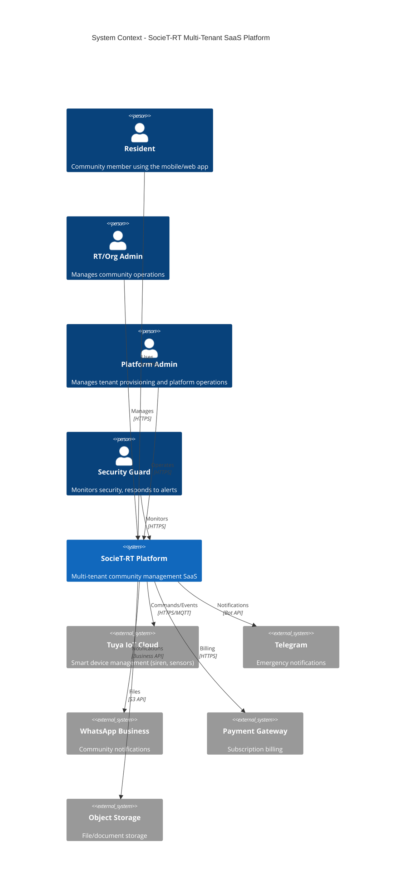

### High-Level Architecture

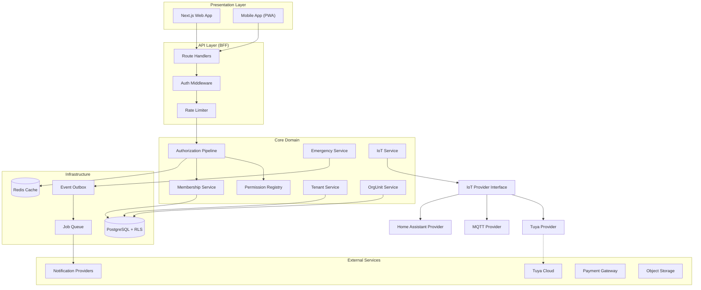

---

## Components and Interfaces

### 1. Tenant Model

**Decision Classification:** LOCKED (L8, L12)

The Tenant is the **primary security boundary** for the entire platform. All tenant-scoped data references the Tenant via `tenant_id`.

```typescript
interface Tenant {
  id: string;                    // UUID
  name: string;
  subdomain: string;             // Unique
  rtRwNumber: string;
  region: string;
  address: string;
  contactPerson: string;
  logoUrl?: string;
  primaryColor?: string;
  secondaryColor?: string;
  sirenDeviceId?: string;
  status: TenantStatus;          // active | suspended (legacy)
  lifecycleStatus: TenantLifecycleStatus;  // PROVISIONING | ACTIVE | SUSPENDED | CLOSING | CLOSED | PURGED
  subscriptionPlanId: string;
  createdAt: Date;
  updatedAt: Date;
}
```

**Key Invariant (INV-TENANT-001):** Tenant-owned records cannot reference another tenant (no cross-tenant FK for tenant-scoped entities).

**References:** Requirements 10, 23, 49

### 2. OrgUnit Hierarchy Model

**Decision Classification:** LOCKED (L4, L7)

OrgUnit represents a node in a tenant's organizational hierarchy. The hierarchy follows: ORGANIZATION > CLUSTER > RW > RT.

```typescript
interface OrgUnit {
  id: string;                    // UUID (deterministic via UUIDv5)
  tenantId: string;              // FK to Tenant
  parentId: string | null;       // Self-referential FK (canonical)
  type: OrgUnitType;             // ORGANIZATION | CLUSTER | RW | RT
  name: string;
  path: string[];                // Materialized path for query optimization
  depth: number;                 // Derived: path.length - 1
  createdAt: Date;
  updatedAt: Date;
}

enum OrgUnitType {
  ORGANIZATION = 'ORGANIZATION',
  CLUSTER = 'CLUSTER',
  RW = 'RW',
  RT = 'RT'
}
```

**OrgUnit Hierarchy Example:**

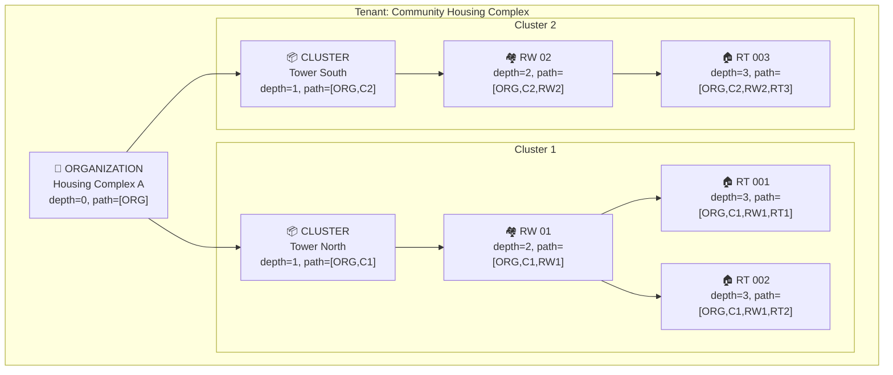

**Hierarchy Invariants:**

| ID | Invariant | Enforcement |
|----|-----------|-------------|
| INV-ORG-001 | OrgUnit parent must belong to same tenant | Composite FK + application |
| INV-ORG-002 | OrgUnit hierarchy cannot contain cycles | Application service |
| INV-ORG-003 | depth = path.length - 1 | Application service |
| INV-ORG-004 | Root OrgUnit has parentId=NULL, depth=0, path=[id] | Application service |

**M1/M2 Frozen State:**
- **2 OrgUnits created:** rt01 root `2459b0bb-115e-52ce-88cd-c176a9aa1e39`, rt02 root `50197f3e-5ebc-5547-91ba-e54b604e0edb` (L1)
- **UUIDv5 Namespace:** `f0e1d2c3-b4a5-5968-8776-655443322110` (L4)
- **Canonical Name Format:** `societ-rt:orgunit:legacy-tenant-root:<tenant_id>`

**References:** Requirements 21, 46

### 3. Membership Model

**Decision Classification:** LOCKED (L2, L5, L6)

Membership links a User to a Tenant with a role, replacing the legacy `User.tenantId` 1:1 relationship.

```typescript
interface Membership {
  id: string;
  userId: string;                // FK to User
  tenantId: string;              // FK to Tenant
  orgUnitId: string | null;      // FK to OrgUnit (NULL only for tenant-level admins)
  role: MembershipRole;
  status: MembershipStatus;
  createdAt: Date;
  updatedAt: Date;
  revokedAt?: Date;
}

enum MembershipRole {
  PLATFORM_ADMIN = 'PLATFORM_ADMIN',
  TENANT_OWNER = 'TENANT_OWNER',
  ORG_ADMIN = 'ORG_ADMIN',
  RT_ADMIN = 'RT_ADMIN',
  SECURITY = 'SECURITY',
  RESIDENT = 'RESIDENT'
}

enum MembershipStatus {
  INVITED = 'INVITED',
  ACTIVE = 'ACTIVE',
  SUSPENDED = 'SUSPENDED',
  REVOKED = 'REVOKED'
}
```

**Role Mapping (LOCKED - L5):**

| Legacy UserRole | Target MembershipRole |
|-----------------|----------------------|
| Super_Admin | PLATFORM_ADMIN |
| Ketua_RT | RT_ADMIN |
| Pengurus | ORG_ADMIN |
| Warga | RESIDENT |
| Security_Guard | SECURITY |

**Membership Invariants:**

| ID | Invariant | Enforcement |
|----|-----------|-------------|
| INV-MEM-001 | Membership OrgUnit belongs to Membership tenant | Composite FK |
| INV-MEM-002 | Tenant-level membership (PLATFORM_ADMIN, TENANT_OWNER) has orgUnitId=NULL | Application |
| INV-MEM-003 | Org-scoped roles require valid orgUnitId | Application |

**M1/M2 Frozen State:**
- **16 Memberships:** 3 platform PLATFORM_ADMIN (tenant-level) + 13 RT org-scoped (L2)
- **Non-admin RT users are org-scoped** to RT root OrgUnit (NOT tenant-wide null) (L6)

**Membership Resolution Flow:**

The membership resolution system supports users with multiple memberships, including multiple memberships within the same tenant (e.g., a user who is both ORG_ADMIN at one OrgUnit and RT_ADMIN at another).

#### Resolution Key Structure

```typescript
/**
 * MembershipResolutionKey - Used to uniquely identify which membership to resolve
 * The combination of (userId, activeTenantId, activeOrgUnitId) determines the specific membership
 */
interface MembershipResolutionKey {
  userId: string;
  activeTenantId: string;
  activeOrgUnitId: string | null;  // null ONLY for tenant-level admins (PLATFORM_ADMIN, TENANT_OWNER)
}

/**
 * AuthorizationContext - Resolved server-side for every protected request
 * CRITICAL: membershipId is NEVER accepted from JWT - always resolved server-side
 */
interface AuthorizationContext {
  userId: string;
  tenantId: string;
  membershipId: string;           // RESOLVED server-side, NEVER from JWT
  orgUnitId: string | null;
  role: MembershipRole;
  permissions: Set<string>;
  tokenVersion: number;
}
```

#### Multi-Membership Resolution Behavior Matrix

| Scenario | Resolution Strategy | Error Code (if fails) |
|----------|---------------------|----------------------|
| **One membership** | Direct match on (userId, tenantId) | AUTH_NO_MEMBERSHIP |
| **Multiple tenants** | activeTenantId selects tenant | CONTEXT_SWITCH_INVALID |
| **Multiple memberships in one tenant** | activeOrgUnitId distinguishes memberships | AUTH_MEMBERSHIP_CONTEXT_INVALID |
| **Tenant-level membership** | activeOrgUnitId = null, role ∈ {PLATFORM_ADMIN, TENANT_OWNER} | AUTH_INVALID_SCOPE |
| **Org-scoped membership** | activeOrgUnitId must match membership.orgUnitId | AUTH_OUT_OF_SCOPE |
| **Invalid/stale context** | Context doesn't match any valid membership | AUTH_MEMBERSHIP_CONTEXT_INVALID |
| **Revoked membership** | Membership.status = REVOKED | AUTH_MEMBERSHIP_INACTIVE |
| **Suspended membership** | Normal ops blocked; safety-critical allowed (L10) | AUTH_MEMBERSHIP_INACTIVE (non-emergency) |

#### Resolution Flow Diagram

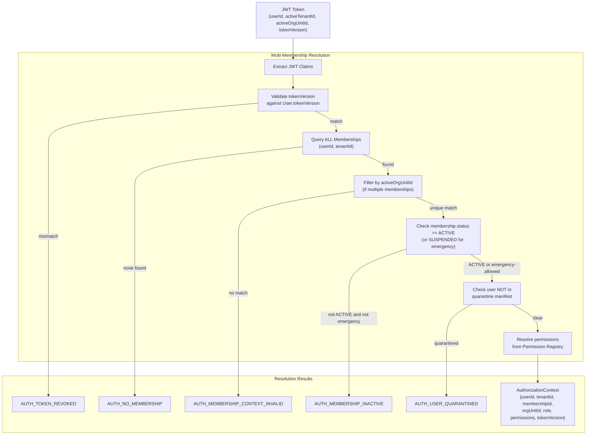

#### membershipId Resolution Rules

**CRITICAL:** `membershipId` is NEVER accepted from the JWT token. The server MUST resolve `membershipId` on every request using the resolution key.

```typescript
async function resolveMembership(
  userId: string,
  activeTenantId: string,
  activeOrgUnitId: string | null
): Promise<Membership | null> {
  // Query all active memberships for user in tenant
  const memberships = await db.membership.findMany({
    where: {
      userId,
      tenantId: activeTenantId,
      status: { in: ['ACTIVE', 'SUSPENDED'] }  // SUSPENDED allowed for emergency check
    }
  });
  
  if (memberships.length === 0) {
    return null;  // AUTH_NO_MEMBERSHIP
  }
  
  if (memberships.length === 1) {
    // Single membership - verify orgUnitId matches or is valid
    const membership = memberships[0];
    if (activeOrgUnitId === null) {
      // Tenant-level membership requires tenant-level role
      if (!['PLATFORM_ADMIN', 'TENANT_OWNER'].includes(membership.role)) {
        return null;  // AUTH_MEMBERSHIP_CONTEXT_INVALID
      }
    } else if (membership.orgUnitId !== activeOrgUnitId) {
      return null;  // AUTH_OUT_OF_SCOPE
    }
    return membership;
  }
  
  // Multiple memberships - activeOrgUnitId MUST distinguish
  if (activeOrgUnitId === null) {
    // Only tenant-level memberships qualify
    const tenantLevelMembership = memberships.find(
      m => m.orgUnitId === null && ['PLATFORM_ADMIN', 'TENANT_OWNER'].includes(m.role)
    );
    return tenantLevelMembership || null;  // AUTH_MEMBERSHIP_CONTEXT_INVALID if none
  }
  
  // Find membership matching the activeOrgUnitId
  const matchingMembership = memberships.find(m => m.orgUnitId === activeOrgUnitId);
  return matchingMembership || null;  // AUTH_MEMBERSHIP_CONTEXT_INVALID if none
}
```

#### Context Switch Validation

When a user requests to switch active context:

```typescript
async function validateContextSwitch(
  userId: string,
  targetTenantId: string,
  targetOrgUnitId: string | null
): Promise<{ valid: boolean; errorCode?: string }> {
  // 1. Verify user has ACTIVE membership in target tenant
  const membership = await resolveMembership(userId, targetTenantId, targetOrgUnitId);
  
  if (!membership) {
    return { valid: false, errorCode: 'CONTEXT_SWITCH_INVALID' };
  }
  
  // 2. Verify membership status allows context switch
  if (membership.status !== 'ACTIVE') {
    return { valid: false, errorCode: 'AUTH_MEMBERSHIP_INACTIVE' };
  }
  
  // 3. For org-scoped switch, verify OrgUnit belongs to tenant
  if (targetOrgUnitId !== null) {
    const orgUnit = await db.orgUnit.findUnique({ where: { id: targetOrgUnitId } });
    if (!orgUnit || orgUnit.tenantId !== targetTenantId) {
      return { valid: false, errorCode: 'CONTEXT_SWITCH_INVALID' };
    }
  }
  
  return { valid: true };
}
```

**References:** Requirements 1, 3, 4, 22

### 4. JWT Structure

**Decision Classification:** DESIGN_DECISION (D1, D3)

JWT carries identity and context only. Authorization is resolved server-side.

```typescript
interface JWTClaims {
  sub: string;              // userId
  activeTenantId: string;   // Current active tenant
  activeOrgUnitId: string | null;  // Current active OrgUnit (null for tenant-level admins)
  tokenVersion: number;     // For forced invalidation
  iat: number;              // Issued at timestamp
  exp: number;              // Expiration timestamp (15 minutes)
}
```

**JWT Rules (INV-AUTH-001):**
- JWT claims are **NOT** authorization authority
- Role and permissions are **never** stored in JWT
- Authorization resolved from Membership and Permission Registry server-side

**Token Flow:**

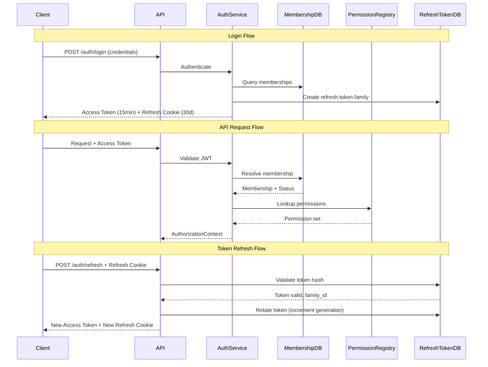

**References:** Requirements 44

### 5. Refresh Token System

**Decision Classification:** DESIGN_DECISION (D2)

Secure refresh token implementation with reuse detection.

```typescript
interface RefreshToken {
  id: string;
  userId: string;
  tokenHash: string;           // SHA-256 of actual token
  familyId: string;            // Stable across rotations
  generation: number;          // Increments on each rotation
  issuedAt: Date;
  expiresAt: Date;             // 30 days default
  revokedAt?: Date;
  replacedBy?: string;
  userAgent?: string;
  ip?: string;
}
```

**Refresh Token Properties:**
- Opaque random 256-bit (NOT JWT)
- Stored as SHA-256 hash (never store plaintext)
- HttpOnly + Secure + SameSite=Strict cookie
- familyId remains **stable** across all rotations within same family
- generation increments **monotonically** on each rotation

**Reuse Detection:**
- If a revoked token is used → **revoke entire family**
- Return error code `AUTH_TOKEN_REUSE_DETECTED`

**References:** Requirements 14, 16

### 6. Token Versioning

**Decision Classification:** VALIDATION_TARGET (V4)

Force-invalidation mechanism for security incidents.

```typescript
interface User {
  // ... other fields
  tokenVersion: number;        // Default 0, increment to invalidate all tokens
}
```

**Operations:**
- Single-user force logout: `incrementTokenVersion(userId)`
- Tenant-wide force logout: `incrementTokenVersionForTenant(tenantId)`
- Both operations also revoke all refresh tokens

**Validation Rule:** JWT tokenVersion MUST exactly equal User.tokenVersion. Any mismatch (less than, greater than, missing, or malformed) results in `AUTH_TOKEN_REVOKED`.

**References:** Requirements 15

### 7. Authorization Pipeline

**Decision Classification:** LOCKED (INV-AUTH-002)

8-step authorization pipeline executed for every protected request.

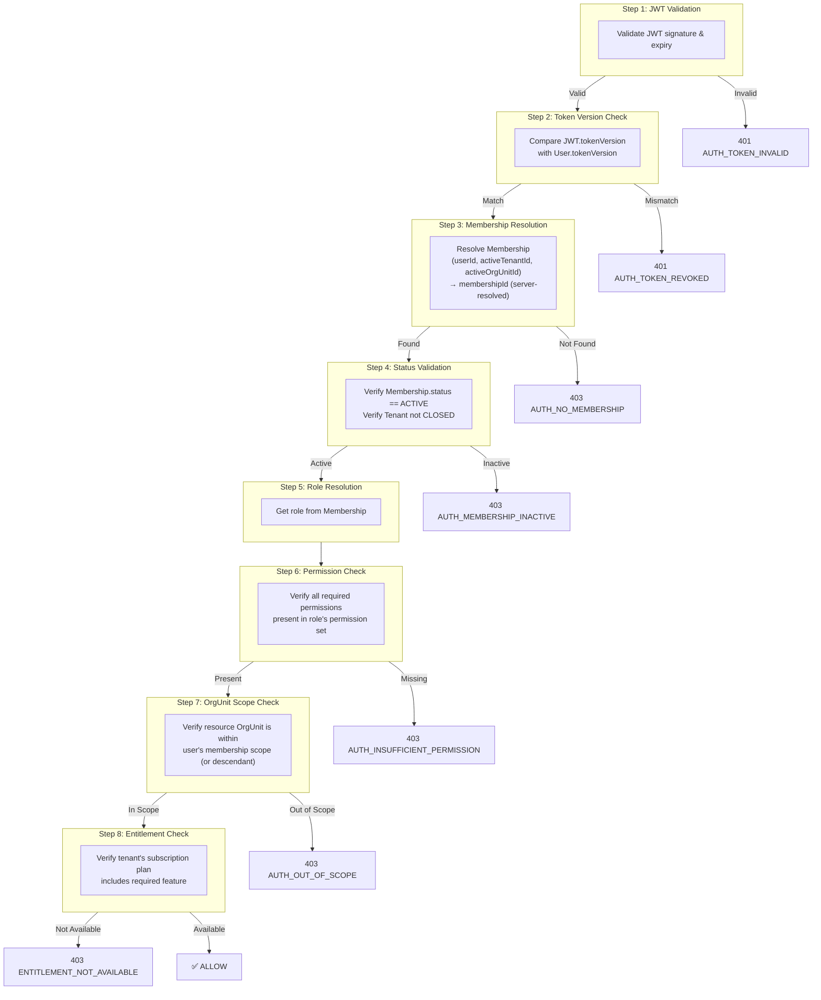

**Authorization fails closed (INV-AUTH-002):** When authoritative context cannot be resolved, access is denied.

**References:** Requirements 3, 5, 6, 19

### 8. Permission Registry

**Decision Classification:** DESIGN_DECISION (D5)

Central configuration mapping roles to explicit permission sets. No inheritance between roles.

```typescript
interface PermissionRegistry {
  // Permission format: {domain}:{action}
  permissions: Map<string, Permission>;
  rolePermissions: Map<MembershipRole, Set<string>>;
}

// Example permissions
const PERMISSIONS = {
  'resident:read': { domain: 'resident', action: 'read' },
  'resident:write': { domain: 'resident', action: 'write' },
  'finance:read': { domain: 'finance', action: 'read' },
  'finance:write': { domain: 'finance', action: 'write' },
  'emergency:create': { domain: 'emergency', action: 'create' },
  'announcement:publish': { domain: 'announcement', action: 'publish' },
  'iot:command': { domain: 'iot', action: 'command' },
  'tenant:manage': { domain: 'tenant', action: 'manage' },
  'membership:delegate': { domain: 'membership', action: 'delegate' },
  // ... more permissions
} as const;

// Role → Permission mapping (EXPLICIT, NO inheritance)
const ROLE_PERMISSIONS: Record<MembershipRole, string[]> = {
  // PLATFORM_ADMIN: Explicit platform-level permissions only
  // NOTE: PLATFORM_ADMIN has NO implicit tenant data access
  // Cross-tenant operations require Privileged Execution Path (L11)
  PLATFORM_ADMIN: [
    'platform:config:read',           // Read platform configuration
    'platform:config:write',          // Modify platform configuration
    'platform:audit:read',            // Read platform-wide audit logs
    'platform:tenant:provision',      // Create new tenants
    'platform:tenant:suspend',        // Suspend tenant operations
    'platform:tenant:terminate',      // Initiate tenant termination
    'platform:subscription:manage',   // Manage subscription plans
    'platform:anomaly:review',        // Review quarantined anomalies
    'platform:anomaly:remediate'      // Remediate anomalies (with approval workflow)
  ],
  TENANT_OWNER: [
    'tenant:manage', 'membership:delegate', 'finance:read', 'finance:write',
    'resident:read', 'resident:write', 'announcement:publish', 'iot:command'
  ],
  ORG_ADMIN: [
    'membership:delegate', 'finance:read', 'finance:write',
    'resident:read', 'resident:write', 'announcement:publish'
  ],
  RT_ADMIN: [
    'membership:delegate', 'finance:read', 'finance:write',
    'resident:read', 'resident:write', 'announcement:publish', 'iot:command'
  ],
  SECURITY: [
    'resident:read', 'emergency:create', 'patrol:manage', 'incident:report'
  ],
  RESIDENT: [
    'resident:read', 'emergency:create', 'announcement:read', 'vote:cast'
  ]
};

/**
 * PLATFORM_ADMIN Tenant Access Rules
 * 
 * PLATFORM_ADMIN cannot access tenant data directly through normal API paths.
 * To access tenant data, PLATFORM_ADMIN must use the Privileged Execution Path which requires:
 * 
 * 1. EXPLICIT OPERATION - Must be an allowlisted operation type
 * 2. EXPLICIT TENANT(S) - Must specify which tenant(s) are affected
 * 3. DOCUMENTED REASON - Must provide justification for the operation
 * 4. STEP-UP AUTH - Fresh authentication required for human actors
 * 5. TRANSACTION SCOPE - Automatically cleared after operation completes
 * 6. IMMUTABLE AUDIT - Full audit trail with tamper detection
 * 7. SECURITY TELEMETRY - Alert emitted for all privileged executions
 * 
 * This ensures PLATFORM_ADMIN is NOT a superuser with implicit access to all tenant data.
 * See Privileged Execution Path (Section 12) and Locked Decision L11.
 */
```

**Key Rules:**
- SECURITY and RESIDENT have **distinct** capability sets (not hierarchy levels)
- Unknown permission check → fail closed with logging
- Registry loaded at startup, **immutable** during runtime

**References:** Requirements 2

### 9. Delegation Matrix

**Decision Classification:** LOCKED (L9)

Explicit configuration of which roles can grant which other roles.

```typescript
const DELEGATION_MATRIX: Record<MembershipRole, MembershipRole[]> = {
  PLATFORM_ADMIN: [],  // Platform operations only, not delegation
  TENANT_OWNER: [MembershipRole.ORG_ADMIN, MembershipRole.RT_ADMIN, MembershipRole.SECURITY, MembershipRole.RESIDENT],
  ORG_ADMIN: [MembershipRole.RT_ADMIN, MembershipRole.SECURITY, MembershipRole.RESIDENT],
  RT_ADMIN: [MembershipRole.SECURITY, MembershipRole.RESIDENT],
  SECURITY: [],
  RESIDENT: []
};
```

**Rules:**
- Delegation is via **explicit matrix**, NOT permission counting
- No role can grant PLATFORM_ADMIN (platform-level operation only)
- No role can grant TENANT_OWNER (requires explicit ownership transfer flow)
- Delegator's membership must be ACTIVE
- Target OrgUnit must be within delegator's scope (or descendant)

**Violation → `AUTH_DELEGATION_VIOLATION`**

**References:** Requirements 25

### 10. Three Authorization Axes

Authorization evaluates three independent dimensions:

| Axis | Question | Source |
|------|----------|--------|
| **Role/Permission** | What actions can the user perform? | Membership.role → Permission Registry |
| **Org Scope** | Which OrgUnits can the user access? | Membership.orgUnitId + descendants |
| **Entitlement** | Which features does the tenant have? | Subscription.plan → Feature entitlements |

All three must pass for access to be granted.

**References:** Requirements 5, 6, 19

### 10.1 Resource Scope Matrix

The Resource Scope Matrix defines access boundaries for all resource operations, including the critical USER_SELF scope.

#### Scope Definitions

| Scope | Code | Description | Example Operations |
|-------|------|-------------|-------------------|
| **GLOBAL** | G | Platform-wide shared data | Read subscription plans, feature flags |
| **TENANT** | T | All data within a tenant | Tenant settings, announcements (tenant-wide) |
| **ORG_UNIT** | O | OrgUnit subtree within tenant | Residents within OrgUnit scope |
| **HOUSEHOLD** | H | Household members only | Household head managing dependents |
| **USER_SELF** | S | User's own data only | View own profile, own emergency history |

#### Scope Hierarchy

```
GLOBAL (G) - No tenant boundary
    └── TENANT (T) - tenant_id filter
          └── ORG_UNIT (O) - tenant_id + orgUnit scope filter
                └── HOUSEHOLD (H) - tenant_id + household membership filter
                      └── USER_SELF (S) - user_id = current user only
```

#### Resource Scope Classification

| Resource Type | Scope | Authorization Check |
|--------------|-------|---------------------|
| Subscription Plans | GLOBAL | Authenticated user |
| Feature Flags | GLOBAL | Authenticated user |
| Tenant Settings | TENANT | Permission `tenant:manage` |
| Announcements (tenant-wide) | TENANT | Permission `announcement:publish` |
| OrgUnit Management | TENANT | Permission `orgunit:manage` |
| Residents | ORG_UNIT | Permission `resident:read` + OrgUnit scope |
| Households | ORG_UNIT | Permission `household:manage` + OrgUnit scope |
| Financial Transactions | ORG_UNIT | Permission `finance:read` + OrgUnit scope |
| Household Members | HOUSEHOLD | Household head OR admin with scope |
| User Profile (own) | USER_SELF | Always allowed for own data |
| Emergency History (own) | USER_SELF | Always allowed for own data |
| Notification Preferences (own) | USER_SELF | Always allowed for own data |

#### Critical: RESIDENT Role Scope Clarification

**IMPORTANT:** A user with RESIDENT role and `resident:read` permission can ONLY read their own data (USER_SELF scope), NOT all residents in the RT.

```typescript
// WRONG interpretation
const allResidentsInRT = await getResidents(authContext); // ❌ RESIDENT cannot do this

// CORRECT interpretation
if (authContext.role === 'RESIDENT') {
  // RESIDENT can only access their own household and personal data
  const ownProfile = await getOwnProfile(authContext.userId); // ✅
  const ownHousehold = await getOwnHousehold(authContext.userId); // ✅
}

// Admin roles (RT_ADMIN, ORG_ADMIN, TENANT_OWNER) can read residents within scope
if (['RT_ADMIN', 'ORG_ADMIN', 'TENANT_OWNER'].includes(authContext.role)) {
  const residentsInScope = await getResidentsInOrgUnitScope(authContext); // ✅
}
```

#### Permission + Scope Matrix

| Permission | PLATFORM_ADMIN | TENANT_OWNER | ORG_ADMIN | RT_ADMIN | SECURITY | RESIDENT |
|------------|----------------|--------------|-----------|----------|----------|----------|
| `resident:read` | — | TENANT | ORG_UNIT | ORG_UNIT | ORG_UNIT | **USER_SELF** |
| `finance:read` | — | TENANT | ORG_UNIT | ORG_UNIT | — | — |
| `announcement:publish` | — | TENANT | ORG_UNIT | ORG_UNIT | — | — |
| `emergency:create` | — | — | — | — | ORG_UNIT | **USER_SELF** |
| `platform:*` | GLOBAL | — | — | — | — | — |

**Note:** PLATFORM_ADMIN has GLOBAL scope only for platform operations, NOT implicit TENANT/ORG_UNIT scope for tenant data. Cross-tenant access requires Privileged Execution Path (L11).

**References:** Requirements 26, INV-AUTH-001

### 11. RLS Foundation

**Decision Classification:** LOCKED (L11)

PostgreSQL Row-Level Security policies enforce tenant isolation at the database layer. **No generic bypass mechanism.**

```sql
-- Enable RLS on TENANT_OWNED tables (NOT users - it is GLOBAL_IDENTITY)
-- NOTE: users table MUST NOT receive tenant RLS in target architecture
ALTER TABLE memberships ENABLE ROW LEVEL SECURITY;
ALTER TABLE org_units ENABLE ROW LEVEL SECURITY;
ALTER TABLE households ENABLE ROW LEVEL SECURITY;
ALTER TABLE residents ENABLE ROW LEVEL SECURITY;
ALTER TABLE tenants ENABLE ROW LEVEL SECURITY;
ALTER TABLE announcements ENABLE ROW LEVEL SECURITY;
ALTER TABLE votes ENABLE ROW LEVEL SECURITY;
ALTER TABLE financial_transactions ENABLE ROW LEVEL SECURITY;
ALTER TABLE emergency_alerts ENABLE ROW LEVEL SECURITY;
ALTER TABLE iot_devices ENABLE ROW LEVEL SECURITY;
-- ... and all other TENANT_OWNED tables

-- RLS Policy Pattern (example: memberships)
CREATE POLICY tenant_isolation ON memberships
  USING (tenant_id = current_setting('app.current_tenant_id')::uuid)
  WITH CHECK (tenant_id = current_setting('app.current_tenant_id')::uuid);

-- Session variable must be set before queries
SET LOCAL app.current_tenant_id = '<tenant_uuid>';
```

**CRITICAL: users table MUST NOT have tenant RLS.**
- `users` is classified as `GLOBAL_IDENTITY`
- Access to user data is authorized via Membership lookup (see Section 3.1)
- `User.tenantId` remains as legacy transitional evidence only

**RLS Rules:**
- Session variable `app.current_tenant_id` required for all queries
- If not set → **deny all access** (fail closed)
- No `is_platform_admin` session flag for bypass
- Cross-tenant operations require **explicit privileged execution path**

**Tables WITHOUT RLS:**

| Table | Classification | Reason |
|-------|----------------|--------|
| `users` | GLOBAL_IDENTITY | User is global identity; access authorized via Membership |
| `subscription_plans` | PLATFORM_SHARED | Read-all lookup for authenticated users |
| `feature_flags` | PLATFORM_SHARED | Read-all lookup for authenticated users |

**User.tenantId is LEGACY TRANSITIONAL ONLY** — it is evidence for migration remediation, NOT authorization authority.

**References:** Requirements 10, 60

### 12. Privileged Execution Path

**Decision Classification:** LOCKED (L11)

Narrow capability for cross-tenant operations. NOT a superuser switch.

```typescript
interface PrivilegedExecutionContext {
  operationType: AllowlistedOperation;   // Must be in allowlist
  affectedTenants: string[];             // Explicit list required
  operatorId: string;                    // Who is executing
  reason: string;                        // Documented justification
  stepUpVerified: boolean;               // Re-authentication required for human actors
  timeoutMs: number;                     // Default 30 seconds
}

enum AllowlistedOperation {
  CROSS_TENANT_REPORT = 'CROSS_TENANT_REPORT',
  PLATFORM_AUDIT = 'PLATFORM_AUDIT',
  TENANT_MIGRATION = 'TENANT_MIGRATION',
  ANOMALY_REMEDIATION = 'ANOMALY_REMEDIATION'
}
```

**Rules:**
- **NOT** a generic RLS bypass flag
- **NOT** available via public API endpoints
- Requires explicit invocation with allowlisted operation
- Requires specification of affected tenant(s)
- Requires step-up authentication for human actors
- Transaction-scoped, automatically cleared after operation
- All operations logged with full audit trail
- Emits security alert

**References:** Requirements 43

### 13. OrgUnit Path Integrity

**Decision Classification:** LOCKED (L7)

Path and depth are derived fields maintained by the hierarchy service.

**Invariants:**
- `depth = path.length - 1` for all OrgUnits
- Root OrgUnits: `depth = 0`, `path = [id]`
- `parentId` is the canonical source of truth
- `path` is optimization for descendant queries

**Operations:**
- Create: Compute path/depth from parent chain
- Move subtree: Update path/depth for all descendants in single transaction
- Repair utility: Fix inconsistent path/depth values

**If path becomes inconsistent:** System continues to function using `parentId` (path is optimization only)

**References:** Requirements 46

---

## Data Models

### Tenant Lifecycle State Machine

**Decision Classification:** LOCKED (L8, L12)

Tenant lifecycle is **separate** from Subscription status.

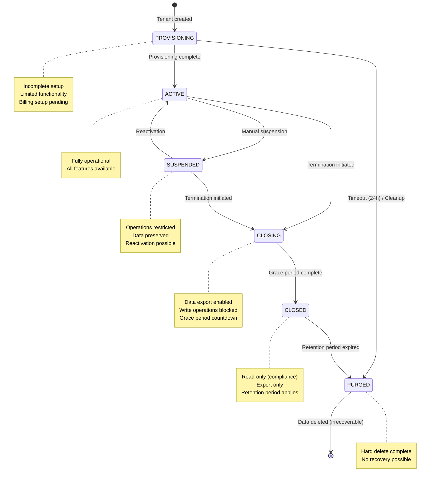

**Transition Rules:**
- No state skipping (e.g., ACTIVE → PURGED forbidden)
- PROVISIONING timeout (24h) → auto-cleanup with notification
- All transitions require explicit API calls with audit logging

**References:** Requirements 49

### Subscription Status State Machine

**Decision Classification:** LOCKED (L12)

Subscription status is **independent** of Tenant lifecycle.

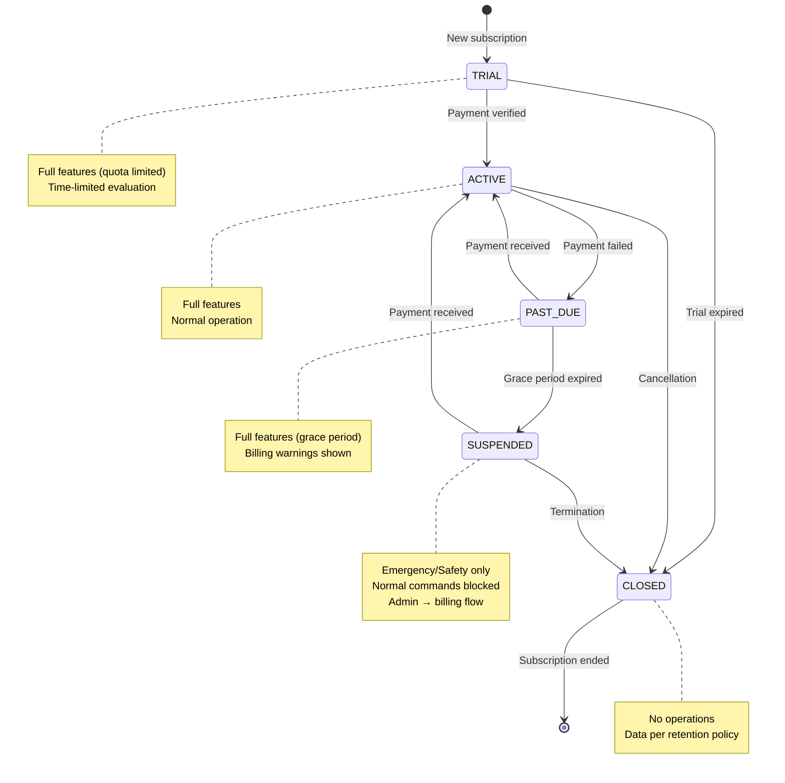

**References:** Requirements 18, 49

### Policy Matrix (Subscription Status × Capability)

| Status \ Capability | READ | INGEST | EMERGENCY_COMMAND | NORMAL_COMMAND | NOTIFICATION | ADMIN_ACCESS |
|---------------------|------|--------|-------------------|----------------|--------------|--------------|
| **TRIAL** | ✅ | ✅ | ✅ | ✅ (quota limited) | ✅ | ✅ |
| **ACTIVE** | ✅ | ✅ | ✅ | ✅ | ✅ | ✅ |
| **PAST_DUE** | ✅ | ✅ | ✅ | ✅ (grace) | ✅ | ✅ (billing warning) |
| **SUSPENDED** | ✅ | ✅ | ✅ | ❌ | ✅ (emergency/billing only) | ⚠️ (billing/recovery only) |
| **CLOSED** | ⚠️ (retention/audit) | ⚠️ (per retention) | ❌ | ❌ | ❌ | ⚠️ (export/offboarding only) |

**References:** Requirements 19, 20

### Safety-Critical Operations

**Decision Classification:** LOCKED (L10)

Emergency operations must work during subscription suspension.

**Subscription Boundary:** Emergency bypass applies to SUSPENDED subscription status, NOT to CLOSED. Per the Policy Matrix, CLOSED subscriptions have EMERGENCY_COMMAND = ❌.

```typescript
const SAFETY_CRITICAL_OPERATIONS = [
  'emergency_alert:create',
  'alarm:trigger',
  'panic_button:activate'
] as const;
```

**Emergency Policy for Membership Status:**

| Membership Status | Emergency Allowed | Notes |
|-------------------|-------------------|-------|
| ACTIVE | ✅ | Normal access |
| SUSPENDED | ✅ | Safety priority + elevated audit |
| INVITED | ❌ | No authenticated session |
| REVOKED | ❌ | No valid membership |

**When SUSPENDED membership triggers emergency:**
- Access granted
- Full context logged
- Administrator alert sent

**References:** Requirements 20

### Emergency Acknowledgement & Escalation

**Decision Classification:** DESIGN_DECISION (D10)

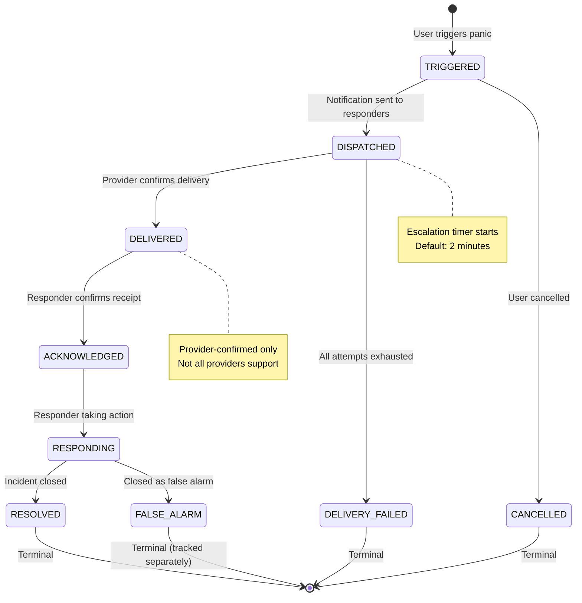

**Escalation Tiers:**
1. On-duty security
2. All security personnel
3. RT_ADMIN
4. ORG_ADMIN
5. TENANT_OWNER

**If no ACK within timeout → escalate to next tier**

**References:** Requirements 57

### IoT Provider Abstraction & Command Lifecycle

**Decision Classification:** DESIGN_DECISION

The IoT subsystem uses a provider abstraction layer to support multiple IoT platforms (Tuya, MQTT, Home Assistant, and future ESP32 direct integration) while maintaining consistent command lifecycle and tenant isolation.

#### Provider Interface

```typescript
/**
 * IoTProvider - Abstract interface for all IoT integrations
 * Provider implementations handle protocol-specific communication
 */
interface IoTProvider {
  connect(): Promise<void>;
  disconnect(): Promise<void>;
  sendCommand(deviceId: string, command: NormalizedCommand): Promise<CommandResult>;
  receiveEvent(callback: (event: NormalizedTelemetry) => void): void;
  healthCheck(): Promise<ProviderHealth>;
  discoverCapabilities(deviceId: string): Promise<DeviceCapabilities>;
}

// Provider Implementations
class TuyaProvider implements IoTProvider { /* Tuya Cloud API */ }
class MQTTProvider implements IoTProvider { /* Generic MQTT */ }
class HomeAssistantProvider implements IoTProvider { /* HA API */ }
// Future: ESP32DirectProvider, ZigbeeProvider, Z-WaveProvider, etc.

enum ProviderType {
  TUYA = 'TUYA',
  MQTT = 'MQTT',
  HOME_ASSISTANT = 'HOME_ASSISTANT',
  ESP32_DIRECT = 'ESP32_DIRECT'  // Future
}
```

#### Normalized Models

```typescript
/**
 * NormalizedDeviceIdentity - Platform-agnostic device identity
 * Decouples internal platform identity from provider-specific identifiers
 */
interface NormalizedDeviceIdentity {
  internalId: string;          // Platform UUID (our system)
  providerId: string;          // Provider-specific ID (e.g., Tuya deviceId)
  providerType: ProviderType;  // Which provider manages this device
  tenantId: string;            // Owning tenant (INV-IOT-001)
  ownerScope: OwnerScope;      // Scope level of ownership
  ownerId: string;             // ID of owning entity within scope
}

enum OwnerScope {
  TENANT = 'TENANT',           // Tenant-wide device (e.g., community alarm)
  ORG_UNIT = 'ORG_UNIT',       // OrgUnit-scoped device (e.g., building entrance)
  HOUSEHOLD = 'HOUSEHOLD'       // Household device (e.g., smart lock)
}

/**
 * NormalizedCommand - Provider-agnostic command representation
 * Provider implementations translate to native protocol
 */
interface NormalizedCommand {
  type: CommandType;           // Standardized command type
  parameters: Record<string, unknown>;
}

enum CommandType {
  TURN_ON = 'TURN_ON',
  TURN_OFF = 'TURN_OFF',
  SET_VALUE = 'SET_VALUE',     // e.g., brightness, temperature
  GET_STATUS = 'GET_STATUS'
}

/**
 * CommandResult - Lifecycle tracking for issued commands
 */
interface CommandResult {
  commandId: string;
  status: CommandStatus;
  providerResponse?: unknown;  // Raw provider response for debugging
  verifiedAt?: Date;           // When physical state was confirmed
}

enum CommandStatus {
  DESIRED = 'DESIRED',           // User intent recorded
  DISPATCHED = 'DISPATCHED',     // Command sent to provider
  ACK_RECEIVED = 'ACK_RECEIVED', // Provider acknowledged (NOT physical success)
  VERIFIED = 'VERIFIED',         // Physical state confirmed via readback
  FAILED = 'FAILED',             // Execution failed
  TIMEOUT = 'TIMEOUT'            // No acknowledgement within window
}

/**
 * NormalizedTelemetry - Provider-agnostic device events
 */
interface NormalizedTelemetry {
  deviceId: string;
  eventType: string;
  payload: Record<string, unknown>;
  occurredAt: Date;            // Device timestamp (informational only)
  receivedAt: Date;            // Server timestamp (authoritative for ordering)
}
```

#### IoT Ownership Scope Matrix

| Scope | Owner Entity | Access Control | Examples |
|-------|--------------|----------------|----------|
| TENANT | Tenant | All tenant admins | Community siren, gate system |
| ORG_UNIT | OrgUnit | Admins with OrgUnit scope | Building entrance, floor sensors |
| HOUSEHOLD | Household | Household head + authorized admins | Smart lock, doorbell camera |

**INV-IOT-001:** Device.tenantId MUST equal Owner.tenantId (regardless of ownership scope)

#### Command Lifecycle State Machine

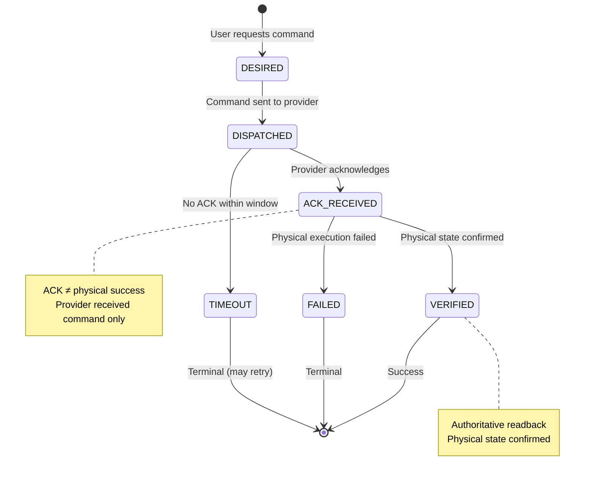

#### Command Lifecycle Rules

1. **ACK_RECEIVED ≠ Physical Success:** Provider acknowledgement only confirms the provider/device received the command, not that the physical action succeeded
2. **Late ACK Handling:** ACK arriving after command is already in FAILED/TIMEOUT state is logged but does NOT change state (terminal states are final)
3. **State Reconciliation:** Safety devices (alarms, door sensors, relays, sirens) MUST reconcile actual physical state against desired state on device reconnect
4. **Command Deduplication:** Same command within short window (configurable, default 5s) returns existing command status instead of creating new command
5. **Offline Handling:** Commands to offline devices are queued for configurable duration; reconciliation occurs on reconnect

#### Provider Credential Ownership

**Decision Classification:** DESIGN_DECISION (D14)

The platform supports two credential ownership modes to accommodate both standard SaaS integrations and enterprise/private deployments:

```typescript
enum ProviderCredentialOwnership {
  PLATFORM_MANAGED = 'PLATFORM_MANAGED',  // Platform-owned credentials
  TENANT_MANAGED = 'TENANT_MANAGED'        // Tenant-owned credentials
}

interface ProviderConfiguration {
  id: string;
  providerType: ProviderType;
  ownershipMode: ProviderCredentialOwnership;
  tenantId: string | null;           // null for PLATFORM_MANAGED
  credentials: EncryptedCredentials; // AES-256 encrypted at rest
  routingConfig?: ProviderRoutingConfig;
  createdAt: Date;
  rotatedAt?: Date;
}

interface ProviderRoutingConfig {
  // Provider-specific routing metadata for multi-tenant scenarios
  tenantIdentifierField?: string;
  deviceRoutingStrategy?: 'BY_DEVICE_ID' | 'BY_TENANT_PREFIX';
}
```

**Ownership Mode Rules:**

| Mode | Credentials Owner | tenantId | Use Case |
|------|------------------|----------|----------|
| **PLATFORM_MANAGED** | SocieT-RT Platform | `null` | Standard SaaS integrations (e.g., centralized Tuya Cloud) |
| **TENANT_MANAGED** | Specific Tenant | Required | Enterprise/private/BYO integrations |

**PLATFORM_MANAGED Rules:**
- Credentials are owned and operated by SocieT-RT platform
- Multiple tenants MAY use the same provider integration
- Tenant/device routing MUST still preserve tenant isolation
- Provider credentials MUST NOT imply cross-tenant data access
- All commands and telemetry MUST resolve tenant ownership before processing
- Tenant authorization remains enforced before any device command

**TENANT_MANAGED Rules:**
- Credentials belong to exactly one tenant
- Intended for enterprise/private/BYO integrations
- Credentials MUST NOT be usable by another tenant
- tenantId is REQUIRED and immutable after creation

**CRITICAL: Credential Ownership ≠ Device Ownership**

IoT credential ownership mode is independent of device ownership scope:

| Concern | Scope | Invariant |
|---------|-------|-----------|
| **Credential Ownership** | Platform or Tenant | D14 |
| **Device Ownership** | TENANT, ORG_UNIT, or HOUSEHOLD | INV-IOT-001 |

Regardless of which credential mode is used:
- **INV-IOT-001 PRESERVED:** Device.tenantId MUST equal Owner.tenantId
- Device ownership scopes (TENANT, ORG_UNIT, HOUSEHOLD) remain unchanged
- Authorization checks tenant ownership before command dispatch
- Telemetry events are routed to correct tenant based on device registration

**References:** Requirements 34, 58, INV-IOT-001

### Quarantine Manifest

**Decision Classification:** LOCKED (L3)

5 platform anomalies explicitly quarantined.

| Alias | User ID | Tenant | Legacy Role | Category |
|-------|---------|--------|-------------|----------|
| PNA-01 | `00000000-0000-0000-0000-000000000021` | platform | Ketua_RT | mis-tenanted-rt-role:has-activity |
| PNA-02 | `00000000-0000-0000-0000-000000000022` | platform | Pengurus | mis-tenanted-rt-role:inactive |
| PNA-03 | `00000000-0000-0000-0000-000000000023` | platform | Warga | mis-tenanted-rt-role:has-activity |
| PNA-04 | `00000000-0000-0000-0000-000000000024` | platform | Security_Guard | mis-tenanted-rt-role:inactive |
| PNA-05 | `42cc1bea-9a68-44b1-aadf-1bb0bb609028` | platform | Warga | app-registration-style-id:inactive |

**INV-QUARANTINE-001:** Quarantined users cannot receive Membership until explicit remediation.

**References:** Requirements 1, 3, 7, 9, 11

---

## Correctness Properties

*A property is a characteristic or behavior that should hold true across all valid executions of a system—essentially, a formal statement about what the system should do. Properties serve as the bridge between human-readable specifications and machine-verifiable correctness guarantees.*

### Property 1: Active Membership Filter Correctness

*For any* user with memberships of mixed statuses (ACTIVE, SUSPENDED, REVOKED, INVITED), *when* querying for authorization purposes, the Membership Read Model SHALL return *only* memberships with status ACTIVE.

**Validates: Requirements 1.3**

### Property 2: Tenant Filter Subset Property

*For any* user with memberships across multiple tenants, querying memberships *without* a tenant filter SHALL return a superset of (or equal to) querying memberships *with* a tenant filter for any specific tenant.

**Validates: Requirements 1.4**

### Property 3: Quarantine Exclusion

*For any* authorization query against the Membership Read Model, the result set SHALL *never* contain any of the 5 quarantined platform anomaly users (PNA-01 through PNA-05).

**Validates: Requirements 1.7, 3.7**

### Property 4: Explicit Permission Resolution

*For any* role in the Permission Registry, the permission set returned SHALL be *exactly* the set explicitly mapped for that role, with *no* permissions inherited or computed from any other role's mapping.

**Validates: Requirements 2.2, 2.5**

### Property 5: Permission Check Completeness

*For any* route requiring permissions P1, P2, ..., Pn, access SHALL be granted *if and only if* the resolved authorization context contains *all* of P1, P2, ..., Pn.

**Validates: Requirements 5.3**

### Property 6: OrgUnit Scope Containment

*For any* resource with orgUnitId R, and *any* user with membership scoped to orgUnitId M, access SHALL be granted *if and only if* R is equal to M *or* R is a descendant of M in the OrgUnit hierarchy.

**Validates: Requirements 6.2**

### Property 7: Token Version Exact Match

*For any* authenticated request, the JWT tokenVersion claim SHALL exactly equal the authoritative User.tokenVersion stored in the database. If the values are not exactly equal, authorization SHALL fail with `AUTH_TOKEN_REVOKED`.

**Exact Match Semantics:**
```
JWT.tokenVersion === User.tokenVersion  →  CONTINUE
JWT.tokenVersion !== User.tokenVersion  →  AUTH_TOKEN_REVOKED
```

**Rejection Conditions:**
- `JWT.tokenVersion < User.tokenVersion` → Rejected (stale token)
- `JWT.tokenVersion > User.tokenVersion` → Rejected (invalid/tampered)
- `JWT.tokenVersion` missing → Rejected (malformed)
- `JWT.tokenVersion` non-integer → Rejected (malformed)

**Rationale:** Using exact equality (not just `<`) ensures:
1. Tokens cannot claim future versions
2. Malformed tokens are rejected
3. Fail-closed behavior for any mismatch

**Validates: Requirements 15.4**

### Property 8: Refresh Token Family Stability

*For any* refresh token rotation within a token family, the familyId SHALL remain *stable* (unchanged) across all rotations, while the generation counter SHALL increment *monotonically* by exactly 1.

**Validates: Requirements 14.3, 14.4**

### Property 9: Refresh Token Reuse Detection

*For any* refresh token T that has been revoked (revokedAt is set), *if* T is used for refresh, *then* all tokens in the same familyId SHALL be revoked and error `AUTH_TOKEN_REUSE_DETECTED` SHALL be returned.

**Validates: Requirements 14.6**

### Property 10: OrgUnit Hierarchy Depth Invariant

*For all* OrgUnits in the system, `depth` SHALL equal `path.length - 1`.

**Validates: Requirements 21.4, 46.3, INV-ORG-003**

### Property 11: OrgUnit Root Invariant

*For all* root OrgUnits (where parentId is NULL), `depth` SHALL equal 0 and `path` SHALL equal an array containing only the OrgUnit's own id.

**Validates: Requirements 21.9, 46.8, INV-ORG-004**

### Property 12: Same-Tenant Parent Constraint

*For any* OrgUnit O with a non-null parentId P, the parent OrgUnit P.tenantId SHALL equal O.tenantId.

**Validates: Requirements 21.3, INV-ORG-001**

### Property 13: Delegation Matrix Enforcement

*For any* delegation attempt where user D (with role R_D) attempts to grant role R_G to user T, the operation SHALL succeed *if and only if* R_G is contained in the explicit Delegation_Matrix entry for R_D.

**Validates: Requirements 25.2, 25.3**

### Property 14: Emergency Bypass Subscription Status

*For any* safety-critical operation (emergency_alert:create, alarm:trigger, panic_button:activate), the operation SHALL remain eligible during subscription states TRIAL, ACTIVE, PAST_DUE, and SUSPENDED, subject to valid membership and authorization rules.

Subscription status CLOSED SHALL NOT receive the subscription suspension safety bypass. CLOSED represents an ended subscription/offboarding state where EMERGENCY_COMMAND capability is explicitly ❌ per the Policy Matrix.

**Clarification of Emergency Bypass Boundaries:**

| Context | Emergency Allowed | Rationale |
|---------|-------------------|-----------|
| Subscription.status = TRIAL | ✅ | Evaluation period, safety features active |
| Subscription.status = ACTIVE | ✅ | Normal operation |
| Subscription.status = PAST_DUE | ✅ | Grace period, safety preserved |
| Subscription.status = SUSPENDED | ✅ | Billing issue, safety priority (L10) |
| Subscription.status = CLOSED | ❌ | Subscription ended, per Policy Matrix |
| Tenant.lifecycleStatus = CLOSED | ❌ | Tenant offboarding, normal rules apply |
| Tenant.lifecycleStatus = PURGED | ❌ | Tenant deleted, no operations possible |
| Membership.status = SUSPENDED | ✅ | L10: Safety priority with elevated audit |
| Membership.status = REVOKED | ❌ | No valid membership |
| Membership.status = INVITED | ❌ | No authenticated session |

**This property does NOT bypass:**
- Tenant lifecycle checks (CLOSED/PURGED tenants)
- Membership validity requirements
- User quarantine status
- Authorization pipeline steps

**Validates: Requirements 20.2, 20.6, Policy Matrix (CLOSED row)**

### Property 15: Emergency Access for Suspended Membership

*For any* user with SUSPENDED membership status triggering a safety-critical operation, the operation SHALL be allowed with elevated audit logging and administrator notification.

**Validates: Requirements 20.10, 20.11**

### Property 16: RLS Fail-Closed

*For any* database query executed *without* the `app.current_tenant_id` session variable set, the query SHALL return an empty result set (not an error exposing tenant data).

**Validates: Requirements 10.7**

### Property 17: RLS Tenant Isolation

*For any* database query executed with `app.current_tenant_id = T`, the result set SHALL contain *only* rows where `tenant_id = T`.

**Validates: Requirements 10.3**

### Property 18: Idempotency Key Cached Response

*For any* request with idempotency key K and request body B that has previously succeeded, a subsequent request with the same K and B SHALL return the cached response without re-executing the operation.

**Validates: Requirements 39.2**

### Property 19: Idempotency Key Mismatch Rejection

*For any* request with idempotency key K and request body B1, *if* a previous request with the same K but different body B2 (B1 ≠ B2) exists, the request SHALL be rejected with `IDEMPOTENCY_MISMATCH`.

**Validates: Requirements 39.4**

### Property 20: Emergency Escalation Timeout

*For any* emergency in DISPATCHED or DELIVERED state, *if* no ACKNOWLEDGED transition occurs within the escalation timeout (default 2 minutes), the system SHALL escalate to the next tier of responders.

**Validates: Requirements 57.10**

### Property 21: IoT Command Late ACK Handling

*For any* IoT command in FAILED or TIMEOUT state, a late ACK arriving from the provider SHALL *not* change the command state (state remains terminal).

**Validates: Requirements 58.12**

### Property 22: Last Admin Protection

*For any* tenant T with exactly one TENANT_OWNER membership, attempts to demote or revoke that membership SHALL be rejected to prevent the tenant from losing all administrators.

**Validates: Requirements 54.3, 54.4, INV-OWNER-001**

---

## Error Handling

### Authorization Error Codes

| Code | HTTP Status | Description |
|------|-------------|-------------|
| `AUTH_TOKEN_INVALID` | 401 | JWT missing, malformed, or expired |
| `AUTH_TOKEN_REVOKED` | 401 | tokenVersion mismatch |
| `AUTH_TOKEN_REUSE_DETECTED` | 401 | Refresh token reuse attempted |
| `AUTH_NO_MEMBERSHIP` | 403 | No membership in requested tenant |
| `AUTH_MEMBERSHIP_INACTIVE` | 403 | Membership status not ACTIVE |
| `AUTH_INSUFFICIENT_PERMISSION` | 403 | User lacks required permission |
| `AUTH_OUT_OF_SCOPE` | 403 | Resource outside user's OrgUnit scope |
| `AUTH_TENANT_MISMATCH` | 403 | Resource tenant ≠ user's active tenant |
| `AUTH_USER_QUARANTINED` | 403 | User in quarantine manifest |
| `AUTH_DELEGATION_VIOLATION` | 403 | Privilege escalation via delegation |
| `AUTH_HOUSEHOLD_MISMATCH` | 403 | Access to another household |
| `AUTH_REAUTH_REQUIRED` | 403 | Step-up authentication required |
| `TENANT_SUSPENDED` | 403 | Tenant subscription suspended |
| `ENTITLEMENT_NOT_AVAILABLE` | 403 | Feature not in subscription plan |
| `CONTEXT_SWITCH_INVALID` | 400 | Invalid tenant or OrgUnit switch |
| `CONFLICT_DETECTED` | 409 | TOCTOU race condition |
| `IDEMPOTENCY_MISMATCH` | 409 | Idempotency key reused with different body |
| `WEBHOOK_SIGNATURE_INVALID` | 401 | Webhook signature verification failed |
| `INVALID_STATUS_TRANSITION` | 400 | Invalid state machine transition |
| `PLAN_HAS_SUBSCRIBERS` | 400 | Cannot delete plan with active subscribers |

### Error Response Format

```typescript
interface ErrorResponse {
  code: string;           // Machine-readable error code
  message: string;        // Human-readable message (safe for user)
  correlationId: string;  // Request tracking ID
  // NEVER include: stack traces, internal details, PII
}
```

**References:** Requirements 47

---

## Testing Strategy

### Test Pyramid

1. **Unit Tests** (Majority)
   - Permission Registry mapping
   - Delegation Matrix validation
   - Token version comparison
   - Path/depth calculation
   - Error code mapping

2. **Integration Tests** (Boundary testing)
   - RLS policy enforcement
   - Membership resolution
   - Authorization pipeline E2E
   - Token refresh flow
   - Cache invalidation

3. **Property-Based Tests** (Universal properties)
   - All 22 correctness properties above
   - Minimum 100 iterations per property

4. **E2E Tests** (Critical paths)
   - Login → context switch → protected resource
   - Emergency alert during SUSPENDED status
   - Token refresh with rotation
   - Ownership transfer flow

### Performance Validation Targets

**Decision Classification:** VALIDATION_TARGET (V1-V3)

| Metric | Target | Test Type |
|--------|--------|-----------|
| Authorization context resolution | < 100ms p99 | Performance test |
| Permission lookup | < 10ms p99 | Performance test |
| RLS query overhead | < 20% latency | Performance test |
| Token version mismatch → rejection | Immediate | Unit test |
| Refresh token reuse → family revocation | Immediate | Integration test |
| OrgUnit path consistency | Property test | Property test |
| Emergency during SUSPENDED | Success | Integration test |

**References:** Requirements 42

### Security Validation

- RLS policies prevent cross-tenant access
- Authorization pipeline rejects tenant mismatch
- Membership scope prevents unauthorized OrgUnit access
- Fail-closed on missing context
- Quarantined users blocked
- Privileged path requires explicit invocation

**References:** Requirements 41

---

## Additional Sections

### Invitation System

**Decision Classification:** DESIGN_DECISION (D7)

- Cryptographically random 256-bit tokens (one-time use)
- Default expiry: 7 days (configurable)
- Email normalization (lowercase, trim whitespace)
- Revocation invalidates token immediately
- Resend generates NEW token, invalidates previous
- Email match identifies candidate only; linking requires authentication + email verification
- No automatic User identity merge

**References:** Requirements 50

### Account Recovery & Credential Security

**Decision Classification:** DESIGN_DECISION (D8)

- Recovery token expiry: 1 hour
- Rate-limit forgot-password: 3/hour/email
- Password reset invalidates ALL sessions (tokenVersion increment)
- Account lockout after 5 failed attempts
- Password history: prevent reuse of last 5

**References:** Requirements 51

### MFA & Step-Up Authentication

**Decision Classification:** DESIGN_DECISION (D9)

- TOTP (Google Authenticator compatible)
- WebAuthn (passkeys/hardware keys)
- Backup codes (10, one-time use)
- MFA required for: PLATFORM_ADMIN, TENANT_OWNER
- Step-up required for: NIK decrypt, privileged execution, billing changes, ownership transfer, tenant deletion, key rotation
- Step-up validity: 5 minutes, operation-scoped

**References:** Requirements 52, 53

### Service Principal / Machine Identity

- Distinct from user accounts
- API key authentication (not JWT)
- Scoped permissions (least privilege)
- Associated with tenant (or platform for cross-tenant jobs)
- Key rotation without downtime
- Cannot impersonate users

**References:** Requirements 29

### Webhook Authentication

- HMAC-SHA256 signature verification
- Per-integration shared secrets
- Timestamp validation (5 minute window)
- Secret rotation with overlap period
- Rate limiting per source IP

**References:** Requirements 30

### Notification Architecture

- Provider interface: TelegramProvider, WhatsAppProvider, EmailProvider, SMSProvider, PushProvider
- Versioned templates with variable substitution
- Delivery status: QUEUED → DISPATCHED → DELIVERED → READ → FAILED
- Retry with exponential backoff
- Deduplication within window
- Fallback channel on primary failure
- User preferences (opt-out, quiet hours) respected except for safety-critical

**References:** Requirements 56

### Background Job & Worker System

- Lifecycle: PENDING → CLAIMED → RUNNING → COMPLETED/FAILED/DEAD_LETTER
- Claim/lease mechanism with heartbeat
- Exponential backoff with jitter
- Dead-letter queue after max retries
- Poison job detection and isolation
- Graceful shutdown (complete or release lease)
- Concurrency limits per-worker and per-job-type
- Priority queues: CRITICAL > HIGH > NORMAL > LOW

**References:** Requirements 59

### Event Outbox Pattern

- Events stored in transactional outbox alongside business data
- At-least-once delivery guarantee
- Idempotency keys for safe consumer retry
- Ordering within aggregate (per tenant, per user)
- Stuck event alert if > 5 minutes old
- Dead-letter for permanently failed events

**References:** Requirements 33

### File Storage Tenant Isolation

**Decision Classification:** DESIGN_DECISION (D11)

- Path structure: `/{tenantId}/{category}/{uuid}.{ext}`
- tenantId MANDATORY in path
- Categories: documents, receipts, photos, reports, attachments
- Signed URLs: 15 minute TTL (default), single-use option
- File validation: type whitelist, max size per category
- Private by default, no public URLs
- AES-256 encryption at rest
- NO cross-tenant access, NO privileged bypass

**References:** Requirements 55

### PII/NIK Protection

- AES-256-GCM encryption for NIK at rest
- HMAC-SHA256 for equality lookup (nik_hmac column)
- Masking in logs: `3201••••••••1234`
- All NIK access audited
- Key rotation via versioning
- Separate keys for encryption and HMAC
- NIK uniqueness constraint: **DEFERRED** (Open Decision O1)

**References:** Requirements 38

### Data Classification & Retention

| Classification | Examples | Retention |
|----------------|----------|-----------|
| PUBLIC | Announcement titles, event names | Tenant lifetime |
| INTERNAL | Operational logs, system metrics | 90 days |
| CONFIDENTIAL | Resident names, addresses, phones | 7 years |
| SENSITIVE | NIK, financial data, health info | 7 years encrypted, purge on tenant deletion |
| SAFETY_CRITICAL | Panic records, emergency logs | 10 years, immutable |

**References:** Requirements 61

### Timestamp Semantics

- Storage: UTC always (database and API responses)
- Presentation: Convert to tenant/user timezone for display
- Server timestamp: Authoritative for audit, billing, security events
- Client timestamp: Informational only (occurredAt + receivedAt)
- Reject events with future timestamp > 5 minutes (clock skew tolerance)
- Timestamp immutability: Audit events, panic records, financial events cannot be modified

**References:** Requirements 61

### Observability Foundation

- Structured JSON logging
- correlationId in all logs
- Distributed tracing across service boundaries
- Metrics: latency, error rates, queue depths, cache hit rates
- PII masking in logs
- Dynamic log level configuration
- Dashboards: system health, authorization performance, tenant activity

**References:** Requirements 35

### Rate Limiting

- Per-tenant rate limits (requests per minute)
- Per-user rate limits within tenant
- 429 with Retry-After header
- Sliding window algorithm
- Configuration per plan tier
- Safety-critical operations have SEPARATE abuse protection:
  - Coalescing/deduplication (same panic within 30s → coalesce)
  - Anomaly detection (alert on >5 panics/hour)
  - Rate threshold is abuse SIGNAL, not hard reject

**References:** Requirements 40

### TOCTOU Prevention

- Database-level locking for critical membership operations
- Optimistic concurrency control with version checks
- Authorization validated immediately before mutation
- SELECT FOR UPDATE for state-dependent operations
- `CONFLICT_DETECTED` on race condition

**References:** Requirements 28

### Household Authorization

- Household head can view/update own household
- Household head can act on behalf of dependents
- No cross-household access (except authorized admins)
- Admin access respects OrgUnit scope

**References:** Requirements 27

### Last-Admin Protection

**Decision Classification:** INV-OWNER-001

- Tenant requires >= 1 TENANT_OWNER (cannot demote/revoke last one)
- OrgUnit administration based on type and policy
- RT may be administered by RT_ADMIN OR authorized ancestor ORG_ADMIN
- PLATFORM_ADMIN override for recovery (with approval workflow and audit)

**References:** Requirements 54

### Ownership Transfer

- Requires current TENANT_OWNER approval AND new owner acceptance
- Re-authentication required from both parties
- Before/after state logged
- Pending transfer cancellable by current owner

**References:** Requirements 54

### Shadow Authorization Validation

- Execute both legacy and new authorization for each request
- Log mismatches with full context
- Legacy result used for actual decision during shadow mode
- Metrics: mismatch rate, false positives, false negatives
- Per-route opt-in during phased rollout
- Alert when mismatch rate > 1%
- Quarantined anomalies excluded from mismatch calculation

**References:** Requirements 7

### Authorization Cutover

- Atomic switching via feature flag
- Per-route granular cutover
- Instant rollback support
- Requires mismatch rate < 0.1% before cutover
- Audit log of all cutover/rollback actions

**References:** Requirements 8

### Migration Safety Net

- Shadow mode for parallel execution
- Automatic rollback on error rate threshold
- Canary promotion gates (manual approval)
- Pre-migration snapshots
- Post-migration verification (row counts, checksums)
- Dry-run mode
- Step-by-step logging

**References:** Requirements 36

### Write-Path Migration

- New user → create corresponding Membership
- Role update → update Membership.role
- User removal → Membership status = REVOKED
- Single transaction for atomicity
- Rollback on Membership failure
- Quarantined anomalies excluded

**References:** Requirements 9

### Legacy Data Remediation (Evidence-Based Workflow)

Legacy data remediation follows an evidence-based workflow where `User.tenantId` and `User.role` are treated as **EVIDENCE**, not **AUTHORITY**. Automatic membership creation is replaced with a deliberate classification and approval process.

#### Evidence-Based Remediation Flow

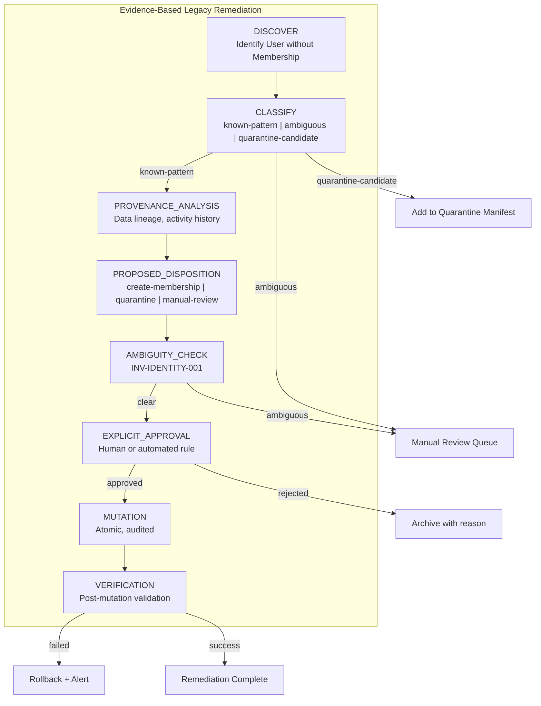

#### Classification Categories

| Category | Description | Disposition |
|----------|-------------|-------------|
| `known-pattern` | User.tenantId exists, tenant exists, role maps cleanly to L5 | Proceed to provenance analysis |
| `ambiguous` | Multiple potential identities, unclear tenant association | Manual review queue |
| `quarantine-candidate` | Matches anomaly patterns (mis-tenanted, app-registration-style) | Add to quarantine manifest |

#### Remediation Principles

**1. User.tenantId/User.role are EVIDENCE, not AUTHORITY**
```typescript
// WRONG: Automatic membership creation from legacy fields
await createMembership({ tenantId: user.tenantId, role: mapRole(user.role) }); // ❌

// CORRECT: Evidence-based workflow with approval
const evidence = { legacyTenantId: user.tenantId, legacyRole: user.role };
const classification = await classifyRemediation(user.id, evidence);
if (classification.disposition === 'CREATE_MEMBERSHIP' && classification.approved) {
  await createMembershipWithAudit(classification); // ✅
}
```

**2. Ambiguous Cases FAIL CLOSED → Remediation Review**
- If identity cannot be unambiguously resolved, case enters manual review queue
- No automatic membership creation for ambiguous identities (INV-IDENTITY-001)
- Review queue provides full evidence package for human decision

**3. Quarantine Manifest Maintained**
- PNA-01 through PNA-05 remain quarantined (L3)
- New quarantine candidates identified during remediation added to manifest
- Quarantined users NEVER receive automatic membership
- Resolution requires explicit remediation workflow with approval

**4. Audit Trail for All Remediation Actions**

| Action | Logged Data |
|--------|-------------|
| CLASSIFY | userId, classification, evidence, timestamp |
| DISPOSITION | userId, proposed action, rationale |
| APPROVE/REJECT | userId, decision, approver, reason |
| MUTATION | userId, membershipId, before/after state, correlationId |
| VERIFY | userId, verification result, discrepancies |
| ROLLBACK | userId, reason, restored state |

#### Workflow Steps

1. **DISCOVER**: Identify all users without corresponding Membership records
2. **CLASSIFY**: Categorize each user based on evidence patterns
3. **PROVENANCE_ANALYSIS**: For known-pattern users, trace data lineage and activity history
4. **PROPOSED_DISPOSITION**: Generate recommended action based on analysis
5. **AMBIGUITY_CHECK**: Verify no identity conflicts (INV-IDENTITY-001)
6. **EXPLICIT_APPROVAL**: Human approval required for ambiguous cases; automated rules for known patterns
7. **MUTATION**: Create membership atomically with full audit trail
8. **VERIFICATION**: Post-mutation validation ensures data consistency

#### Role Mapping (L5 - Locked)

| Legacy UserRole | Target MembershipRole | OrgUnit Scope |
|-----------------|----------------------|---------------|
| Super_Admin | PLATFORM_ADMIN | null (tenant-level) |
| Ketua_RT | RT_ADMIN | RT root OrgUnit |
| Pengurus | ORG_ADMIN | RT root OrgUnit |
| Warga | RESIDENT | RT root OrgUnit |
| Security_Guard | SECURITY | RT root OrgUnit |

**Note:** Non-admin RT users are org-scoped to RT root OrgUnit (L6), NOT tenant-wide null.

**References:** Requirements 11, INV-IDENTITY-001, INV-QUARANTINE-001

### Legacy Schema Cleanup

- Execute only after all code dependencies removed
- Remove User.tenantId column
- Remove unused UserRole enum values
- Backup before destructive operations
- 24-hour rollback window
- Maintenance window with read-only mode

**References:** Requirements 13

### Environment Separation

- Distinct databases for dev/staging/prod
- Production credentials rejected in non-production
- Distinct signing keys per environment
- No production data export to non-production
- Environment identifier in all logs/metrics
- Startup validation of environment configuration

**References:** Requirements 37

### Backup/DR Requirements

- Point-in-time recovery: hourly minimum
- Cross-region replication
- RTO: 4 hours, RPO: 1 hour
- Encryption at rest
- Quarterly restoration testing
- Integrity verification (checksums)
- Tenant-specific restoration without affecting others

**References:** Requirements 32

### Invariant Registry Implementation

All invariants from Requirements 62 must be:
- Registered centrally with ID, description, enforcement layer
- Have automated validation
- CI fails if SECURITY_CRITICAL invariant lacks test
- Updated when new invariants identified

**References:** Requirements 62

---

## Non-Goals

The following are explicitly **NOT** in scope for this design:

1. **User impersonation capability** — High-risk feature deferred (O4)
2. **NIK uniqueness constraint** — Resident/residency model not final (O1)
3. **TRIAL/PAST_DUE quota specifics** — Business rules not finalized (O2)
4. **Authorization cache implementation** — Redis infrastructure pending (O3)
5. **IoT ownership redesign** — Not in FASE 1 scope
6. **RW/Cluster/Organization bootstrap** — Only RT roots exist in M1/M2
7. **Schema drift reconciliation** (gates/cctv_cameras/homes) — Separate effort
8. **Automatic anomaly remediation** — Quarantined users require explicit action

---

## Decision Classification Summary

### LOCKED DECISIONS (Cannot Change)

| ID | Decision |
|----|----------|
| L1 | 2 OrgUnits: rt01 `2459b0bb-115e-52ce-88cd-c176a9aa1e39`, rt02 `50197f3e-5ebc-5547-91ba-e54b604e0edb` |
| L2 | 16 Memberships: 3 platform PLATFORM_ADMIN + 13 RT org-scoped |
| L3 | 5 Platform anomalies quarantined (PNA-01 through PNA-05) |
| L4 | UUIDv5 deterministic IDs with namespace `f0e1d2c3-b4a5-5968-8776-655443322110` |
| L5 | Role mapping: Super_Admin→PLATFORM_ADMIN, Ketua_RT→RT_ADMIN, Pengurus→ORG_ADMIN, Warga→RESIDENT, Security_Guard→SECURITY |
| L6 | Non-admin RT users org-scoped to RT root (NOT tenant-wide null) |
| L7 | Path invariant: root depth=0, path=[id]; depth = path.length - 1 |
| L8 | Tenant.lifecycleStatus SEPARATE from Subscription.status |
| L9 | Role delegation via explicit matrix (NOT permission counting) |
| L10 | Emergency access ALLOWED for SUSPENDED membership (safety priority) |
| L11 | Privileged execution is NARROW capability (NOT superuser switch) |
| L12 | Tenant.lifecycleStatus independent from Subscription.status |

### DESIGN DECISIONS (Implementation Choices)

| ID | Decision | Value |
|----|----------|-------|
| D1 | JWT access token expiry | 15 minutes |
| D2 | Refresh token | opaque 256-bit, SHA-256 hashed, 30-day expiry |
| D3 | JWT algorithm | HS256 |
| D4 | OrgUnit path storage | uuid[] (not ltree) |
| D5 | Role → Permission | config-based static mapping |
| D6 | RLS session variable | `app.current_tenant_id` |
| D7 | Invitation expiry | 7 days default |
| D8 | Recovery token expiry | 1 hour |
| D9 | Step-up validity | 5 minutes |
| D10 | Emergency escalation timeout | 2 minutes default |
| D11 | Signed URL TTL | 15 minutes default |
| D12 | Cookie SameSite policy | Strict |
| D13 | Service Principal auth | API key-based |
| D14 | IoT Credential Ownership | PLATFORM_MANAGED or TENANT_MANAGED |

#### Design Decisions Change Evidence Matrix

Some design decisions may change based on operational feedback or new requirements. This matrix documents what evidence would trigger reconsideration:

| Decision | Current Value | Change Evidence |
|----------|---------------|-----------------|
| D2 (Refresh token expiry) | 30 days | Compliance requirement change (e.g., shorter session for financial) |
| D3 (JWT algorithm) | HS256 | Switch to RS256/ES256 if multiple issuers needed or asymmetric verification required |
| D7 (Invitation expiry) | 7 days | User feedback indicating too short; security incident indicating too long |
| D10 (Escalation timeout) | 2 minutes | Operational feedback from tenant on false alarm rate vs. response time |
| D12 (SameSite=Strict) | Strict | May change to Lax if cross-origin subdomain flows required (e.g., `*.tenant.societ-rt.id`) |
| D13 (Service Principal auth) | API key | May change to mTLS with service mesh adoption |

#### New Design Decisions (V1.1)

**D12: Cookie SameSite Policy**
- Value: `SameSite=Strict`
- Rationale: Maximum CSRF protection for authentication cookies
- Trade-off: Cross-origin requests from subdomains will not include cookies
- Change trigger: If multi-subdomain SSO required, may change to `SameSite=Lax` with additional CSRF token

**D13: Service Principal Authentication**
- Value: API key-based authentication
- Rationale: Simple to implement and rotate for server-to-server communication
- Trade-off: API keys require secure distribution and rotation infrastructure
- Change trigger: Service mesh adoption with mTLS would enable certificate-based machine identity

### VALIDATION TARGETS (Must Be Tested)

| ID | Property |
|----|----------|
| V1 | Authorization context resolution < 100ms p99 |
| V2 | Permission lookup < 10ms p99 |
| V3 | RLS overhead < 20% query latency |
| V4 | Token version mismatch → immediate rejection |
| V5 | Refresh token reuse → family-wide revocation |
| V6 | OrgUnit path consistency with parentId chain |
| V7 | Emergency operations succeed during SUSPENDED status |

### OPEN DECISIONS (Deferred)

| ID | Decision | Blocker |
|----|----------|---------|
| O1 | NIK uniqueness constraint | Resident/residency model not final |
| O2 | TRIAL/PAST_DUE quota limits | Business rules not finalized |
| O3 | Authorization cache TTL | Redis infrastructure pending |
| O4 | User impersonation | High-risk, optional feature deferred |

---

## Traceability Matrix

| Requirement | Design Section | Test Reference |
|-------------|----------------|----------------|
| Req 1 | Membership Model | membership.test.ts |
| Req 2 | Permission Registry | permission-registry.test.ts |
| Req 3 | Authorization Pipeline | authorization-context.test.ts |
| Req 4 | JWT Structure | context-switch.test.ts |
| Req 5 | Authorization Pipeline | route-authorization.test.ts |
| Req 6 | OrgUnit Scope | orgunit-scope.test.ts |
| Req 7 | Shadow Authorization | shadow-auth.test.ts |
| Req 8 | Authorization Cutover | cutover.test.ts |
| Req 9 | Write-Path Migration | dual-write.test.ts |
| Req 10 | RLS Foundation | rls-isolation.test.ts |
| Req 11 | Legacy Data Remediation | remediation.test.ts |
| Req 14 | Refresh Token System | refresh-token.test.ts |
| Req 15 | Token Versioning | token-version.test.ts |
| Req 16 | Session Management | session.test.ts |
| Req 17-19 | Policy Matrix | subscription.test.ts |
| Req 20 | Safety-Critical Operations | emergency-safety.test.ts |
| Req 21 | OrgUnit Hierarchy | orgunit-hierarchy.test.ts |
| Req 22 | Membership Lifecycle | membership-lifecycle.test.ts |
| Req 23 | Tenant Lifecycle | tenant-onboarding.test.ts |
| Req 24 | Audit Trail | audit.test.ts |
| Req 25 | Delegation Matrix | delegation.test.ts |
| Req 26 | Resource Scope | resource-scope.test.ts |
| Req 27 | Household Authorization | household-auth.test.ts |
| Req 28 | TOCTOU Prevention | toctou.test.ts |
| Req 29 | Service Principal | service-principal.test.ts |
| Req 30 | Webhook Authentication | webhook.test.ts |
| Req 31 | Tenant Offboarding | offboarding.test.ts |
| Req 32 | Backup/DR | backup-dr.test.ts |
| Req 33 | Event Outbox | event-outbox.test.ts |
| Req 34 | IoT Abstraction | iot-device.test.ts |
| Req 35 | Observability | observability.test.ts |
| Req 36 | Migration Safety | migration-safety.test.ts |
| Req 37 | Environment Separation | environment.test.ts |
| Req 38 | PII Protection | nik-protection.test.ts |
| Req 39 | Idempotency | idempotency.test.ts |
| Req 40 | Rate Limiting | rate-limiting.test.ts |
| Req 41 | Security Validation | security-validation.test.ts |
| Req 42 | Performance Validation | performance.test.ts |
| Req 43 | Privileged Execution | privileged-path.test.ts |
| Req 44 | JWT Structure | jwt-claims.test.ts |
| Req 45 | Backward Compatibility | backward-compat.test.ts |
| Req 46 | Path Integrity | path-integrity.test.ts |
| Req 47 | Error Standardization | error-codes.test.ts |
| Req 48 | Rollback Support | rollback.test.ts |
| Req 49 | Tenant Lifecycle | tenant-lifecycle.test.ts |
| Req 50 | Invitation System | invitation.test.ts |
| Req 51 | Credential Security | credential-security.test.ts |
| Req 52 | MFA | mfa.test.ts |
| Req 53 | Re-authentication | reauth.test.ts |
| Req 54 | Ownership Transfer | ownership.test.ts |
| Req 55 | File Storage | file-storage.test.ts |
| Req 56 | Notification | notification.test.ts |
| Req 57 | Emergency Escalation | emergency-escalation.test.ts |
| Req 58 | IoT Command | iot-command.test.ts |
| Req 59 | Background Jobs | job-worker.test.ts |
| Req 60 | RLS Coverage | rls-coverage.test.ts |
| Req 61 | Data Governance | data-governance.test.ts |
| Req 62 | Invariant Registry | invariant-registry.test.ts |

---

## Document Metadata

| Field | Value |
|-------|-------|
| Version | 1.3 |
| Status | **FROZEN — MASTER ARCHITECTURE DESIGN V1** |
| Spec ID | 9106ad34-d0b8-4360-9ad5-da31c6e948bc |
| Workflow | requirements-first |
| Requirements Version | V1_FROZEN (62 requirements) |
| Invariants | 16 (INV-*) |
| Locked Decisions | 12 (L1-L12) |
| Design Decisions | 14 (D1-D14) |
| Validation Targets | 7 (V1-V7) |
| Open Decisions | 4 (O1-O4) |
| Correctness Properties | 22 |
| Reconciliation Pass | V1.3 |

### Freeze Record

| Field | Value |
|-------|-------|
| Freeze Date | 2026-09-24 |
| Tag | `master-architecture-design-v1` |
| Base Commit | `585a8b8` (phase-1-m2-dev-promoted) |
| Freeze Notes | FREEZE_NOTES.md |
| Frozen By | Architecture Review |

### Reconciliation Pass V1.1 - Issues Corrected

| Correction ID | Issue | Resolution |
|---------------|-------|------------|
| C1 | GLOBAL_USER_MODEL | User table classified as GLOBAL_IDENTITY with no tenant RLS; access via Membership only |
| C2 | PLATFORM_ADMIN_WILDCARD | Replaced `['*']` with explicit platform permissions; NO implicit tenant access |
| C3 | LEGACY_REMEDIATION | Evidence-based workflow with classification, provenance analysis, explicit approval |
| C4 | MULTI_MEMBERSHIP_RESOLUTION | Added MembershipResolutionKey with activeOrgUnitId; membershipId NEVER from JWT |
| C5 | IOT_PROVIDER_ABSTRACTION | Provider interface with TuyaProvider, MQTTProvider, HomeAssistantProvider |
| C6 | RESOURCE_SCOPE_MATRIX | Added USER_SELF scope; clarified RESIDENT can only access own data |

### Reconciliation Pass V1.2 - Consistency Cleanup

| Correction ID | Issue | Resolution |
|---------------|-------|------------|
| C7 | RLS_SQL_STALE_USERS_TABLE | Removed `ALTER TABLE users ENABLE ROW LEVEL SECURITY` from SQL block; users is GLOBAL_IDENTITY |
| C8 | RLS_POLICY_STALE_USERS_TABLE | Changed `CREATE POLICY tenant_isolation ON users` to `ON memberships`; users has no RLS |
| C9 | IOT_ARCHITECTURE_DIAGRAM_STALE | Updated High-Level Architecture diagram: IoTService→IoTProviderInterface→Providers→TuyaCloud |
| C10 | AUTH_PIPELINE_MEMBERSHIP_RESOLUTION | Step 3 now shows 3-part key (userId, activeTenantId, activeOrgUnitId) with server-resolved membershipId |
| C11 | TABLES_WITHOUT_RLS_INCOMPLETE | Enhanced "Tables WITHOUT RLS" section with table format including users as GLOBAL_IDENTITY |

### Reconciliation Verification Flags

```
GLOBAL_USER_MODEL_CORRECT=true
PLATFORM_ADMIN_WILDCARD_REMOVED=true
LEGACY_REMEDIATION_EVIDENCE_BASED=true
MULTI_MEMBERSHIP_RESOLUTION_DEFINED=true
IOT_PROVIDER_ABSTRACTION_DEFINED=true
RESOURCE_SCOPE_MATRIX_COMPLETE=true
RLS_SQL_USERS_REMOVED=true
IOT_DIAGRAM_PROVIDER_ABSTRACTION=true
AUTH_PIPELINE_3_PART_KEY=true
```

### Reconciliation Pass V1.3 - Final Consistency Patch

| Correction ID | Issue | Resolution |
|---------------|-------|------------|
| C12 | IOT_PROVIDER_CREDENTIAL_OWNERSHIP | Added PLATFORM_MANAGED and TENANT_MANAGED credential modes; credential ownership separated from device ownership; INV-IOT-001 preserved |
| C13 | EMERGENCY_SUBSCRIPTION_BOUNDARY | Property 14 clarified: safety bypass applies to TRIAL/ACTIVE/PAST_DUE/SUSPENDED but NOT CLOSED; aligned with Policy Matrix |
| C14 | TOKEN_VERSION_EXACT_MATCH | Property 7 updated: JWT.tokenVersion must exactly equal User.tokenVersion (not just <); reject >, missing, or malformed |

### Reconciliation Verification Flags (V1.3)

```
IOT_CREDENTIAL_OWNERSHIP_MODES=true
INV_IOT_001_PRESERVED=true
EMERGENCY_CLOSED_BYPASS=false
SUSPENDED_SUBSCRIPTION_EMERGENCY=true
SUSPENDED_MEMBERSHIP_EMERGENCY=true
TOKEN_VERSION_EXACT_MATCH=true
```

### New Error Codes Added (V1.1)

| Code | HTTP Status | Description |
|------|-------------|-------------|
| `AUTH_MEMBERSHIP_CONTEXT_INVALID` | 403 | activeOrgUnitId doesn't match any valid membership in tenant |
| `AUTH_INVALID_SCOPE` | 403 | Tenant-level membership claimed without tenant-level role |

### New Invariants Added (V1.1)

| ID | Invariant | Enforcement |
|----|-----------|-------------|
| INV-USER-001 | User table has NO tenant RLS; access authorized via Membership | Application |

**Constraints Observed:**
- ✅ Did NOT modify requirements.md
- ✅ Did NOT implement runtime code
- ✅ Did NOT modify Prisma schema
- ✅ Did NOT create/execute database migrations
- ✅ Did NOT mutate any database
- ✅ Did NOT modify frozen M1/M2 artifacts
- ✅ Did NOT begin FASE 1.6 implementation
- ✅ Did NOT push

**This is DOCUMENTATION ONLY.**
