# Design Document — SocieT-RT

## Overview

SocieT-RT is a multi-tenant SaaS platform for managing RT/RW/housing/community organizations in Indonesia. The system enables community administrators to manage residents, finances, voting, announcements, security patrols, events, visitor logging, and administrative services — all within a tenant-isolated environment.

The platform follows **Clean Architecture + DDD** on **Next.js 15 App Router**, with strict layer separation (core → infrastructure → presentation → app). All business logic resides in use cases, all external access goes through repositories, and all dependencies are resolved via Awilix DI container.

### Key Design Decisions

1. **Shared-schema multi-tenancy**: All tenants share a single PostgreSQL database with `tenant_id` column filtering. This simplifies operations and reduces cost while maintaining data isolation through middleware-enforced tenant guards.

2. **BFF pattern via Next.js Route Handlers**: Next.js serves as both the frontend and the BFF layer. Route handlers (`app/api/`) act as the HTTP boundary — validating input, resolving auth context, calling use cases, and returning safe UI-centric responses.

3. **Asynchronous processing via BullMQ**: Notifications, audit logs, reminders, and other non-blocking operations are dispatched as background jobs to keep API response times fast.

4. **Custom auth with JWT + HTTP-only cookies**: No third-party auth provider. JWT tokens are issued on login and stored in HTTP-only secure cookies with `SameSite: Lax`.

5. **Feature flags tied to subscription plans**: Feature access is controlled per tenant based on their subscription plan (Free/Pro/Enterprise), with Super_Admin override capability.

6. **DomainResult pattern everywhere**: All repository and use case boundaries return `DomainResult<T>` to make success/error paths explicit and testable.

---

## Architecture

### High-Level Architecture

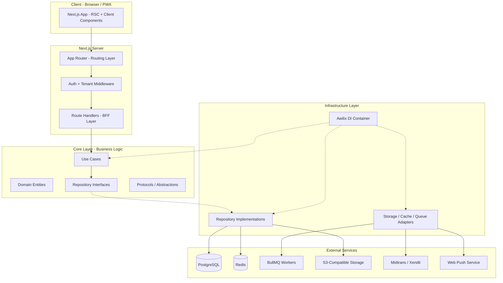

### Layer Responsibilities

| Layer | Responsibility | Allowed Dependencies |
|-------|---------------|---------------------|
| **App** | Routing, layouts, error boundaries | Presentation |
| **Presentation** | UI components, ViewModels, form validation | Core |
| **Core** | Entities, use cases, repository interfaces, domain errors | None (innermost) |
| **Infrastructure** | Repository implementations, adapters, DI container, Zustand stores | Core |

### Request Flow

```
HTTP Request
  → Next.js Middleware (auth check, tenant resolution)
  → Route Handler (input validation via Zod, auth context extraction)
  → Use Case (business logic, domain rules)
  → Repository Interface → Repository Implementation
  → Database / Redis / S3 / External Service
  → DomainResult<T>
  → Response mapping → Safe JSON response
```

### Multi-Tenant Isolation Flow

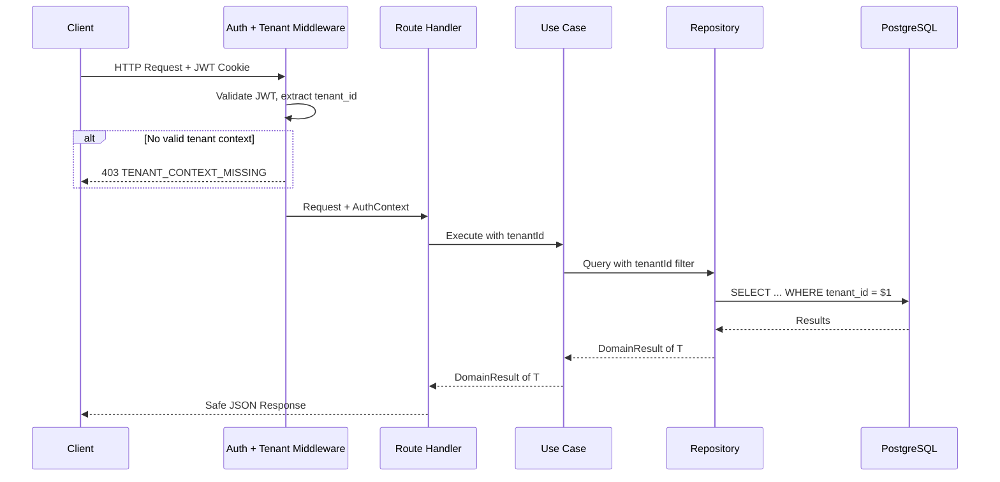

---

## Components and Interfaces

### Domain Modules

The system is organized into the following DDD bounded contexts (domains):

```
src/core/domains/
├── tenant/           # Tenant registration, configuration, branding
├── auth/             # Authentication, sessions, invitation tokens
├── rbac/             # Role-based access control, permissions
├── resident/         # Households, individuals, CSV import/export
├── finance/          # Kas, iuran, transactions, reports
├── voting/           # Votes, options, ballots
├── announcement/     # Announcements, categories, attachments
├── emergency/        # Emergency alerts, GPS, status tracking
├── map/              # Household coordinates, map markers
├── security/         # Patrol schedules, attendance, incidents
├── administration/   # Letter requests, approvals, PDF generation
├── event/            # Community events, RSVP
├── visitor/          # Visitor logs, package logs
├── billing/          # Subscription plans, invoices, payments
├── notification/     # Notification dispatch, inbox, channels
├── audit/            # Audit log entries
├── featureFlag/      # Feature flags, plan mappings, overrides
├── dashboard/        # Metrics aggregation
├── fileStorage/      # File upload, signed URLs
├── privacy/          # Data masking, consent, data export/deletion
└── operational/      # Tenant suspension, impersonation, health
```

### Key Interfaces (Core Protocols)

```typescript
// Core protocol for HTTP abstraction
export interface HttpProtocol {
  get<T>(url: string, config?: RequestConfig): Promise<T>;
  post<T>(url: string, body: unknown, config?: RequestConfig): Promise<T>;
  put<T>(url: string, body: unknown, config?: RequestConfig): Promise<T>;
  patch<T>(url: string, body: unknown, config?: RequestConfig): Promise<T>;
  delete<T>(url: string, config?: RequestConfig): Promise<T>;
}

// Core protocol for cache abstraction
export interface CacheProtocol {
  get<T>(key: string): Promise<T | null>;
  set<T>(key: string, value: T, ttlSeconds?: number): Promise<void>;
  delete(key: string): Promise<void>;
  invalidatePattern(pattern: string): Promise<void>;
}

// Core protocol for queue abstraction
export interface QueueProtocol {
  enqueue<T>(jobType: string, payload: T, options?: JobOptions): Promise<string>;
}

// Core protocol for file storage abstraction
export interface FileStorageProtocol {
  upload(params: UploadParams): Promise<FileMetadata>;
  getSignedUrl(key: string, expiresInSeconds: number): Promise<string>;
  delete(key: string): Promise<void>;
}

// Core protocol for auth context
export interface AuthContext {
  userId: string;
  tenantId: string;
  role: UserRole;
  isImpersonating?: boolean;
  impersonatorId?: string;
}

// DomainResult pattern
export type DomainResult<T> =
  | { success: true; data: T }
  | { success: false; error: AppError };
```

### Repository Interface Examples

```typescript
// Tenant Repository (Core)
export interface TenantRepository {
  create(tenant: CreateTenantInput): Promise<DomainResult<Tenant>>;
  findById(tenantId: string): Promise<DomainResult<Tenant | null>>;
  findBySubdomain(subdomain: string): Promise<DomainResult<Tenant | null>>;
  update(tenantId: string, data: UpdateTenantInput): Promise<DomainResult<Tenant>>;
  suspend(tenantId: string): Promise<DomainResult<void>>;
  reactivate(tenantId: string): Promise<DomainResult<void>>;
}

// Resident Repository (Core)
export interface ResidentRepository {
  createHousehold(tenantId: string, data: CreateHouseholdInput): Promise<DomainResult<Household>>;
  addResident(tenantId: string, householdId: string, data: CreateResidentInput): Promise<DomainResult<Resident>>;
  updateResidentStatus(tenantId: string, residentId: string, status: ResidencyStatus): Promise<DomainResult<Resident>>;
  exportToCsv(tenantId: string): Promise<DomainResult<string>>;
  importFromCsv(tenantId: string, csvContent: string): Promise<DomainResult<CsvImportResult>>;
  findByTenant(tenantId: string, filters: ResidentFilters): Promise<DomainResult<PaginatedResult<Resident>>>;
}

// Finance Repository (Core)
export interface FinanceRepository {
  recordTransaction(tenantId: string, data: CreateTransactionInput): Promise<DomainResult<FinancialTransaction>>;
  getBalance(tenantId: string): Promise<DomainResult<number>>;
  getIuranStatus(tenantId: string, householdId: string, month: string): Promise<DomainResult<IuranStatus>>;
  recordIuranPayment(tenantId: string, householdId: string, month: string): Promise<DomainResult<void>>;
  getReport(tenantId: string, dateRange: DateRange): Promise<DomainResult<FinancialReport>>;
}
```

### Use Case Pattern

```typescript
// Example: CreateVoteUseCase
export interface CreateVoteUseCase {
  execute(params: {
    authContext: AuthContext;
    input: CreateVoteInput;
  }): Promise<DomainResult<Vote>>;
}

export const CreateVoteUseCaseImpl = ({
  votingRepository,
  auditQueue,
  featureFlagService,
}: {
  votingRepository: VotingRepository;
  auditQueue: QueueProtocol;
  featureFlagService: FeatureFlagService;
}): CreateVoteUseCase => ({
  execute: async ({ authContext, input }) => {
    // Check feature flag
    const isEnabled = await featureFlagService.isEnabled(
      authContext.tenantId, 'voting'
    );
    if (!isEnabled) {
      return {
        success: false,
        error: {
          type: 'authorization',
          code: 'FEATURE_DISABLED',
          message: 'Voting feature is disabled',
        },
      };
    }

    // Business rule: must have at least 2 options
    if (input.options.length < 2) {
      return {
        success: false,
        error: {
          type: 'validation',
          code: 'VOTING_INSUFFICIENT_OPTIONS',
          message: 'At least 2 options required',
        },
      };
    }

    const result = await votingRepository.createVote(
      authContext.tenantId, input
    );

    // Enqueue audit log (async)
    if (result.success) {
      await auditQueue.enqueue('audit_log', {
        tenantId: authContext.tenantId,
        actorUserId: authContext.userId,
        actionType: 'vote_created',
        resourceType: 'vote',
        resourceId: result.data.id,
        details: { title: input.title },
      });
    }

    return result;
  },
});
```

### Middleware Stack

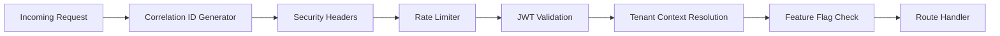

### BFF Route Handler Pattern

```typescript
// app/api/voting/route.ts
export async function POST(request: NextRequest) {
  const correlationId = request.headers.get('x-correlation-id')
    || generateCorrelationId();

  // 1. Validate input
  const body = await request.json();
  const validation = createVoteSchema.safeParse(body);
  if (!validation.success) {
    return NextResponse.json(
      {
        code: 'COMMON_VALIDATION_FAILED',
        fields: formatZodErrors(validation.error),
        correlationId,
      },
      { status: 400 },
    );
  }

  // 2. Resolve auth context from middleware
  const authContext = await resolveAuthContext(request);
  if (!authContext) {
    return NextResponse.json(
      { code: 'AUTH_TOKEN_INVALID', message: 'Unauthorized', correlationId },
      { status: 401 },
    );
  }

  // 3. Execute use case via DI
  const useCase = container.resolve<CreateVoteUseCase>('createVoteUseCase');
  const result = await useCase.execute({
    authContext,
    input: validation.data,
  });

  // 4. Map result to safe response
  if (!result.success) {
    return mapErrorToResponse(result.error, correlationId);
  }

  return NextResponse.json(
    { data: mapVoteToResponseDto(result.data) },
    { status: 201 },
  );
}
```

### Background Job Architecture

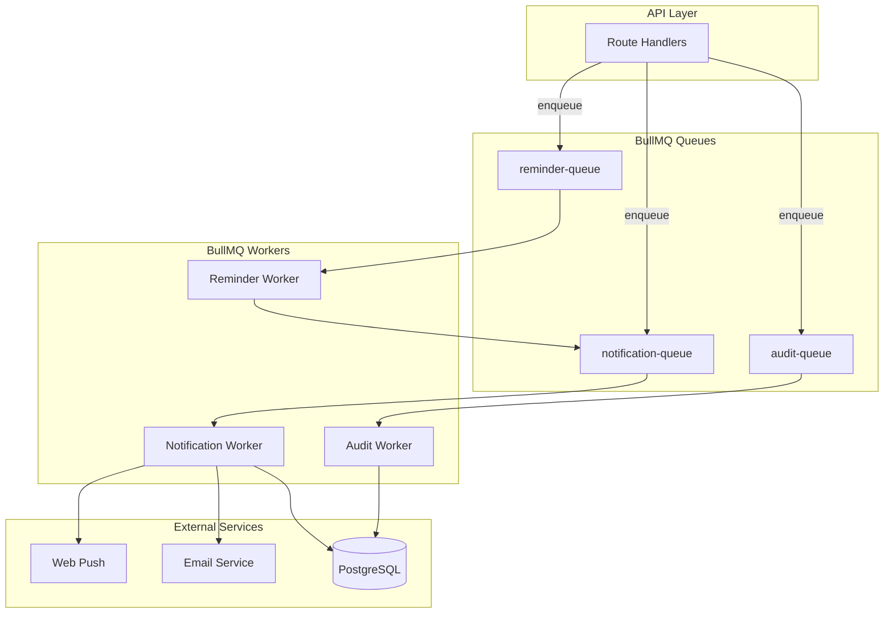

---

## Data Models

### Core Entities (ER Diagram)

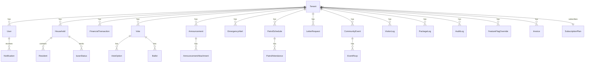

### Key Entity Definitions

```typescript
// Tenant
export interface Tenant {
  id: string;
  name: string;
  subdomain: string;
  rtRwNumber: string;
  region: string;
  address: string;
  contactPerson: string;
  logoUrl: string | null;
  primaryColor: string | null;
  secondaryColor: string | null;
  status: 'active' | 'suspended';
  subscriptionPlanId: string;
  createdAt: Date;
  updatedAt: Date;
}

// User
export interface User {
  id: string;
  tenantId: string;
  name: string;
  email: string;
  passwordHash: string;
  role: 'Super_Admin' | 'Ketua_RT' | 'Pengurus' | 'Warga' | 'Security_Guard';
  status: 'active' | 'locked' | 'inactive';
  failedLoginAttempts: number;
  lockedUntil: Date | null;
  consentTimestamp: Date | null;
  consentVersion: string | null;
  createdAt: Date;
  updatedAt: Date;
  deletedAt: Date | null;
}

// Household
export interface Household {
  id: string;
  tenantId: string;
  householdNumber: string;
  address: string;
  block: string | null;
  latitude: number | null;
  longitude: number | null;
  createdAt: Date;
  updatedAt: Date;
}

// Resident
export interface Resident {
  id: string;
  tenantId: string;
  householdId: string;
  name: string;
  nik: string;
  dateOfBirth: Date;
  gender: 'male' | 'female';
  phone: string | null;
  status: 'tetap' | 'kontrak' | 'kos' | 'pindah';
  categories: ('lansia' | 'balita' | 'disabilitas')[];
  emergencyContactName: string | null;
  emergencyContactPhone: string | null;
  emergencyContactRelationship: string | null;
  createdAt: Date;
  updatedAt: Date;
  deletedAt: Date | null;
}

// FinancialTransaction
export interface FinancialTransaction {
  id: string;
  tenantId: string;
  type: 'income' | 'expense';
  amount: number;
  description: string;
  category: string;
  date: Date;
  createdBy: string;
  createdAt: Date;
  updatedAt: Date;
  deletedAt: Date | null;
}

// IuranStatus
export interface IuranStatus {
  id: string;
  tenantId: string;
  householdId: string;
  month: string; // YYYY-MM format
  status: 'paid' | 'unpaid';
  paidAt: Date | null;
  transactionId: string | null;
  createdAt: Date;
  updatedAt: Date;
}

// Vote
export interface Vote {
  id: string;
  tenantId: string;
  title: string;
  description: string;
  mode: 'anonymous' | 'verified';
  deadline: Date;
  createdBy: string;
  createdAt: Date;
  updatedAt: Date;
}

// VoteOption
export interface VoteOption {
  id: string;
  voteId: string;
  label: string;
  voteCount: number;
}

// Ballot
export interface Ballot {
  id: string;
  voteId: string;
  userId: string;
  optionId: string;
  createdAt: Date;
}

// Announcement
export interface Announcement {
  id: string;
  tenantId: string;
  title: string;
  content: string;
  category: 'umum' | 'keamanan' | 'keuangan' | 'kegiatan' | 'darurat';
  createdBy: string;
  publishedAt: Date | null;
  createdAt: Date;
  updatedAt: Date;
}

// EmergencyAlert
export interface EmergencyAlert {
  id: string;
  tenantId: string;
  userId: string;
  latitude: number | null;
  longitude: number | null;
  locationUnavailable: boolean;
  status: 'active' | 'responding' | 'resolved';
  createdAt: Date;
  updatedAt: Date;
}

// PatrolSchedule
export interface PatrolSchedule {
  id: string;
  tenantId: string;
  date: Date;
  timeSlot: string;
  assignedUserIds: string[];
  createdBy: string;
  createdAt: Date;
  updatedAt: Date;
}

// IncidentReport
export interface IncidentReport {
  id: string;
  tenantId: string;
  date: Date;
  time: string;
  description: string;
  location: string;
  severityLevel: 'low' | 'medium' | 'high' | 'critical';
  reportedBy: string;
  createdAt: Date;
}

// LetterRequest
export interface LetterRequest {
  id: string;
  tenantId: string;
  userId: string;
  letterType: 'surat_pengantar' | 'domisili' | 'SKTM';
  purpose: string;
  status: 'pending' | 'approved' | 'rejected';
  rejectionReason: string | null;
  documentUrl: string | null;
  decidedBy: string | null;
  decidedAt: Date | null;
  createdAt: Date;
  updatedAt: Date;
}

// CommunityEvent
export interface CommunityEvent {
  id: string;
  tenantId: string;
  title: string;
  description: string;
  date: Date;
  time: string;
  location: string;
  createdBy: string;
  createdAt: Date;
  updatedAt: Date;
}

// EventRsvp
export interface EventRsvp {
  id: string;
  eventId: string;
  userId: string;
  response: 'attending' | 'not_attending';
  createdAt: Date;
}

// VisitorLog
export interface VisitorLog {
  id: string;
  tenantId: string;
  visitorName: string;
  purpose: string;
  destinationHouseholdId: string;
  entryTimestamp: Date;
  exitTimestamp: Date | null;
  loggedBy: string;
  createdAt: Date;
  updatedAt: Date;
}

// PackageLog
export interface PackageLog {
  id: string;
  tenantId: string;
  recipientHouseholdId: string;
  courierName: string;
  description: string;
  arrivalTimestamp: Date;
  loggedBy: string;
  createdAt: Date;
}

// SubscriptionPlan
export interface SubscriptionPlan {
  id: string;
  name: 'Free' | 'Pro' | 'Enterprise';
  maxUsers: number | null; // null = unlimited
  features: string[];
  price: number;
  createdAt: Date;
  updatedAt: Date;
}

// Invoice
export interface Invoice {
  id: string;
  tenantId: string;
  planName: string;
  amount: number;
  billingPeriodStart: Date;
  billingPeriodEnd: Date;
  dueDate: Date;
  status: 'pending' | 'paid' | 'failed';
  gatewayTransactionId: string | null;
  paidAt: Date | null;
  retryCount: number;
  createdAt: Date;
  updatedAt: Date;
}

// Notification
export interface Notification {
  id: string;
  tenantId: string;
  userId: string;
  type: string;
  title: string;
  body: string;
  channel: 'push' | 'email' | 'inbox';
  status: 'unread' | 'read';
  createdAt: Date;
}

// AuditLog
export interface AuditLog {
  id: string;
  tenantId: string;
  actorUserId: string;
  actionType: string;
  resourceType: string;
  resourceId: string;
  details: Record<string, unknown>;
  ipAddress: string;
  impersonatorId: string | null;
  timestamp: Date;
}

// FeatureFlag
export interface FeatureFlag {
  id: string;
  featureName: string;
  planId: string;
  enabled: boolean;
}

// FeatureFlagOverride
export interface FeatureFlagOverride {
  id: string;
  tenantId: string;
  featureName: string;
  enabled: boolean;
  overriddenBy: string;
  createdAt: Date;
}
```

### Database Indexing Strategy

All tables with `tenant_id` will have composite indexes:

- `(tenant_id, id)` — primary lookup
- `(tenant_id, created_at)` — chronological listing
- `(tenant_id, status)` — filtered queries
- Domain-specific indexes:
  - `users`: `(tenant_id, email)` unique, `(tenant_id, role)`
  - `households`: `(tenant_id, household_number)` unique
  - `residents`: `(tenant_id, nik)` unique
  - `iuran_status`: `(tenant_id, household_id, month)` unique
  - `ballots`: `(vote_id, user_id)` unique
  - `event_rsvps`: `(event_id, user_id)` unique
  - `audit_logs`: `(tenant_id, timestamp)`, `(tenant_id, action_type)`
  - `notifications`: `(tenant_id, user_id, status, created_at)`
  - `invoices`: `(tenant_id, status, due_date)`

### Caching Strategy (Redis)

| Key Pattern | TTL | Purpose |
|------------|-----|---------|
| `dashboard:{tenantId}:ketua` | 5 min | Ketua_RT dashboard metrics |
| `dashboard:platform:admin` | 5 min | Super_Admin platform metrics |
| `feature_flags:{tenantId}` | 10 min | Tenant feature flag state |
| `session:{userId}` | JWT expiry | Session validation cache |
| `rate_limit:login:{ip}` | 1 min | Login rate limiting |
| `vote_tally:{voteId}` | 5 sec | Real-time vote tallies |


---

## Correctness Properties

*A property is a characteristic or behavior that should hold true across all valid executions of a system — essentially, a formal statement about what the system should do. Properties serve as the bridge between human-readable specifications and machine-verifiable correctness guarantees.*

### Property 1: Tenant Data Isolation

*For any* authenticated user and any database query executed on their behalf, the query results SHALL only contain records where `tenant_id` matches the user's tenant. Additionally, *for any* request without a valid tenant context, the system SHALL reject it, and *for any* request attempting to access a resource belonging to a different tenant, the system SHALL deny access.

**Validates: Requirements 1.3, 1.4, 1.5**

### Property 2: Tenant Registration Uniqueness

*For any* two tenant registration requests, if they share the same subdomain or the same RT/RW number within the same region, the second request SHALL be rejected with `TENANT_DUPLICATE`. Conversely, *for any* valid and unique tenant registration data, the system SHALL create a tenant with a unique `tenant_id` and a generated subdomain.

**Validates: Requirements 2.1, 2.2, 2.5**

### Property 3: Authentication Token Validity

*For any* valid user credentials, login SHALL produce a JWT stored in an HTTP-only cookie. *For any* expired, malformed, or invalid JWT token, the system SHALL reject the request with `AUTH_TOKEN_INVALID`. *For any* authenticated session that is logged out, subsequent requests using that session SHALL be rejected.

**Validates: Requirements 3.1, 3.6, 3.7**

### Property 4: Role-Based Access Enforcement

*For any* user and any protected endpoint, if the user's role is insufficient for that endpoint, the system SHALL reject the request with `AUTH_INSUFFICIENT_ROLE` (HTTP 403). *For any* Ketua_RT assigning a valid non-Super_Admin role to a user within the same tenant, the assignment SHALL succeed.

**Validates: Requirements 4.2, 4.3**

### Property 5: Resident CSV Round-Trip

*For any* valid set of resident records within a tenant, exporting to CSV and then importing that CSV back SHALL produce an equivalent dataset. The CSV SHALL follow the defined column schema (household_number, name, NIK, date_of_birth, gender, phone, status, categories, emergency_contact_name, emergency_contact_phone, emergency_contact_relationship).

**Validates: Requirements 5.7, 5.8, 6.1, 6.2, 6.3**

### Property 6: CSV Import Error Handling

*For any* CSV file containing a mix of valid and invalid rows, the import process SHALL create records for all valid rows, skip all invalid rows, and return a summary report listing each skipped row with its error description. The count of created records plus the count of skipped rows SHALL equal the total number of data rows in the CSV.

**Validates: Requirements 5.9**

### Property 7: Financial Balance Invariant

*For any* tenant and any sequence of income and expense transactions, the running balance SHALL equal the sum of all income transaction amounts minus the sum of all expense transaction amounts. *For any* transaction with an amount that is zero or negative, the system SHALL reject it with `FINANCE_INVALID_AMOUNT`.

**Validates: Requirements 7.1, 7.2, 7.3, 7.9**

### Property 8: Voting Duplicate Prevention

*For any* user and any active vote (before deadline), casting a vote SHALL succeed exactly once. *For any* subsequent attempt by the same user on the same vote, the system SHALL reject it with `VOTING_ALREADY_VOTED`. *For any* vote attempt after the deadline has passed, the system SHALL reject it with `VOTING_DEADLINE_PASSED`.

**Validates: Requirements 8.3, 8.4, 8.5**

### Property 9: Subscription Plan Limit Enforcement

*For any* tenant and their current subscription plan, the system SHALL enforce the plan's user limit (Free: 50, Pro: 500, Enterprise: unlimited). *For any* attempt to add a user beyond the plan's limit, the system SHALL reject it with `BILLING_USER_LIMIT_EXCEEDED`. *For any* feature-flagged endpoint, if the feature is disabled for the tenant's plan (and no override exists), the system SHALL reject access with `FEATURE_DISABLED`.

**Validates: Requirements 16.2, 16.3, 16.4, 16.5, 16.6, 19.2, 19.3**

### Property 10: Error Response Consistency

*For any* error produced by the system, it SHALL be classified into one of seven types (validation, business, authentication, authorization, not_found, technical, unexpected), include a stable error code, and be mapped to the correct HTTP status (validation to 400, authentication to 401, authorization to 403, not_found to 404, business conflict to 409, unexpected to 500). The error response SHALL NOT contain stack traces, internal class names, SQL queries, or internal endpoint URLs.

**Validates: Requirements 21.5, 22.1, 22.2, 22.4**

### Property 11: Sensitive Data Masking

*For any* NIK value displayed or returned via API (except to the data owner or Ketua_RT), the output SHALL show only the last 4 digits with the rest masked. *For any* phone number in list views (except to the data owner, Ketua_RT, or Pengurus), the output SHALL show only the last 4 digits. *For any* audit log entry, sensitive fields (NIK, phone numbers, email addresses) SHALL be masked in the details.

**Validates: Requirements 27.1, 27.2, 27.7**

### Property 12: File Upload Safety

*For any* uploaded file, the system SHALL validate that the file size does not exceed 10MB and the MIME type is one of the allowed types (image/jpeg, image/png, application/pdf, application/vnd.openxmlformats-officedocument.spreadsheetml.sheet). The stored filename SHALL be UUID-based (not the original filename). The storage path SHALL include the tenant_id in the structure `{tenant_id}/{domain}/{filename}`.

**Validates: Requirements 26.2, 26.3, 26.5**

### Property 13: Tenant Suspension Round-Trip

*For any* active tenant, suspending it SHALL block all API access for users within that tenant (returning `TENANT_SUSPENDED`). *For any* suspended tenant, reactivating it SHALL restore full API access. Suspending then reactivating SHALL return the tenant to its original operational state.

**Validates: Requirements 30.1, 30.2**

### Property 14: Audit Log Immutability and Completeness

*For any* audit log entry, the system SHALL store it as an append-only record that cannot be modified or deleted through the application API. *For any* audit entry, all required fields (audit_id, tenant_id, actor_user_id, action_type, resource_type, resource_id, details, ip_address, timestamp) SHALL be present. Sensitive data (passwords, tokens, OTP) SHALL be excluded from audit entry details.

**Validates: Requirements 18.2, 18.5, 18.6**

### Property 15: Impersonation Safety

*For any* Super_Admin impersonation session, the system SHALL create a time-limited token (maximum 60 minutes) and tag all actions during the session with both the impersonator's and the impersonated user's IDs in the audit log. *For any* expired or ended impersonation session, the token SHALL be immediately revoked and the session end event logged.

**Validates: Requirements 30.4, 30.5, 30.6**

---

## Error Handling

### Error Classification

All errors follow the seven-type classification defined in the steering guidelines:

| Error Type | HTTP Status | Example Codes |
|-----------|-------------|---------------|
| `validation` | 400 | `COMMON_VALIDATION_FAILED` |
| `business` | 409 | `FINANCE_INVALID_AMOUNT`, `VOTING_DEADLINE_PASSED`, `BILLING_USER_LIMIT_EXCEEDED` |
| `authentication` | 401 | `AUTH_TOKEN_INVALID`, `AUTH_INVALID_CREDENTIALS`, `AUTH_ACCOUNT_LOCKED` |
| `authorization` | 403 | `AUTH_INSUFFICIENT_ROLE`, `TENANT_ACCESS_DENIED`, `FEATURE_DISABLED`, `TENANT_SUSPENDED` |
| `not_found` | 404 | `COMMON_NOT_FOUND` |
| `technical` | 500/502/503 | `NOTIFICATION_DISPATCH_FAILED`, `JOB_PROCESSING_FAILED` |
| `unexpected` | 500 | `COMMON_UNEXPECTED_ERROR` |

### Error Model

```typescript
export interface AppError {
  type: 'validation' | 'business' | 'authentication' | 'authorization'
    | 'not_found' | 'technical' | 'unexpected';
  code: string;
  message: string;
  userMessage?: string;
  retryable?: boolean;
  cause?: unknown;
}
```

### Error Flow per Layer

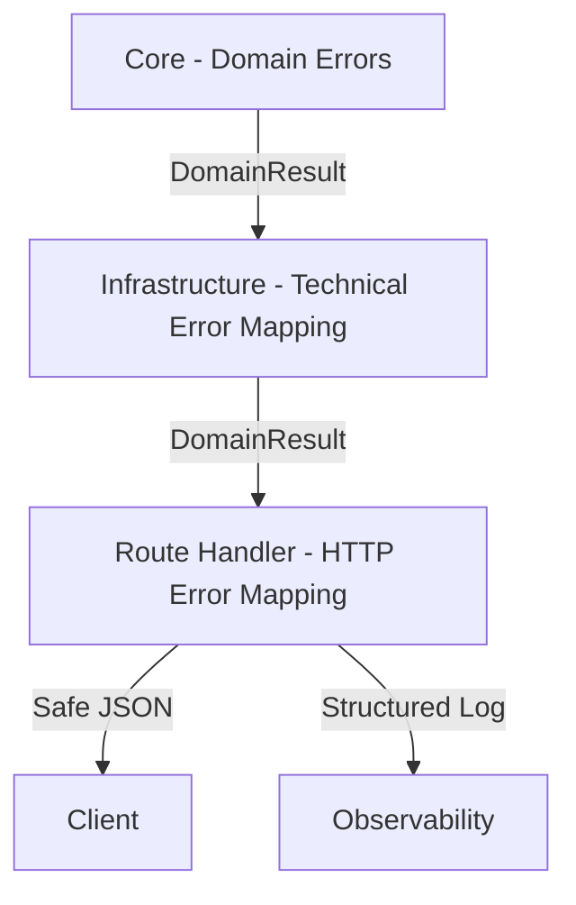

**Core layer**: Defines domain errors with stable codes. Returns `DomainResult<T>` from all use cases and repositories. No UI messages, no logging.

**Infrastructure layer**: Catches technical errors (database timeouts, Redis failures, S3 errors) and maps them to structured `AppError` with appropriate codes. Adds observability context.

**Route Handler (BFF)**: Maps `AppError.type` to HTTP status codes. Adds `correlationId` to all error responses. Sanitizes responses — never exposes stack traces, SQL, or internal URLs. Returns field-level validation errors for Zod failures.

**Presentation layer**: Maps error codes to i18n message keys. Determines UI behavior (toast, inline error, modal, redirect). Handles retry logic for retryable errors.

### Error Response Format

```typescript
// Success response
{ data: T }

// Error response
{
  code: string;
  message: string;
  correlationId: string;
  fields?: Record<string, string>; // For validation errors
}
```

### Retry Strategy

| Error Type | Retryable | Strategy |
|-----------|-----------|----------|
| `technical` (timeout, network) | Yes | Exponential backoff, max 3 retries |
| `validation` | No | Show field errors |
| `business` | No | Show user message |
| `authentication` | No | Redirect to login |
| `authorization` | No | Show access denied |
| `not_found` | No | Show not found page |
| `unexpected` | Maybe | Log + generic message |

### Background Job Error Handling

- Failed jobs retry up to 3 times with exponential backoff
- After all retries exhausted: log with `JOB_PROCESSING_FAILED`, job type, job ID, and error details
- Notification dispatch failures: retry 3 times, then mark as failed in notification record
- Audit log write failures: retry 3 times, then log to fallback error log (audit data must not be lost silently)

---

## Testing Strategy

### Testing Pyramid

```
        ┌─────────┐
        │  E2E    │  Playwright: critical user flows
        │  Tests  │  (login, payment, emergency)
        ├─────────┤
        │ Integr. │  Route handlers + mocked DI
        │  Tests  │  Repository + DB, BullMQ jobs
        ├─────────┤
        │         │  Use cases, mappers, validators
        │  Unit   │  Domain logic, error mapping
        │  Tests  │  ViewModels, utilities
        └─────────┘
```

### Testing Tools

- **Unit / Integration**: Jest + React Testing Library
- **Property-Based Testing**: fast-check (TypeScript PBT library)
- **E2E**: Playwright
- **Mocking**: DI-based mock injection (no global mocks)

### Property-Based Testing Configuration

Each property test:
- Uses **fast-check** library
- Runs minimum **100 iterations** per property
- References the design document property via tag comment
- Tag format: `Feature: societ-rt, Property {number}: {property_text}`

### Test Coverage Targets

| Layer | Minimum Coverage | Priority Areas |
|-------|-----------------|----------------|
| Core (use cases, mappers, entities) | >= 90% | Business logic, domain rules |
| Infrastructure (repositories, adapters) | >= 80% | Error mapping, data transformation |
| Presentation (ViewModels) | >= 80% | State management, error handling |
| Route Handlers (BFF) | >= 85% | Auth, validation, error responses |

### Unit Test Focus

- **Use cases**: Happy path, error path, edge cases, dependency failure
- **Mappers**: Field mapping correctness, fallback/default handling, DTO to Entity to View Model
- **Validators**: Zod schema validation for all API inputs
- **Domain utilities**: Pure function correctness
- **Error mapping**: HTTP status mapping, error code stability

### Property Test Focus

Each correctness property from the design document gets a dedicated property-based test:

| Property | Test Strategy |
|----------|--------------|
| P1: Tenant Isolation | Generate random users + tenant combinations, verify query scoping |
| P2: Tenant Uniqueness | Generate random tenant data, verify duplicate detection |
| P3: Auth Token Validity | Generate random tokens (valid/invalid/expired), verify acceptance/rejection |
| P4: RBAC Enforcement | Generate random user-role-endpoint combinations, verify access decisions |
| P5: CSV Round-Trip | Generate random resident datasets, verify export then import equivalence |
| P6: CSV Import Errors | Generate CSVs with mixed valid/invalid rows, verify correct handling |
| P7: Balance Invariant | Generate random transaction sequences, verify balance = sum(income) - sum(expense) |
| P8: Voting Duplicates | Generate random vote sequences per user, verify exactly-once semantics |
| P9: Plan Limits | Generate random tenants with plans, verify limit enforcement |
| P10: Error Consistency | Generate random errors, verify classification + HTTP mapping + sanitization |
| P11: Data Masking | Generate random NIK/phone values, verify masking output |
| P12: File Upload Safety | Generate random files with various sizes/types, verify validation + UUID naming |
| P13: Suspension Round-Trip | Generate random tenants, verify suspend then block then reactivate then restore |
| P14: Audit Immutability | Generate random audit entries, verify append-only + field completeness |
| P15: Impersonation Safety | Generate random impersonation sessions, verify token limits + audit tagging |

### Integration Test Focus

- Route handlers with mocked DI dependencies
- Repository implementations with test database
- BullMQ job processing with mocked external services
- Webhook signature validation (Midtrans/Xendit)
- Middleware chain (auth, tenant, feature flag)

### E2E Test Focus (Critical Paths)

1. **Login flow**: Register, Login, Access protected page, Logout
2. **Resident management**: Create household, Add resident, Export CSV, Import CSV
3. **Financial flow**: Record income, Record expense, View balance, Generate report
4. **Voting flow**: Create vote, Cast vote, View results
5. **Emergency flow**: Trigger alert, View alert, Resolve alert
6. **Subscription flow**: Subscribe to plan, Hit user limit, Upgrade plan
7. **Admin flow**: Suspend tenant, Verify blocked, Reactivate, Verify restored

### Security Testing

- Unauthorized access to protected endpoints
- Cross-tenant data access attempts
- Invalid/expired JWT handling
- Rate limiting on login endpoint
- Error response sanitization (no stack traces, no SQL)
- File upload with invalid MIME types and oversized files
- Open redirect prevention
- XSS prevention in user-generated content

---

## Architecture Updates (Requirements 31-44)

### Extended High-Level Architecture

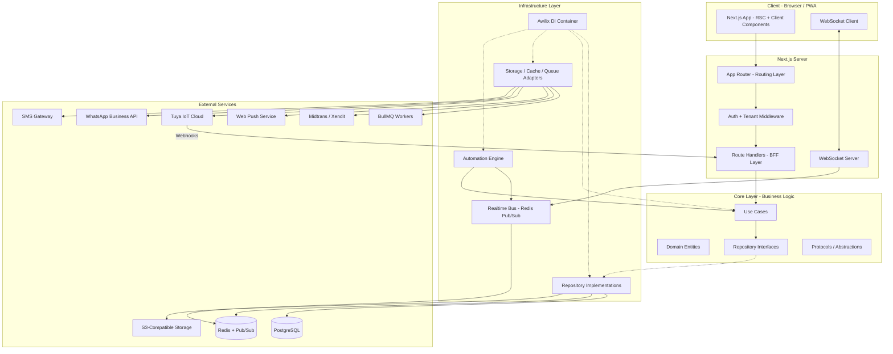

### New External Services

| Service | Purpose | Integration Method |
|---------|---------|-------------------|
| **Tuya IoT Cloud** | Smart home device management, commands, webhooks | REST API + OAuth 2.0 + HMAC-SHA256 webhooks |
| **WebSocket Server** | Realtime event delivery to connected clients | ws library on separate port or Socket.io |
| **Redis Pub/Sub** | Cross-instance event distribution | ioredis pub/sub channels |
| **WhatsApp Business API** | Critical security alert delivery | REST API with template messages |
| **SMS Gateway** | Fallback notification channel | REST API |
| **WebRTC (TURN/STUN)** | Low-latency CCTV live streaming | Browser-native WebRTC |

---

## New Domain Modules (Requirements 31-44)

Added to `src/core/domains/`:

```
src/core/domains/
 ... (existing modules)
 securityCenter/    # Security dashboard, neighborhood alerts, analytics
 incident/          # Incident lifecycle management, escalation
 gate/              # Gate monitoring, sensors, duration tracking
 cctv/              # CCTV streams, snapshots, motion detection
 patrol/            # Enhanced patrol with GPS, routes, checkpoints
 alarm/             # Smart alarm/siren management, zones, scheduling
 societHome/        # Device pairing, home dashboard, device commands
 iot/               # Tuya integration, device registry, webhooks
 automation/        # Rule engine, conditions, actions, chaining
 realtimeBus/       # WebSocket, Redis pub/sub, event routing
```

---

## New Interfaces and Protocols

```typescript
// WebSocket connection management
export interface WebSocketProtocol {
  broadcast(tenantId: string, channel: string, event: RealtimeEvent): Promise<void>;
  sendToUser(userId: string, event: RealtimeEvent): Promise<void>;
  sendToRole(tenantId: string, role: UserRole, event: RealtimeEvent): Promise<void>;
  getActiveConnections(tenantId: string): Promise<number>;
  disconnectUser(userId: string): Promise<void>;
}

// Realtime event bus (Redis pub/sub abstraction)
export interface RealtimeBusProtocol {
  publish(channel: string, event: RealtimeEvent): Promise<void>;
  subscribe(channel: string, handler: (event: RealtimeEvent) => void): Promise<void>;
  unsubscribe(channel: string): Promise<void>;
  getChannelSubscriberCount(channel: string): Promise<number>;
}

// IoT device gateway (Tuya Cloud abstraction)
export interface IoTGatewayProtocol {
  pairDevice(tenantId: string, householdId: string, pairingToken: string): Promise<DomainResult<IoTDevice>>;
  sendCommand(deviceId: string, command: DeviceCommand): Promise<DomainResult<CommandResult>>;
  syncDeviceStatus(deviceId: string): Promise<DomainResult<DeviceStatus>>;
  getDeviceList(householdId: string): Promise<DomainResult<IoTDevice[]>>;
  unpairDevice(deviceId: string): Promise<DomainResult<void>>;
  validateWebhookSignature(payload: string, signature: string, timestamp: string): boolean;
  refreshToken(): Promise<DomainResult<void>>;
}

// Automation rule engine
export interface AutomationEngineProtocol {
  evaluateRule(rule: AutomationRule, event: DeviceEvent): Promise<DomainResult<boolean>>;
  executeActions(rule: AutomationRule, triggerEvent: DeviceEvent): Promise<DomainResult<AutomationExecution>>;
  validateRuleDefinition(rule: CreateAutomationRuleInput): DomainResult<void>;
  getActiveRulesForEvent(tenantId: string, eventType: string): Promise<DomainResult<AutomationRule[]>>;
}

// Circuit breaker for external API calls
export interface CircuitBreakerProtocol {
  execute<T>(operation: () => Promise<T>): Promise<DomainResult<T>>;
  getState(): 'closed' | 'open' | 'half-open';
  reset(): void;
}

// Realtime event types
export interface RealtimeEvent {
  id: string;
  tenantId: string;
  channel: string;
  eventType: string;
  payload: Record<string, unknown>;
  privacy: 'shared' | 'private';
  targetHouseholdId?: string;
  timestamp: Date;
}

export type DeviceCommand = {
  deviceId: string;
  commandType: string;
  params: Record<string, unknown>;
  requestedBy: string;
};

export type CommandResult = {
  success: boolean;
  deviceId: string;
  commandType: string;
  responseTime: number;
  error?: string;
};
```

---

## New Entity Definitions (Requirements 31-44)

```typescript
// Incident (Requirement 32)
export interface Incident {
  id: string;
  tenantId: string;
  title: string;
  description: string;
  location: string;
  latitude: number | null;
  longitude: number | null;
  severity: 'low' | 'medium' | 'high' | 'critical';
  category: 'theft' | 'vandalism' | 'trespassing' | 'fire' | 'flood'
    | 'suspicious_activity' | 'noise_complaint' | 'device_alert' | 'other';
  status: 'open' | 'acknowledged' | 'in_progress' | 'escalated' | 'resolved' | 'closed';
  reportedBy: string;
  assignedTo: string | null;
  escalatedAt: Date | null;
  resolvedAt: Date | null;
  createdAt: Date;
  updatedAt: Date;
}

// IncidentLog (Requirement 32)
export interface IncidentLog {
  id: string;
  incidentId: string;
  status: Incident['status'];
  notes: string | null;
  actorId: string;
  timestamp: Date;
}

// Gate (Requirement 33)
export interface Gate {
  id: string;
  tenantId: string;
  name: string;
  location: string;
  latitude: number;
  longitude: number;
  deviceId: string;
  status: 'open' | 'closed' | 'offline';
  lastStateChange: Date;
  createdAt: Date;
}

// GateEvent (Requirement 33)
export interface GateEvent {
  id: string;
  gateId: string;
  tenantId: string;
  state: 'open' | 'closed';
  duration: number; // seconds of previous state
  timestamp: Date;
}

// CctvCamera (Requirement 34)
export interface CctvCamera {
  id: string;
  tenantId: string;
  name: string;
  rtspUrl: string; // encrypted at rest
  location: string;
  latitude: number;
  longitude: number;
  resolution: string;
  status: 'online' | 'offline' | 'motion_detected';
  lastOnline: Date;
  createdAt: Date;
}

// CctvSnapshot (Requirement 34)
export interface CctvSnapshot {
  id: string;
  cameraId: string;
  tenantId: string;
  fileUrl: string;
  triggerType: 'manual' | 'motion' | 'scheduled';
  timestamp: Date;
}

// PatrolRoute (Requirement 35)
export interface PatrolRoute {
  id: string;
  tenantId: string;
  name: string;
  checkpoints: { latitude: number; longitude: number; label: string }[];
  estimatedDuration: number; // minutes
  createdBy: string;
  createdAt: Date;
}

// PatrolSession (Requirement 35)
export interface PatrolSession {
  id: string;
  tenantId: string;
  routeId: string;
  guardId: string;
  status: 'active' | 'completed' | 'abandoned';
  startedAt: Date;
  completedAt: Date | null;
  checkpointsVisited: number;
  distanceTraveled: number; // meters
}

// PatrolCheckpointVisit (Requirement 35)
export interface PatrolCheckpointVisit {
  id: string;
  sessionId: string;
  checkpointIndex: number;
  latitude: number;
  longitude: number;
  visitedAt: Date;
}

// AlarmDevice (Requirement 36)
export interface AlarmDevice {
  id: string;
  tenantId: string;
  name: string;
  location: string;
  deviceId: string;
  zones: string[];
  scheduleArm: string | null; // HH:mm format
  scheduleDisarm: string | null; // HH:mm format
  status: 'armed' | 'disarmed' | 'triggered' | 'offline';
  createdAt: Date;
}

// AlarmEvent (Requirement 36)
export interface AlarmEvent {
  id: string;
  alarmDeviceId: string;
  tenantId: string;
  triggerSource: 'manual' | 'automation' | 'schedule';
  triggerType: string;
  duration: number; // seconds
  activatedAt: Date;
  deactivatedAt: Date | null;
}

// IoTDevice (Requirements 37, 38)
export interface IoTDevice {
  id: string;
  tenantId: string;
  householdId: string;
  tuyaDeviceId: string;
  deviceType: 'panic_button' | 'smart_siren' | 'smart_lock' | 'cctv'
    | 'motion_sensor' | 'smoke_detector' | 'door_sensor' | 'gate_sensor'
    | 'smart_switch' | 'smart_lighting';
  name: string;
  onlineStatus: 'online' | 'offline';
  batteryLevel: number | null;
  lastSeen: Date;
  metadata: Record<string, unknown>;
  createdAt: Date;
  updatedAt: Date;
}

// DeviceEvent (Requirements 37, 38, 40)
export interface DeviceEvent {
  id: string;
  deviceId: string;
  tenantId: string;
  eventType: 'panic_button_pressed' | 'gate_open' | 'gate_closed'
    | 'motion_detected' | 'smoke_detected' | 'alarm_triggered'
    | 'smart_lock_opened' | 'cctv_motion_detected' | 'device_online'
    | 'device_offline' | 'battery_low' | 'emergency_alert'
    | 'smart_switch_toggled' | 'lighting_changed' | 'gate_open_too_long'
    | 'motion_detection_alert';
  payload: Record<string, unknown>;
  isSharedSecurity: boolean;
  processedAt: Date | null;
  createdAt: Date;
}

// AutomationRule (Requirement 39)
export interface AutomationRule {
  id: string;
  tenantId: string;
  name: string;
  triggerEventType: DeviceEvent['eventType'];
  conditions: AutomationCondition[];
  actions: AutomationAction[];
  enabled: boolean;
  scheduleStart: string | null; // HH:mm
  scheduleEnd: string | null; // HH:mm
  maxChainDepth: number;
  executionCount: number;
  lastExecutedAt: Date | null;
  createdBy: string;
  createdAt: Date;
  updatedAt: Date;
}

export interface AutomationCondition {
  field: string;
  operator: 'equals' | 'not_equals' | 'greater_than' | 'less_than'
    | 'time_between' | 'duration_exceeds';
  value: string | number;
}

export interface AutomationAction {
  type: 'create_incident' | 'notify_security_guard' | 'notify_ketua_rt'
    | 'notify_emergency_contact' | 'trigger_siren' | 'capture_cctv_snapshot'
    | 'broadcast_neighborhood_alert' | 'send_push_notification';
  params: Record<string, unknown>;
}

// AutomationExecution (Requirement 39)
export interface AutomationExecution {
  id: string;
  ruleId: string;
  tenantId: string;
  triggerEvent: DeviceEvent;
  conditionsEvaluated: boolean;
  actionsExecuted: string[];
  durationMs: number;
  status: 'success' | 'partial_failure' | 'failure';
  error: string | null;
  executedAt: Date;
}

// Home (Requirement 37)
export interface Home {
  id: string;
  tenantId: string;
  householdId: string;
  ownerId: string;
  createdAt: Date;
}
```

---

## New Database Indexes (Requirements 31-44)

```sql
-- Incidents
CREATE INDEX idx_incidents_tenant_status ON incidents(tenant_id, status);
CREATE INDEX idx_incidents_tenant_severity ON incidents(tenant_id, severity);
CREATE INDEX idx_incidents_tenant_created ON incidents(tenant_id, created_at);
CREATE INDEX idx_incident_logs_incident ON incident_logs(incident_id, timestamp);

-- Gates
CREATE INDEX idx_gates_tenant_status ON gates(tenant_id, status);
CREATE INDEX idx_gate_events_gate_timestamp ON gate_events(gate_id, timestamp);
CREATE INDEX idx_gate_events_tenant ON gate_events(tenant_id, timestamp);

-- CCTV
CREATE INDEX idx_cctv_cameras_tenant_status ON cctv_cameras(tenant_id, status);
CREATE INDEX idx_cctv_snapshots_camera ON cctv_snapshots(camera_id, timestamp);
CREATE INDEX idx_cctv_snapshots_tenant ON cctv_snapshots(tenant_id, timestamp);

-- Patrol
CREATE INDEX idx_patrol_routes_tenant ON patrol_routes(tenant_id);
CREATE INDEX idx_patrol_sessions_tenant_status ON patrol_sessions(tenant_id, status);
CREATE INDEX idx_patrol_sessions_guard ON patrol_sessions(guard_id, started_at);
CREATE INDEX idx_patrol_checkpoint_visits_session ON patrol_checkpoint_visits(session_id);

-- Alarm
CREATE INDEX idx_alarm_devices_tenant_status ON alarm_devices(tenant_id, status);
CREATE INDEX idx_alarm_events_device ON alarm_events(alarm_device_id, activated_at);
CREATE INDEX idx_alarm_events_tenant ON alarm_events(tenant_id, activated_at);

-- IoT Devices
CREATE INDEX idx_iot_devices_tenant_household ON iot_devices(tenant_id, household_id);
CREATE INDEX idx_iot_devices_tenant_status ON iot_devices(tenant_id, online_status);
CREATE INDEX idx_iot_devices_tuya_id ON iot_devices(tuya_device_id);
CREATE INDEX idx_device_events_device ON device_events(device_id, created_at);
CREATE INDEX idx_device_events_tenant_type ON device_events(tenant_id, event_type, created_at);
CREATE INDEX idx_device_events_shared ON device_events(tenant_id, is_shared_security, created_at);

-- Automation
CREATE INDEX idx_automation_rules_tenant_enabled ON automation_rules(tenant_id, enabled);
CREATE INDEX idx_automation_rules_trigger ON automation_rules(tenant_id, trigger_event_type, enabled);
CREATE INDEX idx_automation_executions_rule ON automation_executions(rule_id, executed_at);
CREATE INDEX idx_automation_executions_tenant ON automation_executions(tenant_id, executed_at);

-- Homes
CREATE INDEX idx_homes_tenant_household ON homes(tenant_id, household_id);
CREATE INDEX idx_homes_owner ON homes(owner_id);
```

---

## New Caching Strategy Entries (Requirements 31-44)

| Key Pattern | TTL | Purpose |
|------------|-----|---------|
| `security_dashboard:{tenantId}` | 10 sec | Security center dashboard metrics |
| `gate_status:{tenantId}` | 5 sec | Current gate statuses for tenant |
| `device_status:{deviceId}` | 30 sec | IoT device online/offline status |
| `device_list:{householdId}` | 60 sec | Devices for a household |
| `automation_rules:{tenantId}:{eventType}` | 5 min | Active rules for event type |
| `patrol_active:{tenantId}` | 10 sec | Active patrol sessions |
| `cctv_status:{tenantId}` | 10 sec | Camera online/offline statuses |
| `alarm_status:{tenantId}` | 10 sec | Alarm device statuses |
| `circuit_breaker:tuya` | N/A | Circuit breaker state (in-memory) |
| `ws_connections:{tenantId}` | 30 sec | Active WebSocket connection count |
| `escalation_timer:{incidentId}` | 15 min | Incident escalation countdown |
| `notification_ack:{eventId}` | 1 hour | Notification acknowledgment status |

---

## Realtime Architecture (Requirements 40, 31)

### WebSocket Server Architecture

```mermaid
graph TB
    subgraph Clients["Connected Clients"]
        C1[Security Guard - WS]
        C2[Ketua RT - WS]
        C3[Home Owner - WS]
    end

    subgraph WSLayer["WebSocket Layer"]
        WSServer[WebSocket Server]
        AuthHandler[JWT Auth on Handshake]
        ChannelRouter[Channel Router]
        PrivacyFilter[Privacy Filter]
    end

    subgraph PubSub["Redis Pub/Sub"]
        SecurityCh[security_events:{tenantId}]
        DeviceCh[device_events:{tenantId}]
        IncidentCh[incident_updates:{tenantId}]
        GateCh[gate_events:{tenantId}]
        CctvCh[cctv_events:{tenantId}]
        PatrolCh[patrol_events:{tenantId}]
        AlarmCh[alarm_events:{tenantId}]
    end

    subgraph Queue["Guaranteed Delivery"]
        BullMQ[BullMQ - Critical Events Queue]
        ReplayBuffer[Event Replay Buffer - 1hr]
    end

    C1 <--> WSServer
    C2 <--> WSServer
    C3 <--> WSServer
    WSServer --> AuthHandler
    AuthHandler --> ChannelRouter
    ChannelRouter --> PrivacyFilter
    PrivacyFilter --> SecurityCh
    PrivacyFilter --> DeviceCh
    PrivacyFilter --> IncidentCh
    PrivacyFilter --> GateCh
    PrivacyFilter --> CctvCh
    PrivacyFilter --> PatrolCh
    PrivacyFilter --> AlarmCh
    SecurityCh --> BullMQ
    BullMQ --> ReplayBuffer
```

### Event Routing Logic

```typescript
// Event classification and routing
const SHARED_SECURITY_EVENTS = [
  'panic_button_pressed',
  'smoke_detected',
  'gate_open_too_long',
  'alarm_triggered',
  'emergency_alert',
  'motion_detection_alert',
] as const;

const PRIVATE_HOME_EVENTS = [
  'smart_lock_opened',
  'smart_switch_toggled',
  'lighting_changed',
  'device_online',
  'device_offline',
  'battery_low',
] as const;

// Routing decision
function routeEvent(event: DeviceEvent): EventRouting {
  if (SHARED_SECURITY_EVENTS.includes(event.eventType)) {
    return {
      privacy: 'shared',
      targetRoles: ['Ketua_RT', 'Pengurus', 'Security_Guard'],
      channels: ['security_events', 'device_events'],
    };
  }
  return {
    privacy: 'private',
    targetHouseholdId: event.householdId,
    channels: ['device_events'],
  };
}
```

### Tenant Isolation on Channels

- Each Redis pub/sub channel is namespaced by 	enantId: {channel}:{tenantId}
- WebSocket connections are tagged with 	enantId and userId on handshake
- Channel subscriptions are validated against the authenticated tenant
- Cross-tenant message delivery is impossible by design

### Privacy Enforcement on Event Delivery

1. Event arrives at Realtime Bus
2. Event is classified as shared or private
3. If shared: broadcast to all Security_Guard, Pengurus, Ketua_RT connections in tenant
4. If private: deliver ONLY to WebSocket connections where userId matches the Home_Owner of the device's household
5. Privacy filter runs on every message before delivery  no bypass path exists

### Reconnection and Event Replay

- Critical events (panic, smoke, emergency) are queued in BullMQ with 1-hour TTL
- On client reconnect, server checks for queued events since last disconnect timestamp
- Non-critical events are not replayed (client fetches latest state via REST)

### Connection Scaling

- Target: 500 concurrent connections per tenant
- WebSocket server runs as a separate process (not in Next.js request lifecycle)
- Redis pub/sub enables horizontal scaling across multiple WS server instances
- Heartbeat: 30-second ping/pong, disconnect after 3 missed pongs

---

## Tuya IoT Integration Architecture (Requirements 38, 44)

### OAuth Token Lifecycle

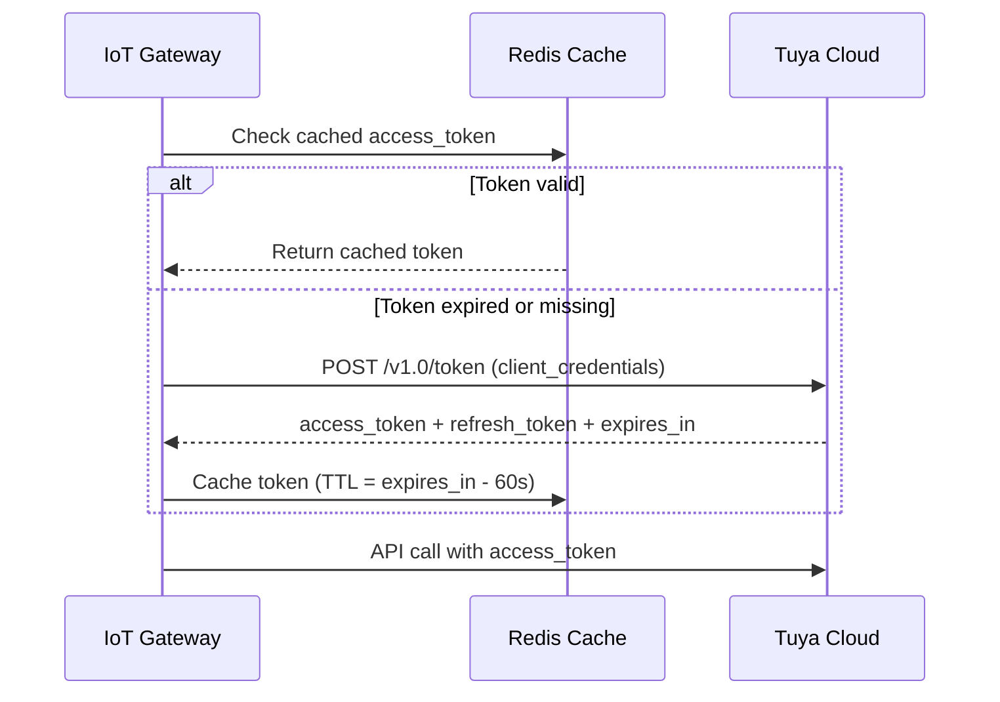

### Webhook Processing Flow

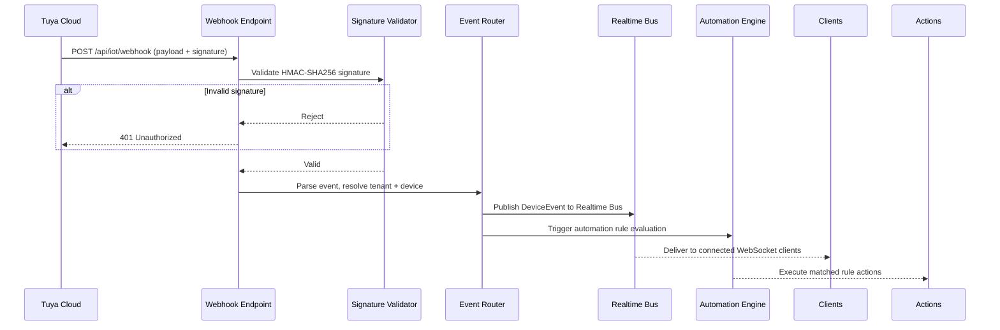

### Device Command Execution with Retry

```typescript
// Retry strategy: exponential backoff (1s, 2s, 4s), max 3 attempts
async function executeDeviceCommand(
  deviceId: string,
  command: DeviceCommand,
): Promise<DomainResult<CommandResult>> {
  const maxRetries = 3;
  const baseDelay = 1000; // 1 second

  for (let attempt = 1; attempt <= maxRetries; attempt++) {
    const result = await iotGateway.sendCommand(deviceId, command);
    if (result.success) return result;

    if (attempt < maxRetries) {
      const delay = baseDelay * Math.pow(2, attempt - 1); // 1s, 2s, 4s
      await sleep(delay);
    }
  }

  return {
    success: false,
    error: { type: 'technical', code: 'IOT_COMMAND_FAILED', message: '...' },
  };
}
```

### Circuit Breaker Pattern

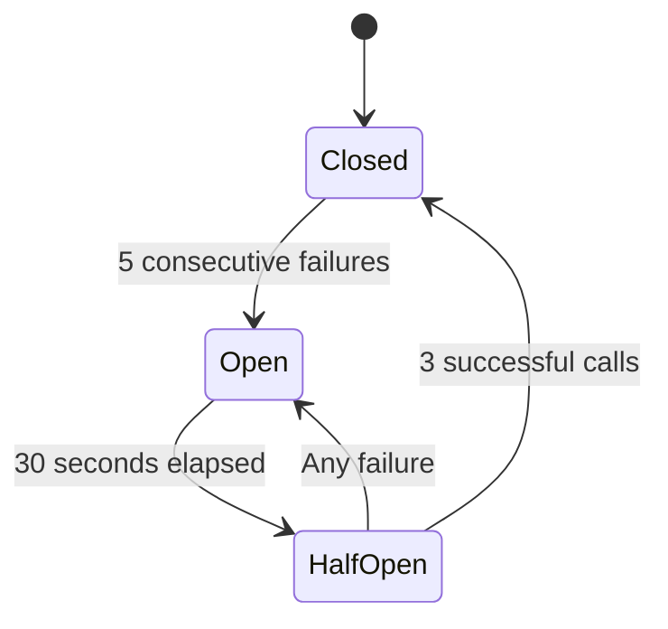

- **Closed**: All requests pass through normally
- **Open**: All requests immediately fail with IOT_CLOUD_UNAVAILABLE, commands queued for up to 5 minutes
- **Half-Open**: Limited requests pass through (probe), 3 successes required to close

### Device Health Monitoring

- Heartbeat check: every 60 seconds per device
- Offline threshold: no status update for 120 seconds
- Battery alert: below 20% triggers attery_low event
- Metrics emitted to OpenTelemetry: online count, offline count, command latency p95

---

## Automation Engine Architecture (Requirement 39)

### Rule Evaluation Pipeline

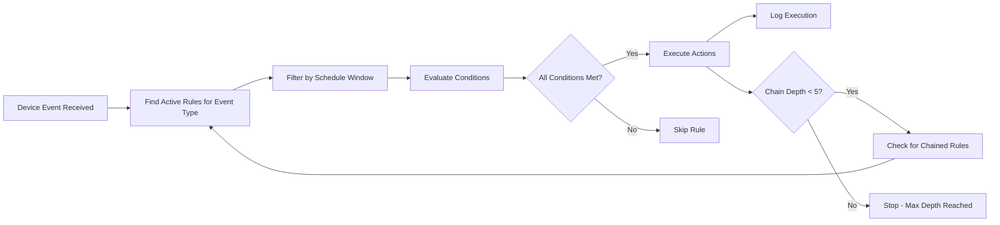

### Condition Evaluation

```typescript
function evaluateCondition(
  condition: AutomationCondition,
  event: DeviceEvent,
): boolean {
  const fieldValue = event.payload[condition.field];

  switch (condition.operator) {
    case 'equals': return fieldValue === condition.value;
    case 'not_equals': return fieldValue !== condition.value;
    case 'greater_than': return Number(fieldValue) > Number(condition.value);
    case 'less_than': return Number(fieldValue) < Number(condition.value);
    case 'time_between': return isCurrentTimeBetween(condition.value as string);
    case 'duration_exceeds': return Number(fieldValue) > Number(condition.value);
    default: return false;
  }
}
```

### Action Execution

- Actions execute sequentially within a rule
- If one action fails, remaining actions still execute (partial failure)
- Failed actions are logged with error details
- Ketua_RT is notified of partial failures
- Each execution is recorded with: rule_id, trigger_event, conditions_evaluated, actions_executed, duration_ms, status

### Rule Chaining with Depth Limit

- Maximum chain depth: 5 levels
- Chain depth counter is passed through the evaluation pipeline
- If depth >= 5, rule evaluation stops and logs a warning
- Prevents infinite loops from circular rule dependencies

### Scheduling

- Rules can have scheduleStart and scheduleEnd (HH:mm format)
- Rules outside their schedule window are skipped during evaluation
- Schedule check happens before condition evaluation (fast path)

---

## Correctness Properties (Requirements 31-44)

### Property 16: Device Ownership Isolation

*For any* IoT device and any user, if the user is NOT the Home_Owner of the Household where the device is registered, the system SHALL reject any attempt to view device details, send commands, or access Private_Home_Events for that device with error code IOT_DEVICE_ACCESS_DENIED.

**Validates: Requirements 37.6, 38.10, 41.4, 41.5**

### Property 17: Event Classification Correctness

*For any* DeviceEvent, the system SHALL classify it as a Shared_Security_Event if and only if its eventType is one of: panic_button_pressed, smoke_detected, gate_open_too_long, alarm_triggered, emergency_alert, or motion_detection_alert. All other event types SHALL be classified as Private_Home_Events. The classification function SHALL be deterministic and total (every event gets exactly one classification).

**Validates: Requirements 41.1, 41.2, 41.3**

### Property 18: Automation Rule Validation and Chain Safety

*For any* automation rule definition, the system SHALL accept it if and only if: the trigger event type is a valid DeviceEvent type, all conditions reference valid operators and field types, all actions reference valid action types with required parameters, and the rule does not create a chain cycle. Additionally, *for any* rule chain execution, the system SHALL halt execution when chain depth reaches 5, preventing infinite loops.

**Validates: Requirements 39.6, 39.12**

### Property 19: Automation Execution Completeness

*For any* automation rule with N configured actions, when the rule is triggered and conditions are met, the system SHALL attempt to execute all N actions regardless of individual action failures. The execution log SHALL record exactly which actions succeeded and which failed, and the total count of attempted actions SHALL equal N.

**Validates: Requirements 39.5, 39.9**

### Property 20: Gate Duration Alert Correctness

*For any* gate and any configured threshold duration T, the system SHALL trigger a gate_open_too_long event if and only if the gate has been continuously open for a duration exceeding T. Gates open for duration less than or equal to T SHALL NOT trigger the alert. Gates that close before exceeding T SHALL NOT trigger the alert.

**Validates: Requirements 33.3, 33.4**

### Property 21: Incident Lifecycle Validity

*For any* incident, the system SHALL only allow the following state transitions: open to acknowledged, open to in_progress, open to escalated, acknowledged to in_progress, acknowledged to escalated, in_progress to escalated, in_progress to resolved, escalated to in_progress, escalated to resolved, resolved to closed. Any transition not in this set SHALL be rejected.

**Validates: Requirements 32.2, 32.4**

### Property 22: WebSocket Tenant Isolation

*For any* WebSocket client authenticated with tenant T1 and any event published to tenant T2 where T1 != T2, the client SHALL NOT receive the event. Conversely, *for any* event published to tenant T1, all connected clients authenticated with tenant T1 (with appropriate role/ownership) SHALL receive the event.

**Validates: Requirements 40.4**

### Property 23: Webhook Signature Validation

*For any* incoming Tuya webhook request, the system SHALL accept the request if and only if the HMAC-SHA256 signature computed from the request payload and the stored client secret matches the provided signature header. Requests with invalid, missing, or tampered signatures SHALL be rejected with HTTP 401.

**Validates: Requirements 38.4, 38.11**

### Property 24: IoT Command Retry Correctness

*For any* device command that fails, the system SHALL retry exactly 3 times with exponential backoff delays of 1 second, 2 seconds, and 4 seconds respectively. After the third failure, the system SHALL return error code IOT_COMMAND_FAILED without further retries. If any retry succeeds, the system SHALL return success immediately without further retries.

**Validates: Requirements 38.7**

### Property 25: Alarm Zone Targeting

*For any* zone-targeted alarm activation request specifying zone Z, the system SHALL activate only siren devices that are associated with zone Z. Siren devices associated with other zones SHALL NOT be activated. The set of activated sirens SHALL be exactly the set of sirens whose zone list contains Z.

**Validates: Requirements 36.6**

### Property 26: Patrol Checkpoint Verification

*For any* Security_Guard GPS position and any checkpoint on their assigned route, the system SHALL record a checkpoint visit if and only if the Haversine distance between the guard's position and the checkpoint coordinates is less than or equal to 50 meters. Positions beyond 50 meters SHALL NOT trigger a checkpoint visit.

**Validates: Requirements 35.4**

### Property 27: Notification Escalation Correctness

*For any* security event with escalation tiers, if a notification is acknowledged by any recipient at any tier, the system SHALL immediately stop all further escalation for that event. No higher-tier notifications SHALL be dispatched after acknowledgment. Conversely, if no acknowledgment is received within the tier timeout, escalation SHALL proceed to the next tier.

**Validates: Requirements 43.3, 43.4**

### Property 28: CCTV Credential Encryption

*For any* CCTV camera registration containing RTSP credentials, the stored value in the database SHALL NOT equal the plaintext input. The stored value SHALL be an AES-256 encrypted ciphertext that, when decrypted with the correct key, produces the original plaintext. Reading credentials from the database without decryption SHALL never expose usable RTSP URLs.

**Validates: Requirements 34.10, 41.7**

### Property 29: Circuit Breaker State Machine

*For any* sequence of Tuya API call results, the circuit breaker SHALL transition from Closed to Open after exactly 5 consecutive failures, from Open to Half-Open after 30 seconds of no requests, from Half-Open to Closed after 3 consecutive successes, and from Half-Open back to Open after any single failure. No other state transitions SHALL occur.

**Validates: Requirements 38.13**

### Property 30: Private Event Privacy

*For any* Private_Home_Event (smart_lock_opened, smart_switch_toggled, lighting_changed, device_online, device_offline, battery_low for non-security devices), the Realtime Bus SHALL deliver the event ONLY to WebSocket connections authenticated as the Home_Owner of the device's Household. The event SHALL NOT be delivered to any Ketua_RT, Pengurus, or Security_Guard connection, regardless of their role privileges.

**Validates: Requirements 37.9, 40.5**

---

## Updated Error Handling (Requirements 31-44)

### New Error Codes

| Module | Error Code | Type | HTTP Status | Description |
|--------|-----------|------|-------------|-------------|
| IoT | IOT_COMMAND_FAILED | technical | 502 | Device command failed after all retries |
| IoT | IOT_DEVICE_ACCESS_DENIED | authorization | 403 | User is not the device owner |
| IoT | IOT_WEBHOOK_SIGNATURE_INVALID | authentication | 401 | Webhook HMAC signature mismatch |
| IoT | IOT_CLOUD_UNAVAILABLE | technical | 503 | Tuya Cloud API unreachable (circuit open) |
| IoT | IOT_DEVICE_OFFLINE | business | 409 | Device is offline, command cannot be delivered |
| IoT | IOT_PAIRING_FAILED | technical | 502 | Device pairing process failed |
| IoT | IOT_RATE_LIMIT_EXCEEDED | business | 429 | Too many commands per device per minute |
| Security | INCIDENT_INVALID_TRANSITION | business | 409 | Invalid incident status transition |
| Security | INCIDENT_ALREADY_RESOLVED | business | 409 | Cannot modify a resolved/closed incident |
| CCTV | CCTV_CAMERA_OFFLINE | business | 409 | Camera is offline, cannot capture snapshot |
| CCTV | CCTV_STREAM_UNAVAILABLE | technical | 503 | RTSP stream not accessible |
| Alarm | ALARM_DEVICE_UNRESPONSIVE | technical | 502 | Siren did not respond to activation |
| Alarm | ALARM_ZONE_NOT_FOUND | not_found | 404 | Specified alarm zone does not exist |
| Automation | AUTOMATION_RULE_INVALID | validation | 400 | Rule definition has invalid structure |
| Automation | AUTOMATION_RULE_LIMIT_EXCEEDED | business | 409 | Tenant has reached 50 active rules |
| Automation | AUTOMATION_CHAIN_DEPTH_EXCEEDED | business | 409 | Rule chain exceeded max depth of 5 |
| Patrol | PATROL_ROUTE_NOT_FOUND | not_found | 404 | Patrol route does not exist |
| Patrol | PATROL_ALREADY_ACTIVE | business | 409 | Guard already has an active patrol session |
| Gate | GATE_SENSOR_OFFLINE | business | 409 | Gate sensor is not responding |
| Notification | NOTIFICATION_CHANNEL_FAILED | technical | 502 | Notification channel delivery failed |
| WebSocket | WS_AUTH_FAILED | authentication | 401 | WebSocket handshake JWT validation failed |
| WebSocket | WS_TENANT_MISMATCH | authorization | 403 | Client attempted cross-tenant subscription |

---

## Updated Testing Strategy (Requirements 31-44)

### New Property Test Focus (P16-P30)

| Property | Test Strategy |
|----------|--------------|
| P16: Device Ownership Isolation | Generate random users + devices + households, verify access control decisions |
| P17: Event Classification | Generate random DeviceEvents with all event types, verify shared/private classification |
| P18: Automation Rule Validation | Generate random rule definitions (valid/invalid), verify acceptance/rejection + chain depth halt |
| P19: Automation Execution Completeness | Generate random action lists with injected failures, verify all actions attempted |
| P20: Gate Duration Alert | Generate random gate open durations + thresholds, verify alert triggers exactly at threshold |
| P21: Incident Lifecycle | Generate random status transition sequences, verify only valid transitions succeed |
| P22: WebSocket Tenant Isolation | Generate random multi-tenant event scenarios, verify delivery scoping |
| P23: Webhook Signature Validation | Generate random payloads + valid/invalid HMAC signatures, verify accept/reject |
| P24: IoT Command Retry | Generate random failure sequences, verify retry count (3) + backoff timing (1s, 2s, 4s) |
| P25: Alarm Zone Targeting | Generate random zone configs + activation requests, verify correct siren set |
| P26: Patrol Checkpoint Verification | Generate random GPS coordinates + checkpoints, verify 50m threshold |
| P27: Notification Escalation | Generate random acknowledgment timings, verify escalation stops on ack |
| P28: CCTV Credential Encryption | Generate random RTSP URLs, verify stored != plaintext and decrypt roundtrip |
| P29: Circuit Breaker State Machine | Generate random success/failure sequences, verify state transitions |
| P30: Private Event Privacy | Generate random private events + connected clients, verify delivery only to owner |

### New Integration Test Focus Areas

- WebSocket connection lifecycle (connect, authenticate, subscribe, receive, disconnect)
- Redis pub/sub message delivery across multiple server instances
- Tuya webhook endpoint with signature validation
- IoT device command execution with circuit breaker
- Automation rule evaluation pipeline end-to-end
- Gate sensor event processing and duration tracking
- CCTV snapshot capture workflow
- Patrol GPS tracking and checkpoint auto-verification
- Alarm activation and deactivation flow
- Notification escalation timer with acknowledgment
- Device pairing flow with Tuya Cloud mock

### New E2E Test Paths

8. **Security Center flow**: View dashboard, create incident, update status, resolve
9. **IoT device flow**: Pair device, view status, send command, receive event
10. **Automation flow**: Create rule, trigger event, verify action execution
11. **Gate monitoring flow**: Register gate, receive open/close events, verify alert
12. **Patrol flow**: Create route, start patrol, visit checkpoints, complete patrol
13. **CCTV flow**: Register camera, view live stream, capture snapshot
14. **Alarm flow**: Register siren, trigger alarm, verify zone targeting

### New Security Testing

- IoT device ownership validation (cross-household access attempts)
- Private event privacy enforcement (role-based access attempts)
- Webhook signature tampering detection
- WebSocket tenant isolation (cross-tenant subscription attempts)
- CCTV credential encryption verification
- IoT command rate limiting enforcement
- Automation rule injection prevention (invalid rule definitions)
