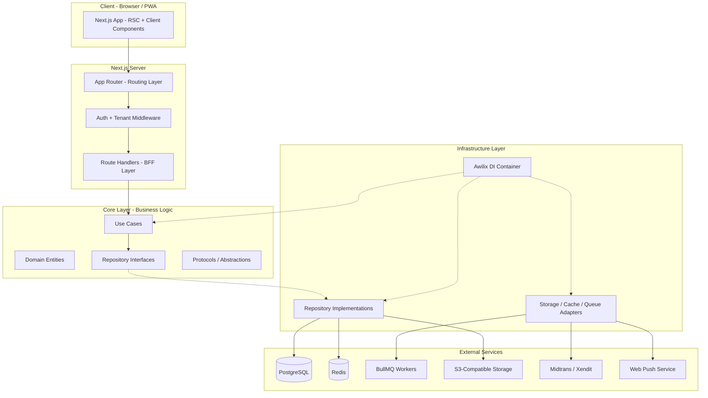
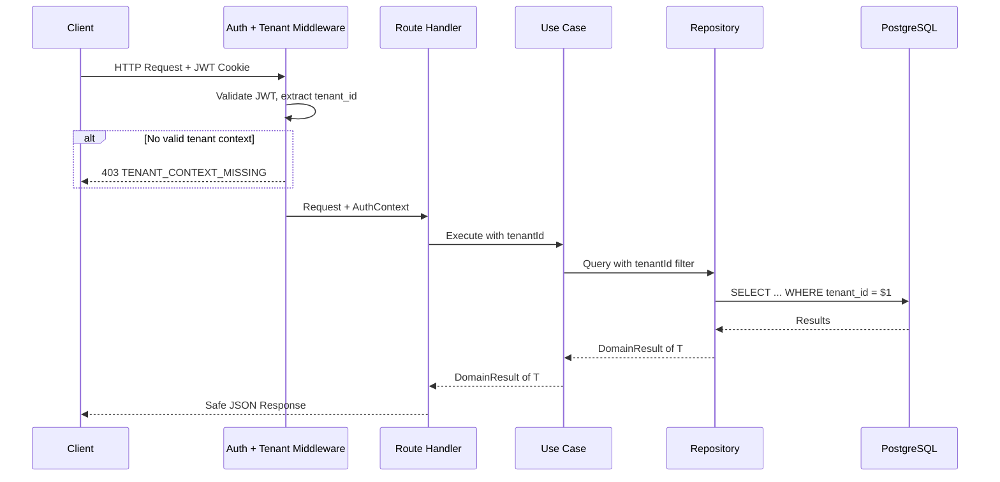
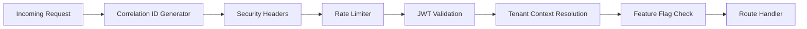
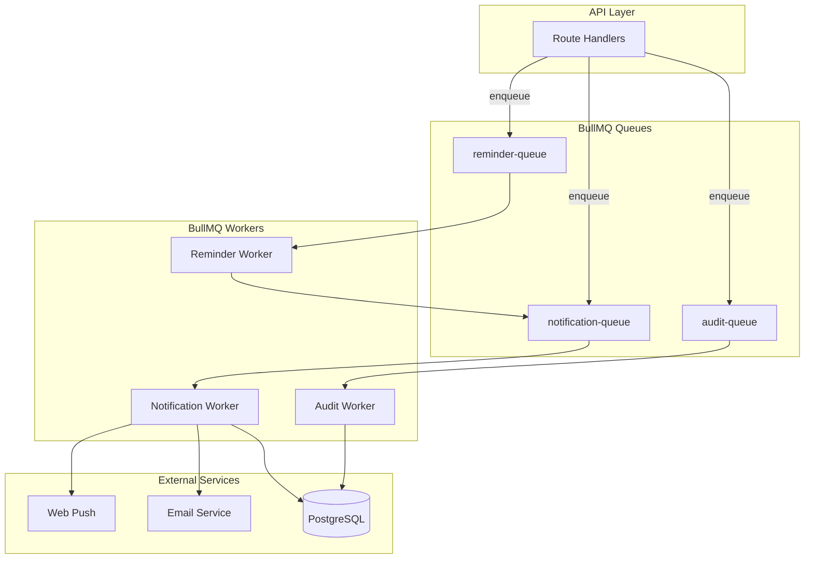
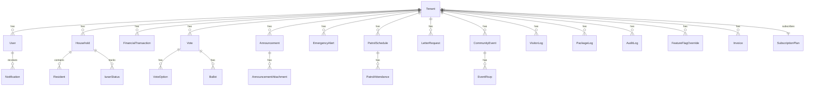
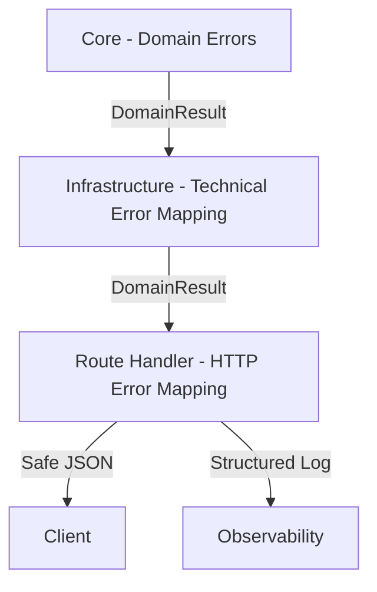

# Design Document — SocieT-RT

## Overview

SocieT-RT is a multi-tenant SaaS platform for managing RT/RW/housing/community organizations in Indonesia. The system enables community administrators to manage residents, finances, voting, announcements, security patrols, events, visitor logging, and administrative services — all within a tenant-isolated environment.

The platform follows **Clean Architecture + DDD** on **Next.js 15 App Router**, with strict layer separation (core → infrastructure → presentation → app). All business logic resides in use cases, all external access goes through repositories, and all dependencies are resolved via Awilix DI container.

### Key Design Decisions

1. **Shared-schema multi-tenancy**: All tenants share a single PostgreSQL database with `tenant_id` column filtering. This simplifies operations and reduces cost while maintaining data isolation through middleware-enforced tenant guards.

2. **BFF pattern via Next.js Route Handlers**: Next.js serves as both the frontend and the BFF layer. Route handlers (`app/api/`) act as the HTTP boundary — validating input, resolving auth context, calling use cases, and returning safe UI-centric responses.

3. **Asynchronous processing via BullMQ**: Notifications, audit logs, reminders, and other non-blocking operations are dispatched as background jobs to keep API response times fast.

4. **Custom auth with JWT + HTTP-only cookies**: No third-party auth provider. JWT tokens are issued on login and stored in HTTP-only secure cookies with `SameSite: Lax`.

5. **Feature flags tied to subscription plans**: Feature access is controlled per tenant based on their subscription plan (Free/Pro/Enterprise), with Super_Admin override capability.

6. **DomainResult pattern everywhere**: All repository and use case boundaries return `DomainResult<T>` to make success/error paths explicit and testable.

---

## Architecture

### High-Level Architecture



### Layer Responsibilities

| Layer | Responsibility | Allowed Dependencies |
|-------|---------------|---------------------|
| **App** | Routing, layouts, error boundaries | Presentation |
| **Presentation** | UI components, ViewModels, form validation | Core |
| **Core** | Entities, use cases, repository interfaces, domain errors | None (innermost) |
| **Infrastructure** | Repository implementations, adapters, DI container, Zustand stores | Core |

### Request Flow

```
HTTP Request
  → Next.js Middleware (auth check, tenant resolution)
  → Route Handler (input validation via Zod, auth context extraction)
  → Use Case (business logic, domain rules)
  → Repository Interface → Repository Implementation
  → Database / Redis / S3 / External Service
  → DomainResult<T>
  → Response mapping → Safe JSON response
```

### Multi-Tenant Isolation Flow



---

## Components and Interfaces

### Domain Modules

The system is organized into the following DDD bounded contexts (domains):

```
src/core/domains/
├── tenant/           # Tenant registration, configuration, branding
├── auth/             # Authentication, sessions, invitation tokens
├── rbac/             # Role-based access control, permissions
├── resident/         # Households, individuals, CSV import/export
├── finance/          # Kas, iuran, transactions, reports
├── voting/           # Votes, options, ballots
├── announcement/     # Announcements, categories, attachments
├── emergency/        # Emergency alerts, GPS, status tracking
├── map/              # Household coordinates, map markers
├── security/         # Patrol schedules, attendance, incidents
├── administration/   # Letter requests, approvals, PDF generation
├── event/            # Community events, RSVP
├── visitor/          # Visitor logs, package logs
├── billing/          # Subscription plans, invoices, payments
├── notification/     # Notification dispatch, inbox, channels
├── audit/            # Audit log entries
├── featureFlag/      # Feature flags, plan mappings, overrides
├── dashboard/        # Metrics aggregation
├── fileStorage/      # File upload, signed URLs
├── privacy/          # Data masking, consent, data export/deletion
└── operational/      # Tenant suspension, impersonation, health
```

### Key Interfaces (Core Protocols)

```typescript
// Core protocol for HTTP abstraction
export interface HttpProtocol {
  get<T>(url: string, config?: RequestConfig): Promise<T>;
  post<T>(url: string, body: unknown, config?: RequestConfig): Promise<T>;
  put<T>(url: string, body: unknown, config?: RequestConfig): Promise<T>;
  patch<T>(url: string, body: unknown, config?: RequestConfig): Promise<T>;
  delete<T>(url: string, config?: RequestConfig): Promise<T>;
}

// Core protocol for cache abstraction
export interface CacheProtocol {
  get<T>(key: string): Promise<T | null>;
  set<T>(key: string, value: T, ttlSeconds?: number): Promise<void>;
  delete(key: string): Promise<void>;
  invalidatePattern(pattern: string): Promise<void>;
}

// Core protocol for queue abstraction
export interface QueueProtocol {
  enqueue<T>(jobType: string, payload: T, options?: JobOptions): Promise<string>;
}

// Core protocol for file storage abstraction
export interface FileStorageProtocol {
  upload(params: UploadParams): Promise<FileMetadata>;
  getSignedUrl(key: string, expiresInSeconds: number): Promise<string>;
  delete(key: string): Promise<void>;
}

// Core protocol for auth context
export interface AuthContext {
  userId: string;
  tenantId: string;
  role: UserRole;
  isImpersonating?: boolean;
  impersonatorId?: string;
}

// DomainResult pattern
export type DomainResult<T> =
  | { success: true; data: T }
  | { success: false; error: AppError };
```

### Repository Interface Examples

```typescript
// Tenant Repository (Core)
export interface TenantRepository {
  create(tenant: CreateTenantInput): Promise<DomainResult<Tenant>>;
  findById(tenantId: string): Promise<DomainResult<Tenant | null>>;
  findBySubdomain(subdomain: string): Promise<DomainResult<Tenant | null>>;
  update(tenantId: string, data: UpdateTenantInput): Promise<DomainResult<Tenant>>;
  suspend(tenantId: string): Promise<DomainResult<void>>;
  reactivate(tenantId: string): Promise<DomainResult<void>>;
}

// Resident Repository (Core)
export interface ResidentRepository {
  createHousehold(tenantId: string, data: CreateHouseholdInput): Promise<DomainResult<Household>>;
  addResident(tenantId: string, householdId: string, data: CreateResidentInput): Promise<DomainResult<Resident>>;
  updateResidentStatus(tenantId: string, residentId: string, status: ResidencyStatus): Promise<DomainResult<Resident>>;
  exportToCsv(tenantId: string): Promise<DomainResult<string>>;
  importFromCsv(tenantId: string, csvContent: string): Promise<DomainResult<CsvImportResult>>;
  findByTenant(tenantId: string, filters: ResidentFilters): Promise<DomainResult<PaginatedResult<Resident>>>;
}

// Finance Repository (Core)
export interface FinanceRepository {
  recordTransaction(tenantId: string, data: CreateTransactionInput): Promise<DomainResult<FinancialTransaction>>;
  getBalance(tenantId: string): Promise<DomainResult<number>>;
  getIuranStatus(tenantId: string, householdId: string, month: string): Promise<DomainResult<IuranStatus>>;
  recordIuranPayment(tenantId: string, householdId: string, month: string): Promise<DomainResult<void>>;
  getReport(tenantId: string, dateRange: DateRange): Promise<DomainResult<FinancialReport>>;
}
```

### Use Case Pattern

```typescript
// Example: CreateVoteUseCase
export interface CreateVoteUseCase {
  execute(params: {
    authContext: AuthContext;
    input: CreateVoteInput;
  }): Promise<DomainResult<Vote>>;
}

export const CreateVoteUseCaseImpl = ({
  votingRepository,
  auditQueue,
  featureFlagService,
}: {
  votingRepository: VotingRepository;
  auditQueue: QueueProtocol;
  featureFlagService: FeatureFlagService;
}): CreateVoteUseCase => ({
  execute: async ({ authContext, input }) => {
    // Check feature flag
    const isEnabled = await featureFlagService.isEnabled(
      authContext.tenantId, 'voting'
    );
    if (!isEnabled) {
      return {
        success: false,
        error: {
          type: 'authorization',
          code: 'FEATURE_DISABLED',
          message: 'Voting feature is disabled',
        },
      };
    }

    // Business rule: must have at least 2 options
    if (input.options.length < 2) {
      return {
        success: false,
        error: {
          type: 'validation',
          code: 'VOTING_INSUFFICIENT_OPTIONS',
          message: 'At least 2 options required',
        },
      };
    }

    const result = await votingRepository.createVote(
      authContext.tenantId, input
    );

    // Enqueue audit log (async)
    if (result.success) {
      await auditQueue.enqueue('audit_log', {
        tenantId: authContext.tenantId,
        actorUserId: authContext.userId,
        actionType: 'vote_created',
        resourceType: 'vote',
        resourceId: result.data.id,
        details: { title: input.title },
      });
    }

    return result;
  },
});
```

### Middleware Stack



### BFF Route Handler Pattern

```typescript
// app/api/voting/route.ts
export async function POST(request: NextRequest) {
  const correlationId = request.headers.get('x-correlation-id')
    || generateCorrelationId();

  // 1. Validate input
  const body = await request.json();
  const validation = createVoteSchema.safeParse(body);
  if (!validation.success) {
    return NextResponse.json(
      {
        code: 'COMMON_VALIDATION_FAILED',
        fields: formatZodErrors(validation.error),
        correlationId,
      },
      { status: 400 },
    );
  }

  // 2. Resolve auth context from middleware
  const authContext = await resolveAuthContext(request);
  if (!authContext) {
    return NextResponse.json(
      { code: 'AUTH_TOKEN_INVALID', message: 'Unauthorized', correlationId },
      { status: 401 },
    );
  }

  // 3. Execute use case via DI
  const useCase = container.resolve<CreateVoteUseCase>('createVoteUseCase');
  const result = await useCase.execute({
    authContext,
    input: validation.data,
  });

  // 4. Map result to safe response
  if (!result.success) {
    return mapErrorToResponse(result.error, correlationId);
  }

  return NextResponse.json(
    { data: mapVoteToResponseDto(result.data) },
    { status: 201 },
  );
}
```

### Background Job Architecture



---

## Data Models

### Core Entities (ER Diagram)



### Key Entity Definitions

```typescript
// Tenant
export interface Tenant {
  id: string;
  name: string;
  subdomain: string;
  rtRwNumber: string;
  region: string;
  address: string;
  contactPerson: string;
  logoUrl: string | null;
  primaryColor: string | null;
  secondaryColor: string | null;
  status: 'active' | 'suspended';
  subscriptionPlanId: string;
  createdAt: Date;
  updatedAt: Date;
}

// User
export interface User {
  id: string;
  tenantId: string;
  name: string;
  email: string;
  passwordHash: string;
  role: 'Super_Admin' | 'Ketua_RT' | 'Pengurus' | 'Warga' | 'Security_Guard';
  status: 'active' | 'locked' | 'inactive';
  failedLoginAttempts: number;
  lockedUntil: Date | null;
  consentTimestamp: Date | null;
  consentVersion: string | null;
  createdAt: Date;
  updatedAt: Date;
  deletedAt: Date | null;
}

// Household
export interface Household {
  id: string;
  tenantId: string;
  householdNumber: string;
  address: string;
  block: string | null;
  latitude: number | null;
  longitude: number | null;
  createdAt: Date;
  updatedAt: Date;
}

// Resident
export interface Resident {
  id: string;
  tenantId: string;
  householdId: string;
  name: string;
  nik: string;
  dateOfBirth: Date;
  gender: 'male' | 'female';
  phone: string | null;
  status: 'tetap' | 'kontrak' | 'kos' | 'pindah';
  categories: ('lansia' | 'balita' | 'disabilitas')[];
  emergencyContactName: string | null;
  emergencyContactPhone: string | null;
  emergencyContactRelationship: string | null;
  createdAt: Date;
  updatedAt: Date;
  deletedAt: Date | null;
}

// FinancialTransaction
export interface FinancialTransaction {
  id: string;
  tenantId: string;
  type: 'income' | 'expense';
  amount: number;
  description: string;
  category: string;
  date: Date;
  createdBy: string;
  createdAt: Date;
  updatedAt: Date;
  deletedAt: Date | null;
}

// IuranStatus
export interface IuranStatus {
  id: string;
  tenantId: string;
  householdId: string;
  month: string; // YYYY-MM format
  status: 'paid' | 'unpaid';
  paidAt: Date | null;
  transactionId: string | null;
  createdAt: Date;
  updatedAt: Date;
}

// Vote
export interface Vote {
  id: string;
  tenantId: string;
  title: string;
  description: string;
  mode: 'anonymous' | 'verified';
  deadline: Date;
  createdBy: string;
  createdAt: Date;
  updatedAt: Date;
}

// VoteOption
export interface VoteOption {
  id: string;
  voteId: string;
  label: string;
  voteCount: number;
}

// Ballot
export interface Ballot {
  id: string;
  voteId: string;
  userId: string;
  optionId: string;
  createdAt: Date;
}

// Announcement
export interface Announcement {
  id: string;
  tenantId: string;
  title: string;
  content: string;
  category: 'umum' | 'keamanan' | 'keuangan' | 'kegiatan' | 'darurat';
  createdBy: string;
  publishedAt: Date | null;
  createdAt: Date;
  updatedAt: Date;
}

// EmergencyAlert
export interface EmergencyAlert {
  id: string;
  tenantId: string;
  userId: string;
  latitude: number | null;
  longitude: number | null;
  locationUnavailable: boolean;
  status: 'active' | 'responding' | 'resolved';
  createdAt: Date;
  updatedAt: Date;
}

// PatrolSchedule
export interface PatrolSchedule {
  id: string;
  tenantId: string;
  date: Date;
  timeSlot: string;
  assignedUserIds: string[];
  createdBy: string;
  createdAt: Date;
  updatedAt: Date;
}

// IncidentReport
export interface IncidentReport {
  id: string;
  tenantId: string;
  date: Date;
  time: string;
  description: string;
  location: string;
  severityLevel: 'low' | 'medium' | 'high' | 'critical';
  reportedBy: string;
  createdAt: Date;
}

// LetterRequest
export interface LetterRequest {
  id: string;
  tenantId: string;
  userId: string;
  letterType: 'surat_pengantar' | 'domisili' | 'SKTM';
  purpose: string;
  status: 'pending' | 'approved' | 'rejected';
  rejectionReason: string | null;
  documentUrl: string | null;
  decidedBy: string | null;
  decidedAt: Date | null;
  createdAt: Date;
  updatedAt: Date;
}

// CommunityEvent
export interface CommunityEvent {
  id: string;
  tenantId: string;
  title: string;
  description: string;
  date: Date;
  time: string;
  location: string;
  createdBy: string;
  createdAt: Date;
  updatedAt: Date;
}

// EventRsvp
export interface EventRsvp {
  id: string;
  eventId: string;
  userId: string;
  response: 'attending' | 'not_attending';
  createdAt: Date;
}

// VisitorLog
export interface VisitorLog {
  id: string;
  tenantId: string;
  visitorName: string;
  purpose: string;
  destinationHouseholdId: string;
  entryTimestamp: Date;
  exitTimestamp: Date | null;
  loggedBy: string;
  createdAt: Date;
  updatedAt: Date;
}

// PackageLog
export interface PackageLog {
  id: string;
  tenantId: string;
  recipientHouseholdId: string;
  courierName: string;
  description: string;
  arrivalTimestamp: Date;
  loggedBy: string;
  createdAt: Date;
}

// SubscriptionPlan
export interface SubscriptionPlan {
  id: string;
  name: 'Free' | 'Pro' | 'Enterprise';
  maxUsers: number | null; // null = unlimited
  features: string[];
  price: number;
  createdAt: Date;
  updatedAt: Date;
}

// Invoice
export interface Invoice {
  id: string;
  tenantId: string;
  planName: string;
  amount: number;
  billingPeriodStart: Date;
  billingPeriodEnd: Date;
  dueDate: Date;
  status: 'pending' | 'paid' | 'failed';
  gatewayTransactionId: string | null;
  paidAt: Date | null;
  retryCount: number;
  createdAt: Date;
  updatedAt: Date;
}

// Notification
export interface Notification {
  id: string;
  tenantId: string;
  userId: string;
  type: string;
  title: string;
  body: string;
  channel: 'push' | 'email' | 'inbox';
  status: 'unread' | 'read';
  createdAt: Date;
}

// AuditLog
export interface AuditLog {
  id: string;
  tenantId: string;
  actorUserId: string;
  actionType: string;
  resourceType: string;
  resourceId: string;
  details: Record<string, unknown>;
  ipAddress: string;
  impersonatorId: string | null;
  timestamp: Date;
}

// FeatureFlag
export interface FeatureFlag {
  id: string;
  featureName: string;
  planId: string;
  enabled: boolean;
}

// FeatureFlagOverride
export interface FeatureFlagOverride {
  id: string;
  tenantId: string;
  featureName: string;
  enabled: boolean;
  overriddenBy: string;
  createdAt: Date;
}
```

### Database Indexing Strategy

All tables with `tenant_id` will have composite indexes:

- `(tenant_id, id)` — primary lookup
- `(tenant_id, created_at)` — chronological listing
- `(tenant_id, status)` — filtered queries
- Domain-specific indexes:
  - `users`: `(tenant_id, email)` unique, `(tenant_id, role)`
  - `households`: `(tenant_id, household_number)` unique
  - `residents`: `(tenant_id, nik)` unique
  - `iuran_status`: `(tenant_id, household_id, month)` unique
  - `ballots`: `(vote_id, user_id)` unique
  - `event_rsvps`: `(event_id, user_id)` unique
  - `audit_logs`: `(tenant_id, timestamp)`, `(tenant_id, action_type)`
  - `notifications`: `(tenant_id, user_id, status, created_at)`
  - `invoices`: `(tenant_id, status, due_date)`

### Caching Strategy (Redis)

| Key Pattern | TTL | Purpose |
|------------|-----|---------|
| `dashboard:{tenantId}:ketua` | 5 min | Ketua_RT dashboard metrics |
| `dashboard:platform:admin` | 5 min | Super_Admin platform metrics |
| `feature_flags:{tenantId}` | 10 min | Tenant feature flag state |
| `session:{userId}` | JWT expiry | Session validation cache |
| `rate_limit:login:{ip}` | 1 min | Login rate limiting |
| `vote_tally:{voteId}` | 5 sec | Real-time vote tallies |


---

## Correctness Properties

*A property is a characteristic or behavior that should hold true across all valid executions of a system — essentially, a formal statement about what the system should do. Properties serve as the bridge between human-readable specifications and machine-verifiable correctness guarantees.*

### Property 1: Tenant Data Isolation

*For any* authenticated user and any database query executed on their behalf, the query results SHALL only contain records where `tenant_id` matches the user's tenant. Additionally, *for any* request without a valid tenant context, the system SHALL reject it, and *for any* request attempting to access a resource belonging to a different tenant, the system SHALL deny access.

**Validates: Requirements 1.3, 1.4, 1.5**

### Property 2: Tenant Registration Uniqueness

*For any* two tenant registration requests, if they share the same subdomain or the same RT/RW number within the same region, the second request SHALL be rejected with `TENANT_DUPLICATE`. Conversely, *for any* valid and unique tenant registration data, the system SHALL create a tenant with a unique `tenant_id` and a generated subdomain.

**Validates: Requirements 2.1, 2.2, 2.5**

### Property 3: Authentication Token Validity

*For any* valid user credentials, login SHALL produce a JWT stored in an HTTP-only cookie. *For any* expired, malformed, or invalid JWT token, the system SHALL reject the request with `AUTH_TOKEN_INVALID`. *For any* authenticated session that is logged out, subsequent requests using that session SHALL be rejected.

**Validates: Requirements 3.1, 3.6, 3.7**

### Property 4: Role-Based Access Enforcement

*For any* user and any protected endpoint, if the user's role is insufficient for that endpoint, the system SHALL reject the request with `AUTH_INSUFFICIENT_ROLE` (HTTP 403). *For any* Ketua_RT assigning a valid non-Super_Admin role to a user within the same tenant, the assignment SHALL succeed.

**Validates: Requirements 4.2, 4.3**

### Property 5: Resident CSV Round-Trip

*For any* valid set of resident records within a tenant, exporting to CSV and then importing that CSV back SHALL produce an equivalent dataset. The CSV SHALL follow the defined column schema (household_number, name, NIK, date_of_birth, gender, phone, status, categories, emergency_contact_name, emergency_contact_phone, emergency_contact_relationship).

**Validates: Requirements 5.7, 5.8, 6.1, 6.2, 6.3**

### Property 6: CSV Import Error Handling

*For any* CSV file containing a mix of valid and invalid rows, the import process SHALL create records for all valid rows, skip all invalid rows, and return a summary report listing each skipped row with its error description. The count of created records plus the count of skipped rows SHALL equal the total number of data rows in the CSV.

**Validates: Requirements 5.9**

### Property 7: Financial Balance Invariant

*For any* tenant and any sequence of income and expense transactions, the running balance SHALL equal the sum of all income transaction amounts minus the sum of all expense transaction amounts. *For any* transaction with an amount that is zero or negative, the system SHALL reject it with `FINANCE_INVALID_AMOUNT`.

**Validates: Requirements 7.1, 7.2, 7.3, 7.9**

### Property 8: Voting Duplicate Prevention

*For any* user and any active vote (before deadline), casting a vote SHALL succeed exactly once. *For any* subsequent attempt by the same user on the same vote, the system SHALL reject it with `VOTING_ALREADY_VOTED`. *For any* vote attempt after the deadline has passed, the system SHALL reject it with `VOTING_DEADLINE_PASSED`.

**Validates: Requirements 8.3, 8.4, 8.5**

### Property 9: Subscription Plan Limit Enforcement

*For any* tenant and their current subscription plan, the system SHALL enforce the plan's user limit (Free: 50, Pro: 500, Enterprise: unlimited). *For any* attempt to add a user beyond the plan's limit, the system SHALL reject it with `BILLING_USER_LIMIT_EXCEEDED`. *For any* feature-flagged endpoint, if the feature is disabled for the tenant's plan (and no override exists), the system SHALL reject access with `FEATURE_DISABLED`.

**Validates: Requirements 16.2, 16.3, 16.4, 16.5, 16.6, 19.2, 19.3**

### Property 10: Error Response Consistency

*For any* error produced by the system, it SHALL be classified into one of seven types (validation, business, authentication, authorization, not_found, technical, unexpected), include a stable error code, and be mapped to the correct HTTP status (validation to 400, authentication to 401, authorization to 403, not_found to 404, business conflict to 409, unexpected to 500). The error response SHALL NOT contain stack traces, internal class names, SQL queries, or internal endpoint URLs.

**Validates: Requirements 21.5, 22.1, 22.2, 22.4**

### Property 11: Sensitive Data Masking

*For any* NIK value displayed or returned via API (except to the data owner or Ketua_RT), the output SHALL show only the last 4 digits with the rest masked. *For any* phone number in list views (except to the data owner, Ketua_RT, or Pengurus), the output SHALL show only the last 4 digits. *For any* audit log entry, sensitive fields (NIK, phone numbers, email addresses) SHALL be masked in the details.

**Validates: Requirements 27.1, 27.2, 27.7**

### Property 12: File Upload Safety

*For any* uploaded file, the system SHALL validate that the file size does not exceed 10MB and the MIME type is one of the allowed types (image/jpeg, image/png, application/pdf, application/vnd.openxmlformats-officedocument.spreadsheetml.sheet). The stored filename SHALL be UUID-based (not the original filename). The storage path SHALL include the tenant_id in the structure `{tenant_id}/{domain}/{filename}`.

**Validates: Requirements 26.2, 26.3, 26.5**

### Property 13: Tenant Suspension Round-Trip

*For any* active tenant, suspending it SHALL block all API access for users within that tenant (returning `TENANT_SUSPENDED`). *For any* suspended tenant, reactivating it SHALL restore full API access. Suspending then reactivating SHALL return the tenant to its original operational state.

**Validates: Requirements 30.1, 30.2**

### Property 14: Audit Log Immutability and Completeness

*For any* audit log entry, the system SHALL store it as an append-only record that cannot be modified or deleted through the application API. *For any* audit entry, all required fields (audit_id, tenant_id, actor_user_id, action_type, resource_type, resource_id, details, ip_address, timestamp) SHALL be present. Sensitive data (passwords, tokens, OTP) SHALL be excluded from audit entry details.

**Validates: Requirements 18.2, 18.5, 18.6**

### Property 15: Impersonation Safety

*For any* Super_Admin impersonation session, the system SHALL create a time-limited token (maximum 60 minutes) and tag all actions during the session with both the impersonator's and the impersonated user's IDs in the audit log. *For any* expired or ended impersonation session, the token SHALL be immediately revoked and the session end event logged.

**Validates: Requirements 30.4, 30.5, 30.6**

---

## Error Handling

### Error Classification

All errors follow the seven-type classification defined in the steering guidelines:

| Error Type | HTTP Status | Example Codes |
|-----------|-------------|---------------|
| `validation` | 400 | `COMMON_VALIDATION_FAILED` |
| `business` | 409 | `FINANCE_INVALID_AMOUNT`, `VOTING_DEADLINE_PASSED`, `BILLING_USER_LIMIT_EXCEEDED` |
| `authentication` | 401 | `AUTH_TOKEN_INVALID`, `AUTH_INVALID_CREDENTIALS`, `AUTH_ACCOUNT_LOCKED` |
| `authorization` | 403 | `AUTH_INSUFFICIENT_ROLE`, `TENANT_ACCESS_DENIED`, `FEATURE_DISABLED`, `TENANT_SUSPENDED` |
| `not_found` | 404 | `COMMON_NOT_FOUND` |
| `technical` | 500/502/503 | `NOTIFICATION_DISPATCH_FAILED`, `JOB_PROCESSING_FAILED` |
| `unexpected` | 500 | `COMMON_UNEXPECTED_ERROR` |

### Error Model

```typescript
export interface AppError {
  type: 'validation' | 'business' | 'authentication' | 'authorization'
    | 'not_found' | 'technical' | 'unexpected';
  code: string;
  message: string;
  userMessage?: string;
  retryable?: boolean;
  cause?: unknown;
}
```

### Error Flow per Layer



**Core layer**: Defines domain errors with stable codes. Returns `DomainResult<T>` from all use cases and repositories. No UI messages, no logging.

**Infrastructure layer**: Catches technical errors (database timeouts, Redis failures, S3 errors) and maps them to structured `AppError` with appropriate codes. Adds observability context.

**Route Handler (BFF)**: Maps `AppError.type` to HTTP status codes. Adds `correlationId` to all error responses. Sanitizes responses — never exposes stack traces, SQL, or internal URLs. Returns field-level validation errors for Zod failures.

**Presentation layer**: Maps error codes to i18n message keys. Determines UI behavior (toast, inline error, modal, redirect). Handles retry logic for retryable errors.

### Error Response Format

```typescript
// Success response
{ data: T }

// Error response
{
  code: string;
  message: string;
  correlationId: string;
  fields?: Record<string, string>; // For validation errors
}
```

### Retry Strategy

| Error Type | Retryable | Strategy |
|-----------|-----------|----------|
| `technical` (timeout, network) | Yes | Exponential backoff, max 3 retries |
| `validation` | No | Show field errors |
| `business` | No | Show user message |
| `authentication` | No | Redirect to login |
| `authorization` | No | Show access denied |
| `not_found` | No | Show not found page |
| `unexpected` | Maybe | Log + generic message |

### Background Job Error Handling

- Failed jobs retry up to 3 times with exponential backoff
- After all retries exhausted: log with `JOB_PROCESSING_FAILED`, job type, job ID, and error details
- Notification dispatch failures: retry 3 times, then mark as failed in notification record
- Audit log write failures: retry 3 times, then log to fallback error log (audit data must not be lost silently)

---

## Testing Strategy

### Testing Pyramid

```
        ┌─────────┐
        │  E2E    │  Playwright: critical user flows
        │  Tests  │  (login, payment, emergency)
        ├─────────┤
        │ Integr. │  Route handlers + mocked DI
        │  Tests  │  Repository + DB, BullMQ jobs
        ├─────────┤
        │         │  Use cases, mappers, validators
        │  Unit   │  Domain logic, error mapping
        │  Tests  │  ViewModels, utilities
        └─────────┘
```

### Testing Tools

- **Unit / Integration**: Jest + React Testing Library
- **Property-Based Testing**: fast-check (TypeScript PBT library)
- **E2E**: Playwright
- **Mocking**: DI-based mock injection (no global mocks)

### Property-Based Testing Configuration

Each property test:
- Uses **fast-check** library
- Runs minimum **100 iterations** per property
- References the design document property via tag comment
- Tag format: `Feature: societ-rt, Property {number}: {property_text}`

### Test Coverage Targets

| Layer | Minimum Coverage | Priority Areas |
|-------|-----------------|----------------|
| Core (use cases, mappers, entities) | >= 90% | Business logic, domain rules |
| Infrastructure (repositories, adapters) | >= 80% | Error mapping, data transformation |
| Presentation (ViewModels) | >= 80% | State management, error handling |
| Route Handlers (BFF) | >= 85% | Auth, validation, error responses |

### Unit Test Focus

- **Use cases**: Happy path, error path, edge cases, dependency failure
- **Mappers**: Field mapping correctness, fallback/default handling, DTO to Entity to View Model
- **Validators**: Zod schema validation for all API inputs
- **Domain utilities**: Pure function correctness
- **Error mapping**: HTTP status mapping, error code stability

### Property Test Focus

Each correctness property from the design document gets a dedicated property-based test:

| Property | Test Strategy |
|----------|--------------|
| P1: Tenant Isolation | Generate random users + tenant combinations, verify query scoping |
| P2: Tenant Uniqueness | Generate random tenant data, verify duplicate detection |
| P3: Auth Token Validity | Generate random tokens (valid/invalid/expired), verify acceptance/rejection |
| P4: RBAC Enforcement | Generate random user-role-endpoint combinations, verify access decisions |
| P5: CSV Round-Trip | Generate random resident datasets, verify export then import equivalence |
| P6: CSV Import Errors | Generate CSVs with mixed valid/invalid rows, verify correct handling |
| P7: Balance Invariant | Generate random transaction sequences, verify balance = sum(income) - sum(expense) |
| P8: Voting Duplicates | Generate random vote sequences per user, verify exactly-once semantics |
| P9: Plan Limits | Generate random tenants with plans, verify limit enforcement |
| P10: Error Consistency | Generate random errors, verify classification + HTTP mapping + sanitization |
| P11: Data Masking | Generate random NIK/phone values, verify masking output |
| P12: File Upload Safety | Generate random files with various sizes/types, verify validation + UUID naming |
| P13: Suspension Round-Trip | Generate random tenants, verify suspend then block then reactivate then restore |
| P14: Audit Immutability | Generate random audit entries, verify append-only + field completeness |
| P15: Impersonation Safety | Generate random impersonation sessions, verify token limits + audit tagging |

### Integration Test Focus

- Route handlers with mocked DI dependencies
- Repository implementations with test database
- BullMQ job processing with mocked external services
- Webhook signature validation (Midtrans/Xendit)
- Middleware chain (auth, tenant, feature flag)

### E2E Test Focus (Critical Paths)

1. **Login flow**: Register, Login, Access protected page, Logout
2. **Resident management**: Create household, Add resident, Export CSV, Import CSV
3. **Financial flow**: Record income, Record expense, View balance, Generate report
4. **Voting flow**: Create vote, Cast vote, View results
5. **Emergency flow**: Trigger alert, View alert, Resolve alert
6. **Subscription flow**: Subscribe to plan, Hit user limit, Upgrade plan
7. **Admin flow**: Suspend tenant, Verify blocked, Reactivate, Verify restored

### Security Testing

- Unauthorized access to protected endpoints
- Cross-tenant data access attempts
- Invalid/expired JWT handling
- Rate limiting on login endpoint
- Error response sanitization (no stack traces, no SQL)
- File upload with invalid MIME types and oversized files
- Open redirect prevention
- XSS prevention in user-generated content
